# Architecture

Status: architecture only. No feature code exists yet. Words follow [GLOSSARY.md](GLOSSARY.md). Decisions are in
[adr/](adr/README.md). Tables are in [DATA_MODEL.md](DATA_MODEL.md). Shapes are in [API.md](API.md).

## Overview

Offload has one loop:

1. A **thin Mac client** observes work, masks it on the device, and uploads masked observations.
2. The **cloud brain** turns observations into spans, tasks and episodes, and keeps a long-term **user model**
   (profile, entities, bi-temporal facts, propositions, day/week/month/quarter records, task ledger).
3. The **opportunity finder** ranks repeated work against the user's goals, in code.
4. The **fix designer** picks fix kinds and writes a brief, checks, a held-out check and replay fixtures.
5. The user presses **OK, build**. The **build orchestrator** runs one sandboxed TDD worker, checks it against the
   held-out check and the replay fixtures, fans out only on failure, verifies, and signs a receipt. Cap: $4.00.
6. A **second approval** deploys the artifact as a **routine**.
7. The **routine runtime** runs it. Commit steps ask before committing until a policy graduates them.
8. **hs-1** measures hours saved, which flow back into the user model and the weekly review.

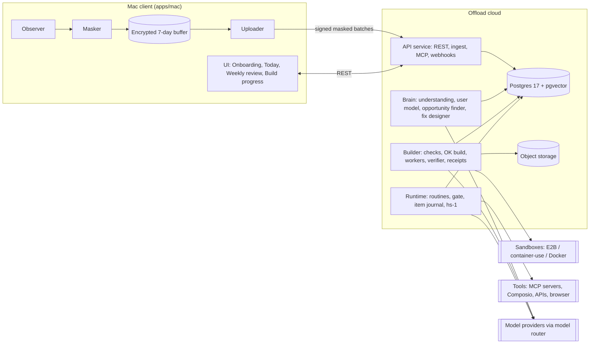

The full end-to-end sequence is in [section 16](#16-end-to-end-observe-to-measured-saving).

## 1. Mac client

Swift 6, SwiftUI, SwiftPM, macOS 14+ ([ADR 0024](adr/0024-client-stacks.md)). Capture and UI only
([ADR 0007](adr/0007-cloud-brain-thin-mac-client.md)).

Parts:
- **Observer**: a 1-second tick. Focus poll every 2 s (NSWorkspace + Accessibility for app, window title, URL host),
  idle after 120 s (CGEventSource), input counts per 60 s (event types only, never keys), OCR of the focused window on
  change or every 30 s (ScreenCaptureKit single-window capture + Vision), keyframes at most one per 20 s and 60 per hour
  and only when the perceptual hash moved (dHash distance over 40 of 1024 bits). No network code (test enforced).
- **Masker**: on-device detectors (secrets, cards, IDs, bank numbers, OTPs, API keys, emails, phones, URL paths and
  queries, person names). Masked OCR text is truncated to 8000 characters and de-duplicated by hash. Keyframes black out
  masked lines and secure fields, downscale to 1280 px, JPEG quality 0.6.
- **Exclusions**: built-in list (password managers, authenticators, banking apps and domains, private-window markers)
  plus user "Never watch" entries; reloaded every 2 s; synced to the server so ingest can double-check.
- **Encrypted buffer**: day files `days/YYYY-MM-DD.jsonl.enc`, AES-256-GCM, one key per day wrapped by a Keychain
  master key (service `ai.offload.mac`, account `master-key`, this device only). Kept 7 days, purged hourly.
- **Uploader**: reads only masked records, builds `observation_batch` envelopes, signs with the device key, posts every
  5 minutes and on quit, backs off up to 6 hours ([ADR 0020](adr/0020-device-ingest-protocol.md)).
- **Local now summary**: the onboarding "last 10 minutes" line is computed on the Mac from local spans, in code, with no
  model call and no upload (harvested from the s34 `GET /now` tests).
- **UI**: Onboarding, Today, Weekly review, Build progress, Settings; notifications; in-window pointer (no global
  overlay). Talks to the API service over HTTPS with the member session.
- **Recordings import** (optional): read a folder of screen recordings into a separate import space, using the same
  masker and exclusions; uploads with `source = 'import'`. Can be wiped in one action.

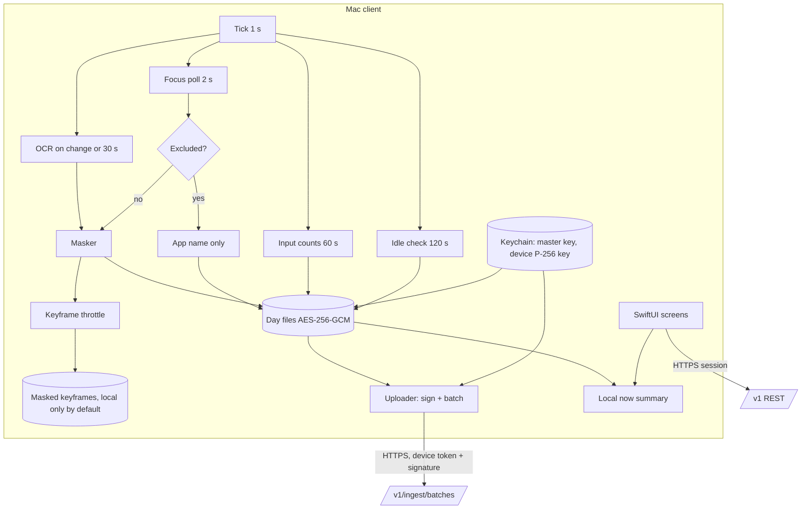

## 2. Service layout

Four Bun services ([ADR 0023](adr/0023-service-layout.md)). They share Postgres and object storage and talk through
durable workflows and the `events_outbox` table.

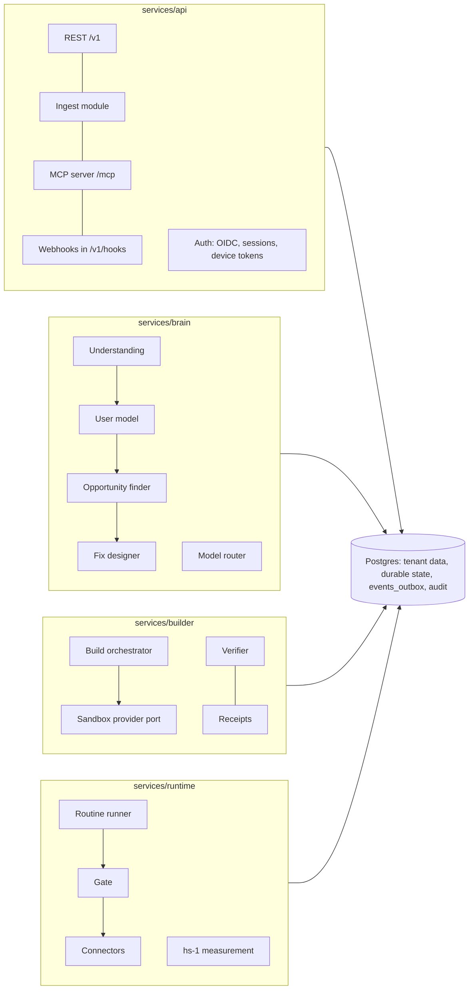

## 3. Ingest

Module `ingest` inside `services/api`. Accepts only the closed set of upload kinds: `observation_batch`,
`review_event`, `notice_ack`, `keyframe` ([ADR 0020](adr/0020-device-ingest-protocol.md)).

Steps per request:
1. Verify device token (ES256, audience `device`, 15 min) and resolve `tenant_id`, `member_id`, `device_id`.
2. Verify `Offload-Signature` over the JCS bytes with the device's registered public key.
3. Check `seq` > last seq for the device and `sent_at` within ±10 minutes.
4. Validate each object against `packages/contracts` schemas. Reject unknown kinds.
5. Leak scan (`packages/masking`) and server-side exclusion check. A leak rejects the object with `leak_detected` and
   writes `privacy.leak_blocked` to the audit log.
6. Insert into `observations` (or `review_events`, `notice_acks`, `keyframes`) with `ON CONFLICT (tenant_id, device_id,
   object_id) DO NOTHING`. Record the batch in `ingest_batches`.
7. Emit `observations.ingested` to `events_outbox` in the same transaction. Return the receipt.

```mermaid
sequenceDiagram
  participant Mac as Mac uploader
  participant API as API service (ingest)
  participant PG as Postgres
  Mac->>API: POST /v1/ingest/batches (Bearer device token, Offload-Signature)
  API->>API: verify token, signature, seq, sent_at
  API->>API: schema validate, leak scan, exclusion check
  API->>PG: BEGIN; SET LOCAL app.tenant_id
  API->>PG: INSERT observations ON CONFLICT DO NOTHING
  API->>PG: INSERT ingest_batches, events_outbox(observations.ingested)
  API->>PG: COMMIT
  API-->>Mac: 200 IngestReceipt {accepted, rejected}
```

## 4. Contracts

`packages/contracts` holds every wire shape as zod schemas, exported to JSON Schema 2020-12, with Swift types generated
for the Mac client ([ADR 0008](adr/0008-contracts-first.md)). It also holds the JCS canonicaliser, hash helpers, the
capability vocabulary, the error envelope and design token values.

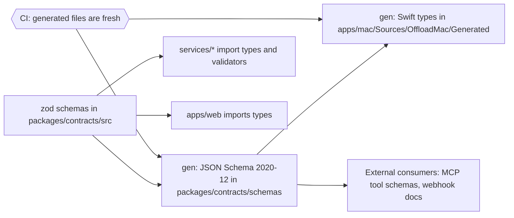

## 5. Cloud brain and user model

`services/brain`. Event and schedule driven, on the durable runtime.

**Understanding** (harvested from the old `sessionize.ts`, `understanding/*`):
- Spans: continuous focus on one app + title + host; minimum span 10 s; idle merges up to 15 min; idle start backdated 120 s.
- Span descriptions: rules first (surface, verb, object), Haiku `label` route only within fixed vocabularies.
- Embeddings: local embedder, 1024 dims, stored in pgvector.
- Task induction: steps joined by exact surface+verb+object key, else best embedding match (assign threshold 0.7);
  tasks are connected components of steps linked by shared identifiers or reliable transitions; instances split on a new
  day, a gap over 10 min, a conflicting identifier, or the start surface recurring.

**User model** ([ADR 0019](adr/0019-user-model-storage.md)):
- **Task ledger**: maps each induced task to a stable `task_key` (`k_` + 12 hex). Match order: same signature; else same
  kind, app and host with masked-name Jaccard ≥ 0.5; else centroid cosine ≥ 0.85 over stored centroids (vectors only);
  else mint a new key. Each key is used at most once per window.
- **Episodes**: one per focus block (≥ 25 min, gaps under 2 min) or task instance, with a masked verb-object name.
- **Records**: day records nightly for each closed day in the member's timezone; week records at the review slot and on
  demand; month = weeks whose Monday falls in the month; quarter = 3 months. Trend = Theil-Sen slope of weekly minutes
  (needs 3+ weeks). Persistence: present in ≥ 3 of 4 weeks (month) or ≥ 8 of 13 (quarter). Baseline per task key =
  median of the last 8 weeks.
- **Entities and facts**: entity resolution over masked attributes (splink-style blocking and scoring), bi-temporal
  facts (`valid_at`, `invalid_at`, `recorded_at`, `expired_at`).
- **Propositions**: kinds `repeats`, `time_share`, `sequence`. Confidence by rule:
  `score = 0.45·min(1, days/10) + 0.35·(1 − e^(−instances/6)) + 0.2·sameness`, `confidence = clamp(round(1 + 9·score), 1, 10)`;
  decay `clamp(round(1 + 9·min(1, days/14)), 1, 10)`. A rate change over 50% starts a new version and invalidates the
  old one; not seen for 7 analysed days → invalidated. Nothing is deleted except by forget.
- **Profile**: from onboarding and settings.
- **Narrative**: the weekly sentence is written by a model and checked by `checkNarrative` ([ADR 0003](adr/0003-numbers-come-from-code.md)).

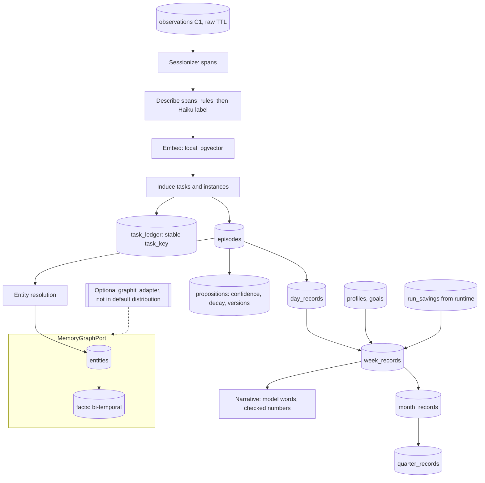

## 6. Opportunity finder

Deterministic ranking in `services/brain` (harvested from `feat/user-model-gum-graphiti` `opportunities.ts` and old
`solutions/rules.ts`):

```
score = weeklyHoursSaved            top fix option's saving, from fix rules (code)
      × persistence                 weeks present / weeks observed, last 8 (+0.1 in weeks 1–4 if a drain matches)
      × goalWeight                  1 + 0.5·alignment if it advances a goal; 1 − 0.3·alignment if it competes; else 1
      × confidence                  fix-rule confidence × this user's track record for that fix kind
      ÷ max(1, paybackWeeks)        setup hours / weekly saving
      × declinePenalty              0 if not_now / never / left_alone, unless hours rose ≥ 50% over baseline; else 1
```

- `alignment` = cosine between the goal text embedding and the task description embedding, clamped to 0..1. A review
  answer that names a goal sets it to 1.
- Top 5 per week are stored in `opportunities` with every factor and its arithmetic. Today shows one at a time.
- An empty profile gives the plain fix-rule order (tested).

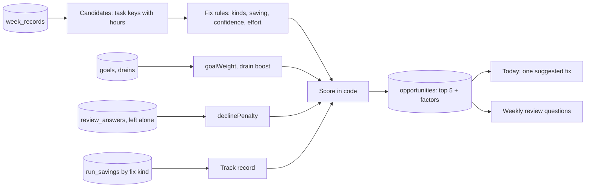

## 7. Fix designer

`services/brain`. Turns an opportunity into options and, after the user picks a build option, into a brief and checks.

- **Fix kinds**: build kinds `agent_workflow`, `api_integration`, `scheduled_routine`, `script`, `browser_automation`,
  `small_app`; non-build outcomes `setup_change`, `remove_step`, `leave_alone`.
- **Options**: up to 3 per opportunity, numbered, one marked recommended, plus "leave it alone". Kind, saving,
  confidence and effort come from code (rules harvested from s22: part tags, factors, fit, effort table; `leave_alone`
  first when the best saving is below 0.5 h/week). Opus only words the options.
- **Brief** (`fix_briefs`): goal, inputs, outputs, capabilities with step classes, connectors chosen, acceptance lines,
  forbidden actions, budget, estimated saving with arithmetic. `brief_hash = sha256(JCS(brief))`.
- **Checks** (before OK, build, within the design budget, default $0.60): check set from the acceptance lines (Opus,
  `check_write` route), held-out check (Opus, separate context), replay fixture set from recorded instances, teeth gate.
  See [ADR 0012](adr/0012-builder-policy-one-worker-held-out-fan-out.md).
- **Non-build outcomes**: `setup_change` produces a reviewed config patch or step-by-step instructions with an undo
  note; `remove_step` produces a short recommendation with the evidence; `leave_alone` records the answer.

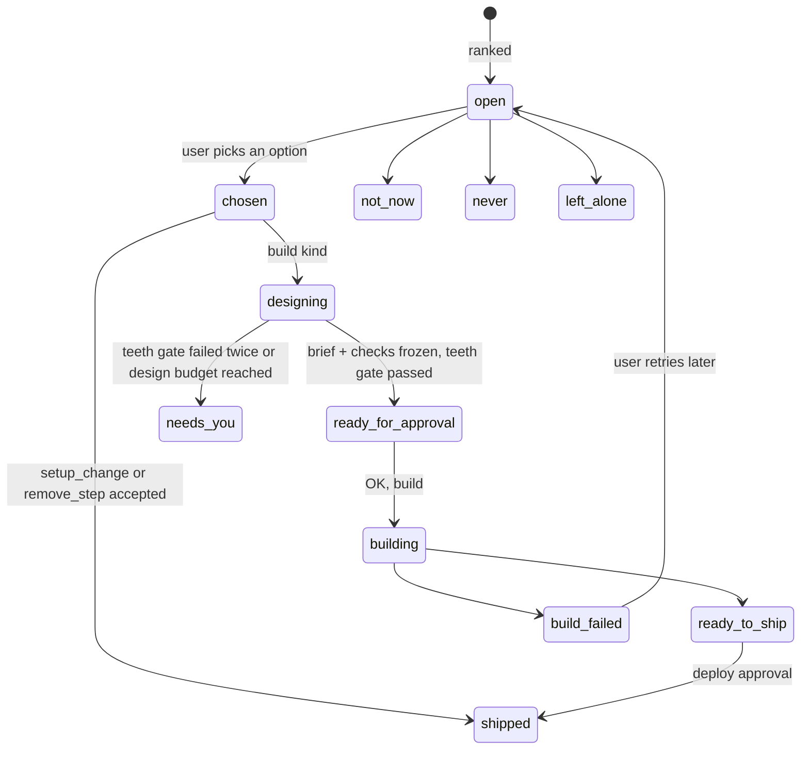

(These are `opportunities.state` values. Build states are in [section 8](#8-build-orchestrator).)

## 8. Build orchestrator

`services/builder`, on the durable runtime. Policy in [ADR 0012](adr/0012-builder-policy-one-worker-held-out-fan-out.md).

- **OK, build**: `POST /v1/fixes/{id}/build-approvals` with `brief_hash`, `check_set_hash`, `held_out_hash`,
  `fixture_set_hash`, `cap_usd`. All must equal the stored values. Creates a single-use approval (hashed token, TTL 24 h)
  and a `builds` row in `queued`. The build workflow claims the approval atomically as its first step after setup.
- **Build states**: `queued → building → verifying → ready`, with `fanning_out` after a failed first attempt, and end
  states `failed`, `capped`, `tampered`, `cancelled`.
- **Budget ledger**: every model call and sandbox minute writes `budget_entries` with `build_id`. Before each call the
  orchestrator checks `remaining = 4.00 − spent`; a call that could exceed it is not started.
- **Winner**: held-out pass, then mutation score (up to 30 sampled mutants), then smallest diff.
- **Verifier**: Opus, fresh context, sees the brief and the artifact, not the worker transcript. Answers pass/fail with
  reasons tied to acceptance lines.
- **Artifact and receipt**: artifact files + manifest in object storage, `artifact_sha256` over paths, types and
  contents. Receipt (JSON, JCS) holds every hash, attempt ids, costs, verdicts, model ids, sandbox ids; signed with the
  service's Ed25519 key; `receipt_hash` stored.
- **Deploy approval**: `POST /v1/builds/{id}/deploy` with `artifact_sha256` and `receipt_hash`. Creates the
  routine version ([section 11](#11-routine-runtime)).

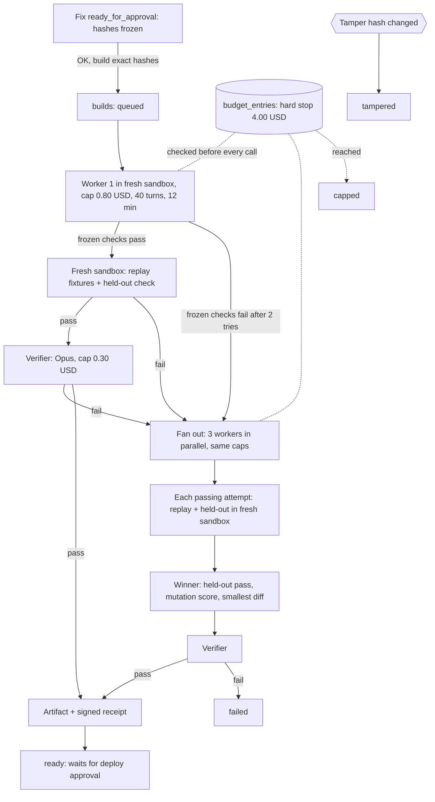

## 9. Sandboxed TDD workers

[ADR 0011](adr/0011-sandboxed-build-workers.md). One sandbox per attempt, no secrets inside, network denied except the
model egress proxy and allowlisted registries, checks mounted read-only, tamper hash before and after.

Inside a worker sandbox:
- Claude Agent SDK (Claude Code headless), model `claude-sonnet-5-5`, tools Read, Write, Edit, Glob, Grep, Bash
  (allowlisted commands), plus the `run_checks` tool which runs the frozen check set through the trusted harness and
  returns its output. No web tools, no subagents.
- superpowers skills `test-driven-development` and `verification-before-completion` loaded.
- tdd-guard-style PreToolUse hook: an edit to a non-test source file is refused until a failing test exists.
- Trusted harness (`harness`) runs checks in a child process and prints `OFFLOAD_PROOF {nonce, status, exit, completed}`.
- The `.claude/` write wall is avoided: workers never need to write Claude Code settings; such fixes are `setup_change`.

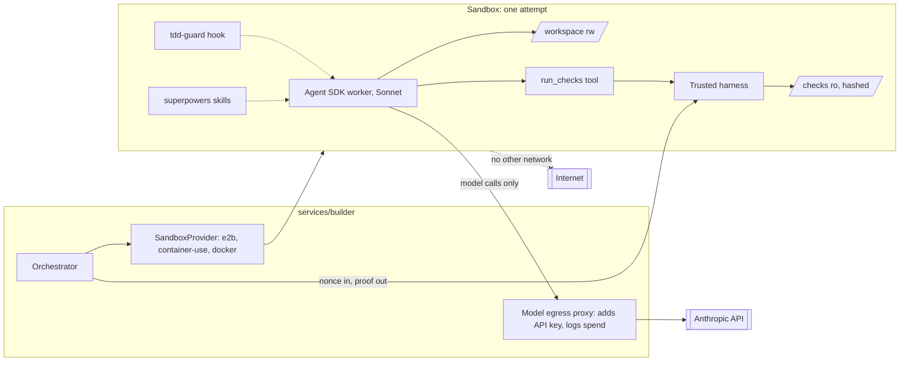

## 10. Connector and tool layer

[ADR 0010](adr/0010-mcp-first-connectors.md). `packages/connectors-sdk` with adapters: `mcp`, `composio`, `openapi`,
`browser`. Resolution order per capability: MCP → Composio → direct API → browser automation.

- Offload is an **MCP client** to tool servers and an **MCP server** to other agents (read and propose only).
- **Capabilities** have argument schemas and a step class. Commit capabilities have allowlisted arguments.
- **Credential vault**: `credentials` rows hold ciphertext under a per-tenant data key (AES-256-GCM) wrapped by KMS
  (`OFFLOAD_KMS_KEY_REF`); or a reference only (Composio connected account id, OAuth grant id). Decrypted in the runtime
  for one call, never logged, never sent to a model or a sandbox.
- Tool output is untrusted data: wrapped in `<tool_output untrusted="true">` before any model sees it.

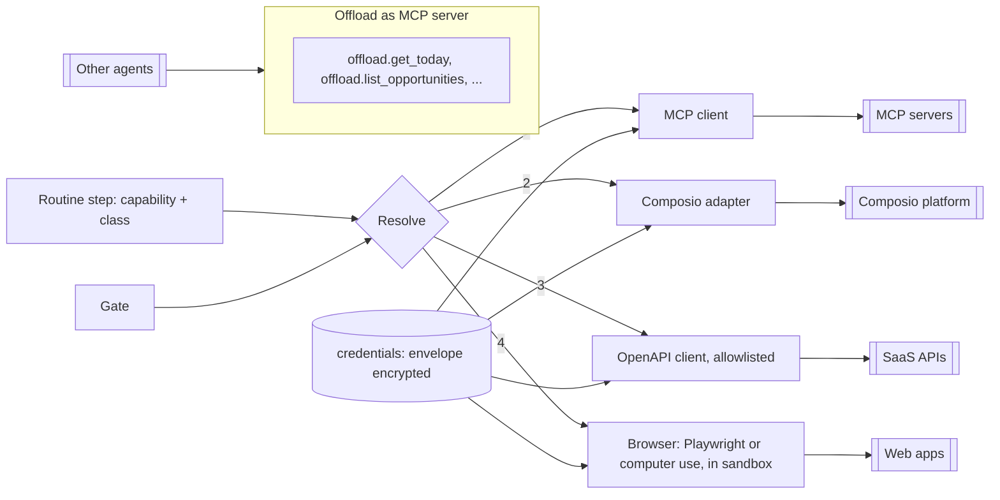

## 11. Routine runtime

`services/runtime`, on the durable runtime.

- **Routine**: a deployed fix with immutable versions (`routine_versions`), triggers (`schedule` cron, `webhook`,
  `event`), a policy (limits, commit mode), and an artifact.
- **Run**: a durable workflow. Steps run in order. `read` and `draft` steps run freely within budget. `commit` steps
  collect **items** into a **batch**.
- **Commit mode** `ask_before_commit` (default after deploy): the run stops in `awaiting_approval`; the user sees the
  batch (real values restored) and approves the exact `batch_hash`. `auto_commit`: the policy engine decides per item
  ([ADR 0017](adr/0017-policy-engine-cedar.md)).
- **Item journal**: `pending → sending → sent | failed_before_send | unknown`, written before each call. `unknown` is
  never retried automatically.
- **Circuit breakers** pause commits for the routine: 2 failed runs in a row; any `unknown` item; batch hash mismatch;
  credential or account change; mail bounce rate over 5%; recipient outside the run's input set.
- **Quiet hours**: no commits 01:00 to 03:59 member-local (core policy).
- **Graduation**: after 5 consecutive approved runs with no edits and no `failed_before_send` or `unknown` items, the
  policy proposes `auto_commit`; the user confirms ([ADR 0016](adr/0016-no-dry-run.md)).
- **Measurement**: after each run, hs-1 computes `run_savings` ([ADR 0022](adr/0022-hours-saved-hs-1.md)).
- **Undo**: retiring a routine stops triggers; `setup_change` fixes ship with an undo patch.

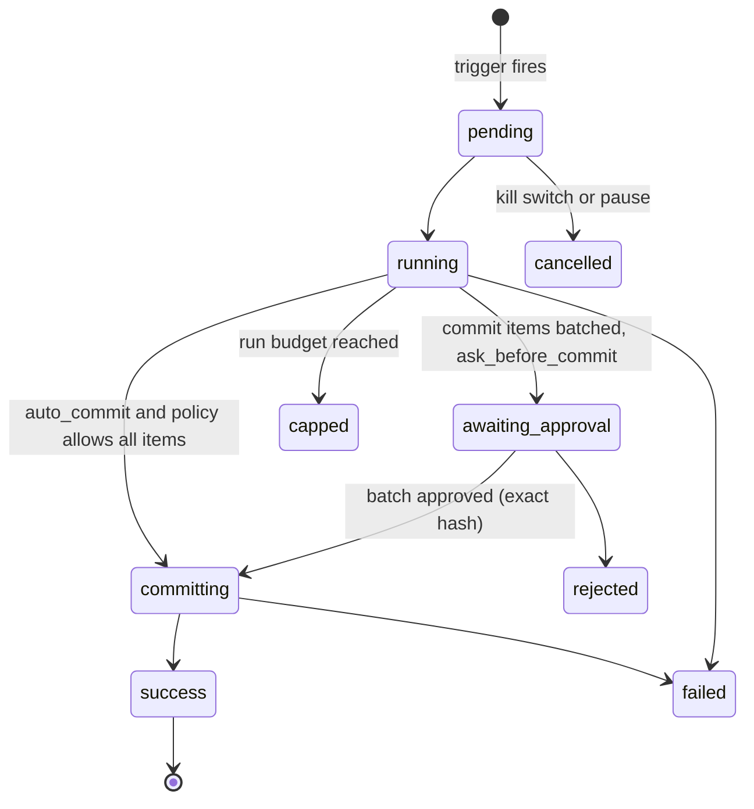

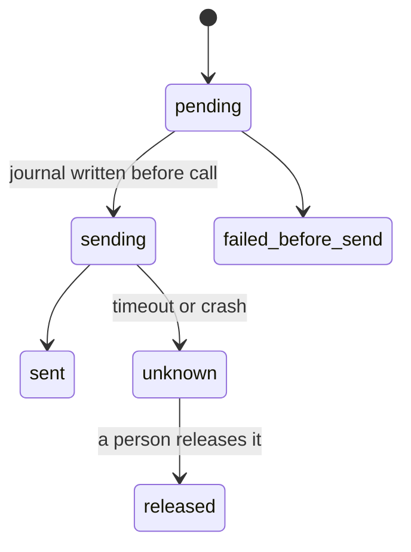

## 12. Governance and audit

- **Policy engine**: Cedar in `packages/policy` with built-in core policies; custom policies and approval chains in EE.
- **Approvals**: one scheme for `build`, `deploy`, `batch`, `graduation` ([ADR 0004](adr/0004-every-external-action-is-gated.md)).
- **Audit log**: per-tenant hash chain, written in the same transaction, anchored hourly ([ADR 0018](adr/0018-audit-log-hash-chain.md)).
- **Retention policies**: per data class ([section 15](#15-data-and-privacy)); EE makes them configurable.
- **Identity**: OIDC in core, SAML/SCIM in EE ([ADR 0014](adr/0014-identity.md)).

| Capability | Core | EE |
|---|---|---|
| Gates, approvals, item journal, kill switches | yes | |
| Built-in Cedar policies, rule id on every decision | yes | |
| Custom Cedar policies, approval chains (N of M), policy simulation | | yes |
| Audit chain, verify, in-app viewer | yes | |
| Audit export, SIEM streaming, legal hold, configurable retention | | yes |
| OIDC login, magic link, roles owner/admin/member/auditor | yes | |
| SAML SSO, enforced SSO, SCIM, custom roles | | yes |
| Data residency choice, BYOC, dedicated deployment | | yes |

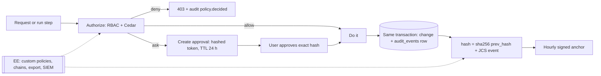

## 13. Tenancy

[ADR 0013](adr/0013-tenancy-and-rls.md). Tenant → workspace → member. RLS on `tenant_id` with `app.tenant_id` set by
`withTenant`. Workspace scope and roles are enforced by authorization.

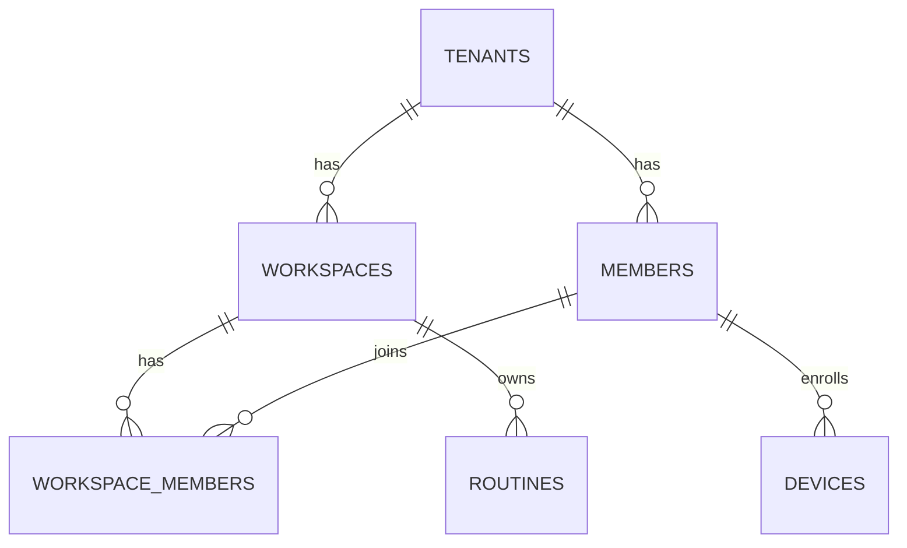

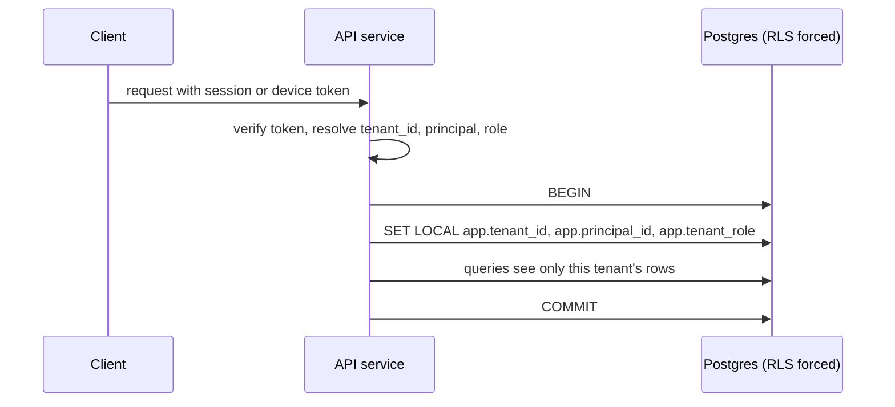

## 14. Deployment

| Mode | What runs | Who |
|---|---|---|
| Offload Cloud (Free personal, Pro) | Four services, managed Postgres 17 + pgvector, S3, E2B sandboxes, WorkOS | Muhammad first, then Pro teams |
| Self-host (core) | Same images; Postgres + S3-compatible storage; container-use or Docker sandboxes; any OIDC | Free users, developers |
| Enterprise self-host | Core + `@offload-ee/server-ee` entry + license key | Enterprise |
| Enterprise BYOC / dedicated | Offload-operated stack in the customer's cloud account, or a dedicated database per tenant | Enterprise |

Hosting provider and region for Offload Cloud: [OQ-01](OPEN_QUESTIONS.md#oq-01-cloud-hosting-provider-and-region)
(default AWS `ca-central-1`). `infra/docker-compose` has Postgres for dev; `infra/helm/offload` is a placeholder chart.

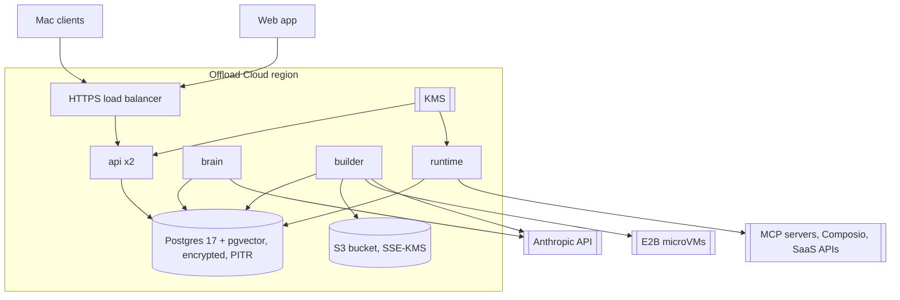

## 15. Data and privacy

Full detail in [SECURITY_PRIVACY.md](SECURITY_PRIVACY.md). Summary:

| Class | What | Where | Retention |
|---|---|---|---|
| C0 | Raw frames, unmasked OCR, unmasked titles | Mac only | 7 days, never uploaded |
| C1 | Masked observations (and masked keyframes if opted in) | Cloud `observations`, `keyframes` | Raw TTL, default 30 days ([OQ-02](OPEN_QUESTIONS.md#oq-02-raw-ttl-for-masked-observations-in-the-cloud)) |
| C2 | Derived user model (episodes, records, entities, facts, propositions, profile) | Cloud | Until the user forgets it ([OQ-03](OPEN_QUESTIONS.md#oq-03-keep-the-derived-user-model-long-term)) |
| C3 | Connector credentials, BYOK keys | Cloud credential vault | Until disconnected |
| C4 | Audit events, approvals, receipts, budget ledger | Cloud | 6 years team, 1 year personal (EE configurable) |
| C5 | Build artifacts, fixtures, checks | Object storage | Routine retired + 90 days |

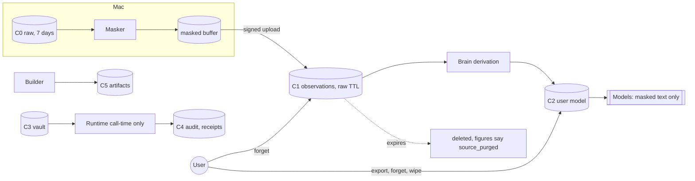

## 16. End to end: observe to measured saving

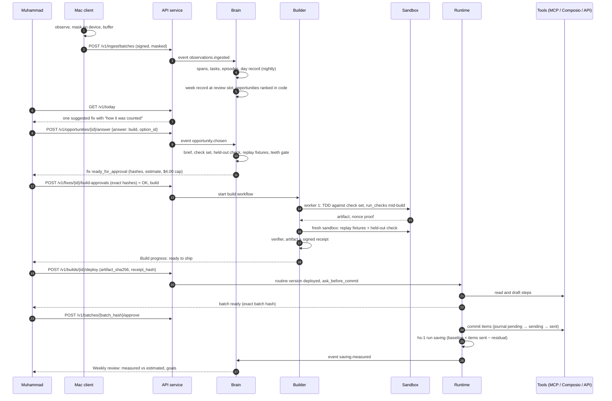

## 17. Model router

[ADR 0021](adr/0021-model-router-and-builders.md). One egress for model calls in every service.


