# Architecture

Status: architecture only. No feature code exists yet. Words follow [GLOSSARY.md](GLOSSARY.md). Decisions are in
[adr/](adr/README.md). Tables are in [DATA_MODEL.md](DATA_MODEL.md). Shapes are in [API.md](API.md). The order of work
is in [ROADMAP.md](ROADMAP.md).

## Overview

Offload has one loop:

1. A **thin Mac client** observes work, masks it on the device, replaces people, emails and document paths with
   **stable keyed pseudonyms**, and uploads masked observations through one egress guard.
2. The **cloud brain** turns observations into spans, tasks and episodes, and keeps a long-term **user model**
   (profile, entities, bi-temporal facts, propositions, day/week/month/quarter records, task ledger).
3. **Opportunities** come from three sources: the **opportunity finder** ranks observed repeated work against the
   user's goals in code; the user can type a task (**manual**); and the **instant read** scans connected apps on day one.
4. The **fix designer** picks fix kinds, asks the user to connect the apps the fix needs, runs **fixture capture**
   (read-only reads of real past instances), and writes a brief, a check set and a held-out check.
5. The user presses **OK, build**. The **build orchestrator** runs one sandboxed TDD worker. The only pass that counts
   comes from a fresh verification sandbox (frozen checks, replay fixtures, held-out check). It fans out only on check
   failure, gives a failed verifier one repair turn, and signs a receipt. Cap: $4.00, enforced at the model egress proxy.
6. A **second approval** deploys the artifact (`routine.json` plus pure transforms) as a **routine**. The approval
   binds a definition the user can read: trigger, capabilities, which accounts, limits.
7. The **routine runtime** runs it. Each step runs in the cloud or on the Mac (attended, typed commands only). Commit
   steps ask before committing until a policy graduates them.
8. **hs-1** measures hours saved, which flow back into the user model and the weekly review.

The first milestones prove the riskiest half first: a hand-fed task goes through steps 4 to 8 before capture feeds
step 3 ([ROADMAP M2](ROADMAP.md#m2-hand-fed-loop)). Capture is built in parallel ([M3](ROADMAP.md#m3-capture-to-cloud)).

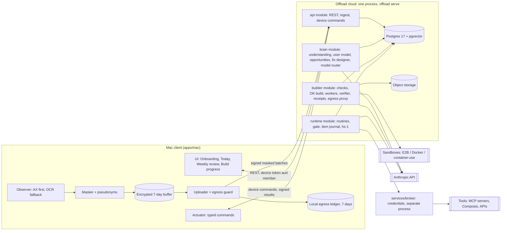

The full end-to-end sequence is in [section 19](#19-end-to-end-observe-to-measured-saving).

## 1. Mac client

Swift 6, SwiftUI, SwiftPM, macOS 14+ ([ADR 0024](adr/0024-client-stacks.md)). Capture, on-device masking, upload, UI,
and an attended actuator for device steps ([ADR 0007](adr/0007-cloud-brain-thin-mac-client.md),
[ADR 0025](adr/0025-execution-placement-and-mac-actuator.md)). It does no understanding, ranking or building.

SwiftPM targets (empty markers today): `OffloadContracts` (generated types, JCS), `OffloadObserver`, `OffloadMasker`,
`OffloadStore`, `OffloadUploader`, `OffloadImport`, `OffloadActuator`, and the app target `OffloadMac`. The observer
depends on contracts, store and masker only and never links the uploader.

Parts:
- **Observer** ([ADR 0006](adr/0006-metadata-first-capture.md)). Accessibility first:
  - Focus: NSWorkspace activation plus a 2 s poll for title and URL through Accessibility.
  - Text: a bounded Accessibility walk of the focused window (at most 1,500 nodes, depth 12, 150 ms; secure fields
    skipped) on focus change and at most every 30 s when the text hash changed. `text_source = ax`.
  - OCR fallback: ScreenCaptureKit single-window frame + Vision, only when the walk yields fewer than 200 characters
    for a window with visible content. `text_source = ocr`. At most one per 30 s per window; none on battery below 20%.
  - Idle after 120 s (CGEventSource, no permission). Input counts per 60 s are **off by default**; Input Monitoring is
    not requested at setup.
  - Keyframes: at most one per 20 s and 60 per hour, only when the perceptual hash moved (dHash distance over 40 of
    1024 bits). Local only unless `keyframes_to_cloud` ([OQ-04](OPEN_QUESTIONS.md#oq-04-keyframes-to-the-cloud)).
  - Pause on screen lock, sleep and fast user switch (`pause`/`resume` with `reason`). Permission state is checked
    every 5 s in the heartbeat and changes are recorded as `permission_change` observations. When macOS re-asks for
    screen recording, capture continues from Accessibility and the UI shows the re-consent step.
  - Runs as a child of the app for TCC attribution, started as an `SMAppService` login item (spike S1).
  - No network code (test enforced). Budgets: under 3% of one core averaged over an 8-hour day on an M1 Air, under
    200 MB resident.
- **Masker** ([ADR 0005](adr/0005-masked-text-only-reaches-models.md), [ADR 0028](adr/0028-stable-keyed-pseudonyms.md)).
  Structured secrets are destroyed: card numbers (Luhn), CVV and expiry, SSN, SIN, bank routing and account, IBAN,
  CUSIP, ISIN, one-time codes, API keys and tokens. People, emails, phones and document paths become stable keyed
  pseudonyms `<person:h_…>`, `<email:h_…>`, `<phone:h_…>`, `<doc:h_…>` (HMAC-SHA256 under the tenant pseudonym key
  in the Keychain, first 16 hex). URLs keep the host; the path becomes `<doc:h_…>`; query and fragment are dropped.
  Text is truncated to 8000 characters after masking and de-duplicated by hash. Keyframes black out masked lines and
  secure fields, downscale to 1280 px, JPEG quality 0.6.
- **Reveal map**: pseudonym → real value, kept on the Mac only (C0, 7 days), so the UI can show "is this the sheet?"
  with the real name on the device ([ADR 0028](adr/0028-stable-keyed-pseudonyms.md)).
- **Exclusions**: built-in list (password managers, authenticators, banking apps and domains, private-window markers,
  system authentication dialogs, the Offload windows, screen-sharing clients) shared with the server as
  `packages/masking/src/exclusions.builtin.json`, plus user "Never watch" entries; reloaded within 2 s; synced to the
  server so ingest can double-check.
- **Encrypted buffer**: day files `days/YYYY-MM-DD.jsonl.enc`, AES-256-GCM, one key per day wrapped by a Keychain
  master key (Keychain service = the app's bundle id, so `ai.offload.mac` for release builds and `ai.offload.mac.dev`
  for dev builds, which never share keys; account `master-key`; this device only). Kept 7 days, purged hourly.
- **Uploader = egress guard** ([ADR 0035](adr/0035-mac-egress-guard-and-ledger.md)): one destination (the configured
  API host); closed schemas with `additionalProperties: false`; detectors run again; fail closed. It builds signed
  envelopes ([ADR 0020](adr/0020-device-ingest-protocol.md)), persists `seq` and the exact bytes before sending, posts
  every 5 minutes and on quit, and backs off up to 6 hours. Every batch is written to the **local egress ledger**
  (7 days), which the app shows as "What was sent".
- **Local now summary**: the onboarding "last 10 minutes" line is computed on the Mac from local spans, in code, with no
  model call and no upload (logic from PR #44 `brain/src/time/now.ts`: top apps, minutes, switches, one line).
- **UI**: Onboarding ([ONBOARDING.md](ONBOARDING.md)), Today, Weekly review, Build progress, Routines, Settings;
  notifications; the in-window pointer (no separate overlay window). Permission checkmarks poll every 1.5 s during
  onboarding (ported from farzaa/clicky, MIT, as in PR #44), with a "Show Offload in Finder" link when a permission is
  missing. The UI talks to the API with a device token of audience `member`; approvals from the Mac are signed by the
  device key ([ADR 0014](adr/0014-identity.md)).
- **Actuator** ([section 12](#12-execution-placement-and-the-mac-actuator)): runs approved device steps from typed
  commands. Lands in M6.
- **Recordings import** (optional backfill, M3): a folder of `.mov`/`.mp4` screen recordings, including macOS default
  names (U+202F before AM/PM, "(2)" copies, 24-hour names) and CleanShot names. Frames are sampled at most every 5 s,
  at most 720 per file, at most 1280 px, and pass through the same OCR, masker, exclusions and keyframe throttle. A
  ledger keeps SHA-256 fingerprints only. Imports go to a separate **import space** (`source = 'import'`), never the
  live store, and can be wiped in one action (PR #44).
- **Updates**: Sparkle with EdDSA signatures on a Developer ID signed, notarized app with a locked bundle id
  ([ADR 0024](adr/0024-client-stacks.md), [DEPLOYMENT.md](DEPLOYMENT.md)).

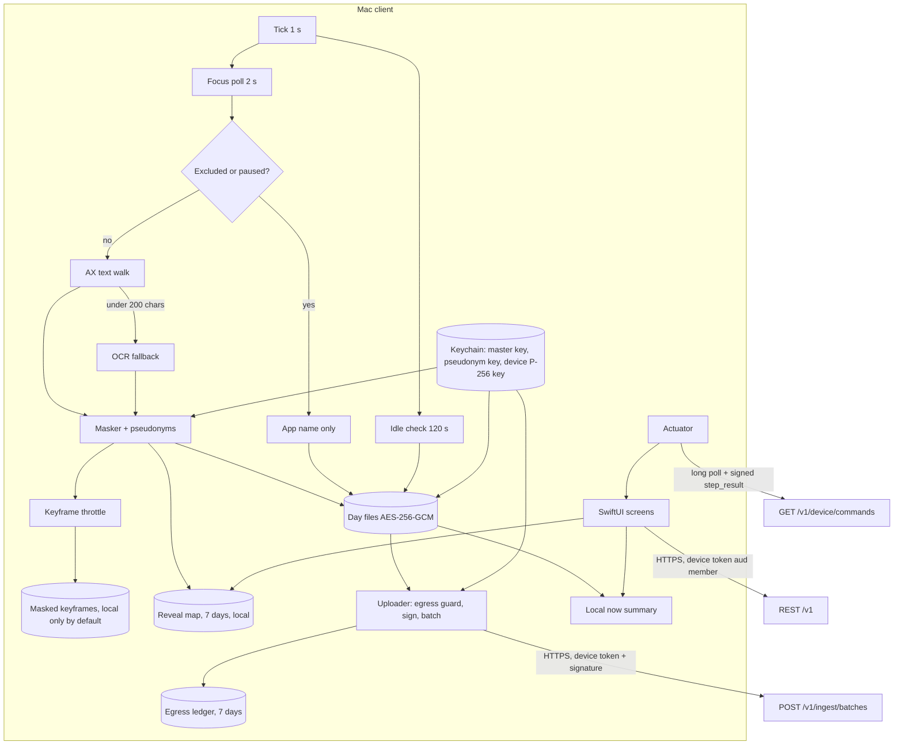

## 2. Process layout (modular monolith)

[ADR 0023](adr/0023-service-layout.md). Until there is a second tenant, Offload Cloud runs **one process**,
`offload serve`, with four modules that keep their own folders, entry points and route prefixes: `services/api`,
`services/brain`, `services/builder`, `services/runtime`. Splitting them into separate processes later is a deploy
change, not a code change (an M8 option). Modules talk through Postgres: durable workflows and the `events_outbox`
table ([API.md](API.md#7-internal-events)). No message broker.

One exception runs from day one: **`services/broker`**, a small separate process that alone holds credential decrypt
rights ([ADR 0034](adr/0034-credential-broker-and-key-providers.md)).

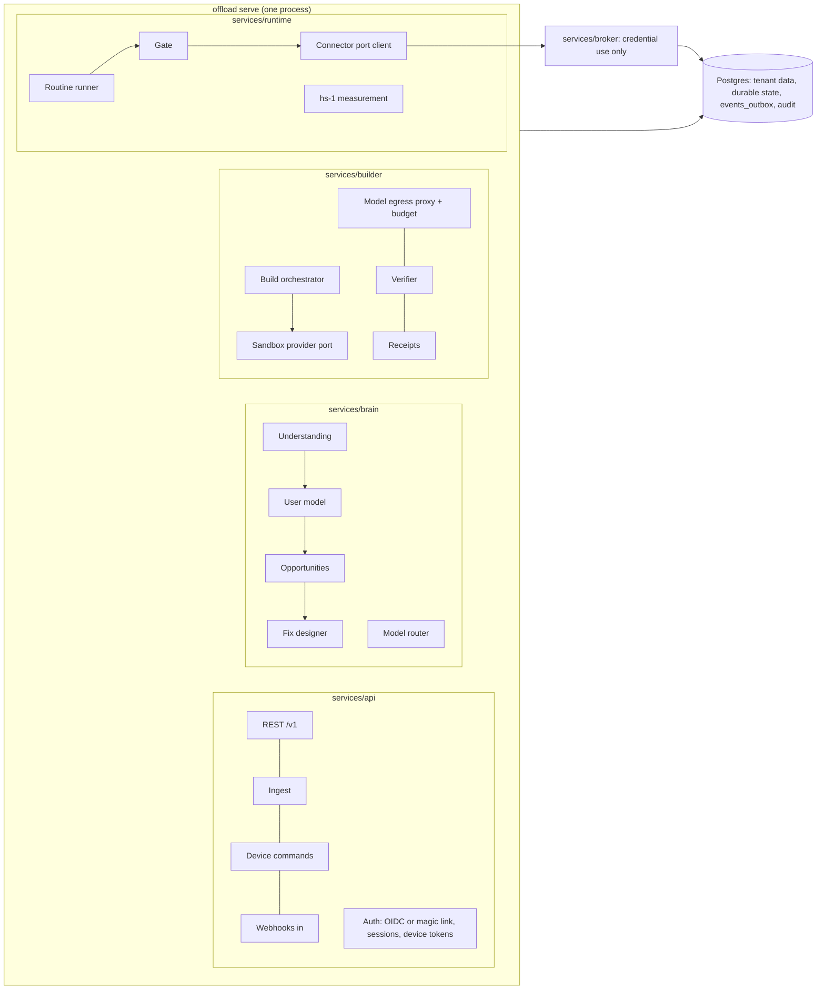

## 3. Ingest

Module `ingest` inside `services/api` ([ADR 0020](adr/0020-device-ingest-protocol.md)). Accepts only the closed set
of upload kinds: `observation_batch`, `review_event`, `notice_ack`, `keyframe`, `step_result`. Kinds whose milestone
has not landed are accepted as envelopes but each object is rejected `not_enabled`.

Steps per request (this order is the contract; [API.md](API.md#3-device-ingest) has the full list):
1. Verify the device token (ES256, audience `device`, 15 min). Resolve `tenant_id`, `member_id`, `device_id`. Apply the
   rate limit.
2. Check the body size, that the body equals `jcs(JSON.parse(body))`, and `Offload-Signature` (raw `r‖s`, base64url)
   over the exact request bytes with the device's public key.
3. Check that `envelope.device_id` and the signature `keyid` equal the token's device (else `403 forbidden`).
4. Look up `ingest_batches (device_id, seq)`. Same `body_sha256` returns the stored receipt. Different bytes return
   `409 seq_replay`. Otherwise require `seq > devices.last_seq`.
5. Check `sent_at` within ±10 minutes (else `400 clock_skew`, nothing stored) and the envelope kind.
6. Validate each object against `packages/contracts`. Objects older than 7 days are rejected `too_old` (imported
   objects excepted, [ADR 0020](adr/0020-device-ingest-protocol.md)); objects more than 10 minutes in the future are
   `schema_invalid`; kinds not yet enabled are `not_enabled`; observations from a member without upload consent are
   `consent_missing`.
7. Leak scan (`packages/masking`, a transport check with the same rules as the device) and the server-side exclusion
   check. A leak rejects the object `leak_detected` and writes `privacy.leak_blocked` to the audit log.
8. In one short transaction: insert into `observations` or `observation_texts` (partitioned by `day`, the UTC date of
   `ts`) with `ON CONFLICT (tenant_id, device_id, object_id, day) DO NOTHING`; insert the `ingest_batches` row; set
   `devices.last_seq`; emit `observations.ingested` to `events_outbox`. Return the receipt.

Rate limit: 60 requests per minute per device (`429 rate_limited`).

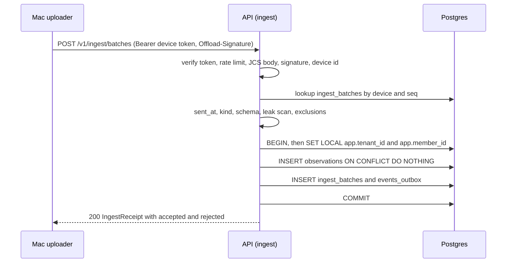

## 4. Contracts

`packages/contracts` holds every wire shape as zod schemas, exported to JSON Schema 2020-12, with Swift types generated
for the Mac client by a dependency-free emitter (`packages/contracts/scripts/gen-swift.ts`) into the
`OffloadContracts` target ([ADR 0008](adr/0008-contracts-first.md)). It also holds the JCS canonicaliser (with a Swift
twin tested on the same RFC 8785 vectors), hash helpers, the pseudonym shape, the capability vocabulary, the error
envelope and design token values. `packages/routine-sdk` holds the routine artifact contract
([ADR 0026](adr/0026-routine-artifact-contract.md)).

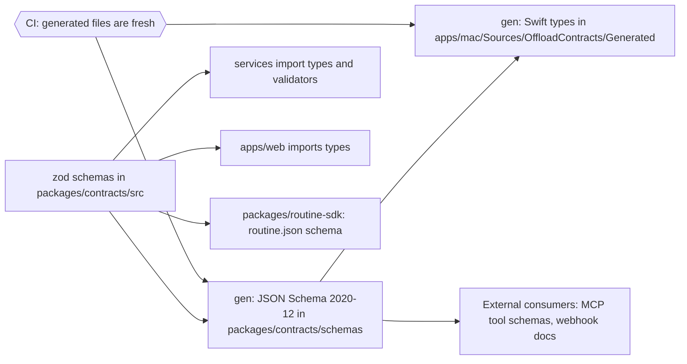

## 5. Cloud brain and user model

`services/brain`. Event and schedule driven, on the durable runtime. Everything it reads from capture is masked and
pseudonymised; equal pseudonyms mean the same person, email or document, so tasks and entities can be joined across
days without the real values ([ADR 0028](adr/0028-stable-keyed-pseudonyms.md)).

**Understanding** (harvested from the old `sessionize.ts`, `understanding/*`; lands in M5):
- Spans: continuous focus on one app + title + host; minimum span 10 s; idle merges up to 15 min; idle start backdated
  120 s.
- Span descriptions: rules first (surface, verb, object); the Haiku `label` route only within fixed vocabularies.
- Embeddings: local embedder, 1024 dims, stored in pgvector.
- Task induction: steps joined by exact surface + verb + object key, else best embedding match (assign threshold 0.7);
  tasks are connected components of steps linked by shared pseudonyms (same `<doc:h_…>`, same `<person:h_…>`) or
  reliable transitions; instances split on a new day, a gap over 10 min, a conflicting pseudonym, or the start surface
  recurring.

**User model** ([ADR 0019](adr/0019-user-model-storage.md); constants match PR #43):
- **Task ledger**: maps each induced task to a stable `task_key` (`k_` + 12 hex). Match order: same signature; else same
  kind, app and host with masked-name Jaccard ≥ 0.5; else centroid cosine ≥ 0.85 over stored centroids (vectors only);
  else mint a new key. Each key is used at most once per window. Two fixture weeks of the same work keep ≥ 95% of keys.
- **Episodes**: one per focus block (≥ 25 min, gaps under 2 min) or task instance, with a masked verb-object name.
- **Records**: day records nightly for each closed day in the member's timezone; week records at the review slot and
  on demand; month = weeks whose Monday falls in the month; quarter = 3 months. Trend = Theil-Sen slope of weekly
  minutes (needs 3+ weeks). Persistence: present in ≥ 3 of 4 weeks (month) or ≥ 8 of 13 (quarter). Baseline per task
  key = median of the last 8 weeks.
- **Entities and facts** (M7): entity resolution over pseudonyms and masked attributes (splink-style blocking and
  scoring), bi-temporal facts (`valid_at`, `invalid_at`, `recorded_at`, `expired_at`).
- **Propositions** (M7): kinds `repeats`, `time_share`, `sequence`. Confidence by rule:
  `score = 0.45·min(1, days/10) + 0.35·(1 − e^(−instances/6)) + 0.2·sameness`, `confidence = clamp(round(1 + 9·score), 1, 10)`;
  decay `clamp(round(1 + 9·min(1, days/14)), 1, 10)`. A rate change over 50% starts a new version and invalidates the
  old one; not seen for 7 analysed days → invalidated. Nothing is deleted except by forget.
- **Profile**: from onboarding and settings. Goals ≤ 3, each ≤ 80 characters.
- **Narrative**: the weekly sentence is written by a model and checked by `checkNarrative`
  ([ADR 0003](adr/0003-numbers-come-from-code.md)).

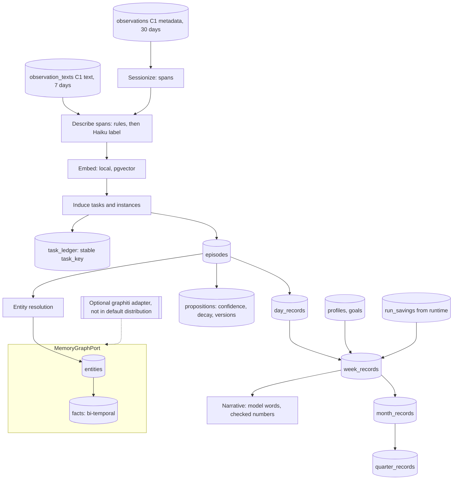

## 6. Opportunity finder

Deterministic ranking in `services/brain` (harvested from `feat/user-model-gum-graphiti` `opportunities.ts` and old
`solutions/rules.ts`). Opportunities have a `source` ([ADR 0036](adr/0036-opportunity-sources-and-instant-read.md)):

| Source | How it starts | Milestone |
|---|---|---|
| `manual` | The user types a task: `POST /v1/opportunities` | M2 |
| `instant_read` | After apps are connected, a read-only scan of the last 30 days of their metadata (C6) proposes candidates with grade C estimates | M5 |
| `finder` | Week records rank observed repeated work | M5 |
| `agent` | Another agent proposes through the Offload MCP server | M8 |

Manual and agent text is masked server-side and leak scanned before it is stored. All sources go through the same fix
designer and build path. The finder scores:

```
score = weeklyHoursSaved            top fix option's saving, from fix rules (code)
      × persistence                 weeks present / weeks observed, last 8 (+0.1 in weeks 1–4 if a drain matches)
      × goalWeight                  1 + 0.5·alignment if it advances a goal; 1 − 0.3·alignment if it competes; else 1
      × confidence                  fix-rule confidence × this user's track record for that fix kind
      ÷ max(1, paybackWeeks)        setup hours / weekly saving
      × declinePenalty              0 if never or left_alone, or not_now within 4 weeks, unless hours rose ≥ 50%
                                    over baseline; else 1
```

- `alignment` = cosine between the goal text embedding and the task description embedding, clamped to 0..1. A review
  answer that names a goal sets it to 1.
- Top 5 per week are stored in `opportunities` with every factor and its arithmetic. Today shows one at a time.
- An empty profile gives the plain fix-rule order (tested).

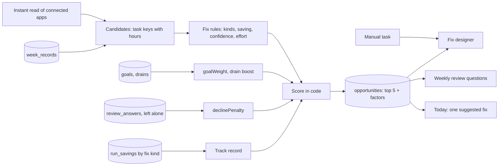

## 7. Fix designer

`services/brain`. Turns an opportunity into options and, after the user picks a build option, into a brief, fixtures
and checks.

- **Fix kinds**: build kinds `agent_workflow`, `api_integration`, `scheduled_routine`, `script` (a script or macOS
  Shortcut), `browser_automation`, `small_app`; non-build outcomes `setup_change`, `remove_step`, `leave_alone`. Where
  each kind runs is in [section 12](#12-execution-placement-and-the-mac-actuator). `small_app` is not offered before M8.
- **Options**: up to 3 per opportunity, numbered, one marked recommended, plus "leave it alone". Kind, saving,
  confidence and effort come from code (rules harvested from s22: part tags, factors, fit, effort table;
  `leave_alone` first when the best saving is below 0.5 h/week). Opus only words the options.
- **Connect apps**: the option lists the capabilities it needs. Missing connections put the opportunity in
  `needs_connection`; the UI asks the user to connect them ([section 10](#10-connector-and-tool-layer)). The fix
  designer **pins** each step's `connection_id`, adapter, tool name and tool pin hash
  ([ADR 0033](adr/0033-pinned-connector-resolution-and-launch-catalog.md)). Pseudonyms in the evidence are matched to
  connector values on the Mac ("is this the sheet?") so the brief names the right sheet or inbox.
- **Fixture capture** ([ADR 0027](adr/0027-fixture-capture-and-connector-content.md)): read-only connector reads (gate
  mode `read`) of the last N real instances' inputs (default 6, at least 3) and of the resulting state (the row he
  appended, the mail he sent). Fixture = recorded reads + expected commit items. Values are tokenised per fixture set
  (`tok_` + 12 hex) before they enter any sandbox; the token map stays in Postgres (C6). Fewer than 3 instances: the
  brief says so and the build relies on checks and the held-out check.
- **Brief** (`fix_briefs`): goal, inputs, outputs, steps with class and `runs_on`, pinned connections, capabilities,
  acceptance lines, forbidden actions, limits, budget, estimated saving with arithmetic.
  `brief_hash = sha256(JCS(brief))`.
- **Checks** (within the design budget, default $0.60, [OQ-07](OPEN_QUESTIONS.md#oq-07-design-budget-before-ok-build)):
  check set from the acceptance lines (Opus, `check_write` route), held-out check (Opus, separate context), teeth gate.
  A new build of the same brief regenerates the held-out check ([ADR 0029](adr/0029-build-verdicts.md)).
- **Non-build outcomes**: `setup_change` produces a reviewed config patch or step-by-step instructions with an undo
  note (applied by the user on the Mac); `remove_step` produces a short recommendation with the evidence; `leave_alone`
  records the answer.
- **Playbook and tone**: drafts for `agent_workflow` follow-ups use the user's tone card (old `tone/draft.ts` and the
  playbook pipeline, rewritten); any number in a draft is checked against its source as in `checkNarrative`.

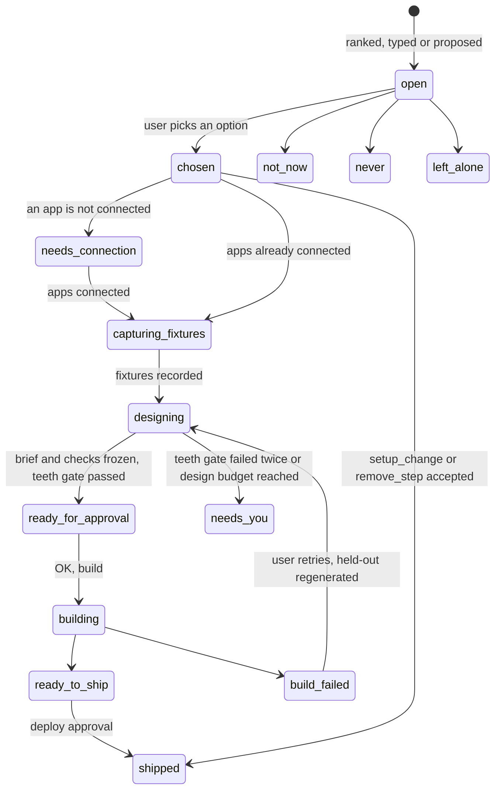

(These are `opportunities.state` values. `not_now` lasts 4 weeks. Build states are in
[section 8](#8-build-orchestrator).)

## 8. Build orchestrator

`services/builder`, on the durable runtime. Policy in
[ADR 0012](adr/0012-builder-policy-one-worker-held-out-fan-out.md), verdicts in [ADR 0029](adr/0029-build-verdicts.md),
budget in [ADR 0030](adr/0030-build-budget-at-egress-proxy.md), failures in
[ADR 0031](adr/0031-build-infrastructure-failures.md). As built in s35 (PR #45), with the fake-pass hole that Claude Code
review found closed by design: a pass only counts from a fresh sandbox.

- **OK, build**: `POST /v1/fixes/{id}/build-approvals` with `brief_hash`, `check_set_hash`, `held_out_hash`,
  `fixture_set_hash`, `cap_usd`. All must equal the stored values. Creates a single-use approval (internal token,
  hashed at rest, TTL 24 h) and a `builds` row in `queued`. The build workflow claims the approval as its first step.
  A second OK while a build of that brief is queued or running is `409 already_running`.
- **Build states**: `queued → building → verifying → ready`, with `fanning_out` after a check failure and `repairing`
  after a verifier failure; end states `failed`, `capped`, `tampered`, `cancelled`, `infra_failed`.
- **Teeth**: the frozen check set and the held-out check must both fail on an empty workspace and leave it unchanged.
- **Worker 1**: one test-first worker in a fresh sandbox, with the brief, the check set and tokenised fixtures. Caps per
  attempt: $0.70, 40 turns, 12 minutes; up to 2 tries inside the attempt with the frozen check output fed back. Its
  own `run_checks` results are advisory.
- **Verification**: a fresh verification sandbox from the attempt's artifact runs frozen checks, replay fixtures and the
  held-out check, in parallel shards; any failing shard is a fail. Only this verdict counts.
- **Fan-out** on check failure only: `fanout_workers` more workers in parallel (1 in M2, 3 from M6), each with its own
  pre-allocated cap. They see the frozen check output; never the held-out check or its output, only that it failed.
- **Winner** among passing attempts: replay + held-out pass, then smallest diff (lines changed excluding checks).
  Mutation score is not used ([OQ-21](OPEN_QUESTIONS.md#oq-21-drop-mutation-score-from-the-build-winner-rule)).
- **Verifier**: Opus, fresh context, cap $0.25; sees the brief and the artifact, not the transcript. A fail sends one
  repair turn (cap $0.15) to the same worker with the reasons, then a fresh verification and the verifier again. A
  second fail ends the build `failed`. A verifier fail never fans out.
- **Budget**: enforced at the model egress proxy with per-call reservations; sandbox seconds are reserved too; hard
  stop $4.00 including sandboxes. Worst planned model spend $3.45; sandbox worst case 8,760 vCPU-seconds
  ([ADR 0030](adr/0030-build-budget-at-egress-proxy.md)).
- **Artifact and receipt**: `routine.json`, transform modules and their tests in object storage; `artifact_sha256`
  over paths, types and contents. The deploy step checks `manifest.capabilities ⊆ brief.capabilities`. Receipt (JCS)
  holds every hash, attempt ids, costs, verdicts, model ids and sandbox ids; signed with the service Ed25519 key;
  `receipt_hash` stored. Artifacts are scanned for secret patterns before `ready`.
- **Deploy approval**: `POST /v1/builds/{id}/deploy` with `artifact_sha256`, `receipt_hash` and `definition_hash`. The
  UI shows the definition in words first ([ADR 0032](adr/0032-deploy-approval-binds-definition.md)). Re-deploying a
  deployed build is `409 state_conflict`.

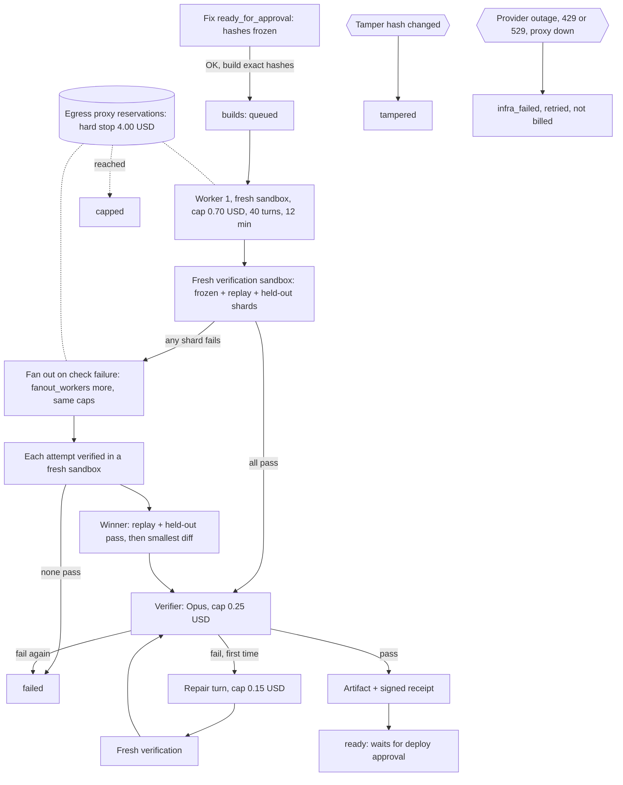

## 9. Sandboxed TDD workers

[ADR 0011](adr/0011-sandboxed-build-workers.md). One sandbox per attempt, no secrets inside, network denied except the
model egress proxy, checks mounted read-only, tamper hash before and after. Images are **prebuilt** with a pinned
dependency set; there is no package registry access inside, because fixtures hold user data.

Inside a worker sandbox:
- Claude Agent SDK (Claude Code headless), model `claude-sonnet-5-5`, tools Read, Write, Edit, Glob, Grep, Bash
  (allowlisted commands), plus the `run_checks` tool which runs the frozen check set through the trusted harness
  (advisory). No web tools, no subagents.
- Skills loaded: superpowers `test-driven-development` and `verification-before-completion`; gstack QA and ship skills
  (MIT, vendored with their headers) ([ADR 0021](adr/0021-model-router-and-builders.md)).
- tdd-guard-style PreToolUse hook: an edit to a non-test source file is refused until a failing test exists.
- Trusted harness runs checks in a child process and prints `OFFLOAD_PROOF {nonce, status, exit, completed}`. Exit code
  alone never counts, and in-worker proofs are advisory because the agent shares the sandbox with the harness.
- The `.claude/` write wall is avoided: workers never need to write Claude Code settings; such fixes are `setup_change`.
- Providers: `e2b` (Offload Cloud), `docker` and `container-use` (self-host and dev), `apple-container` (dev only, on a
  dedicated build Mac that holds no user secrets; the s35 shard runner). Chosen by `OFFLOAD_SANDBOX_PROVIDER`.
- A **reaper** destroys sandboxes tagged `offload-build-<build_id>` that outlive their build
  ([ADR 0031](adr/0031-build-infrastructure-failures.md)).

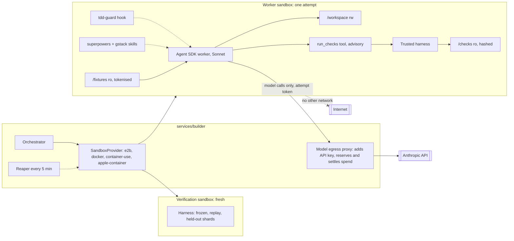

## 10. Connector and tool layer

[ADR 0010](adr/0010-mcp-first-connectors.md), [ADR 0033](adr/0033-pinned-connector-resolution-and-launch-catalog.md),
[ADR 0034](adr/0034-credential-broker-and-key-providers.md). `packages/connectors-sdk` defines the connector port and
adapters `mcp`, `composio`, `openapi`, `browser`.

- **Resolution happens once, at design time.** The fix designer prefers MCP, then Composio, then a direct API, then
  the browser, picks a connection, and pins `connection_id`, adapter, tool name and tool pin hash
  (sha256 of JCS `{name, description, input_schema}`) into the brief. The runtime never re-resolves. A changed pin or
  adapter pauses the routine in `needs_review` until it is rebuilt or re-approved.
- **Launch catalog** (verify each in spike S5): Gmail, Google Calendar, Google Sheets and Google Drive through the
  owner's own Google Cloud OAuth client marked Internal to his Workspace (no Google verification needed for internal
  users; tenant of one only), Composio for anyone else until Offload has a verified client; Slack through Composio;
  Notion and Linear through their first-party remote MCP servers; Stripe through its API with a restricted read key;
  QuickBooks and Xero through Composio.
- **Composio constraints** (PR #42 A§10.4): opaque `user_id` (member uuid, never an email); explicit toolkit and tool
  allowlist per session; meta tools never exposed; REST API only; default payload logging up to a year, disclosed in
  [SECURITY_PRIVACY.md](SECURITY_PRIVACY.md#10-sub-processors); zero-retention add-on before any second user.
- **Capabilities** have argument schemas and a step class (`read`, `draft`, `commit`). Commit capabilities have
  allowlisted arguments. Browser commits always ask.
- **Credential broker** (`services/broker`, a separate process): the only holder of decrypt rights. Before a commit it
  re-checks the gate token and the item hash; before a read, the run's declared read set. Credentials leave it only
  inside the outbound request. Key provider `aws-kms`, `gcp-kms` or `local` (a master key file for self-host).
  Token refresh is single-flight with a lease row, outside any transaction.
- Tool output is untrusted data: wrapped in `<untrusted source="…">` before any model sees it.
- Offload's own **MCP server** (read and propose only) lands in M8.

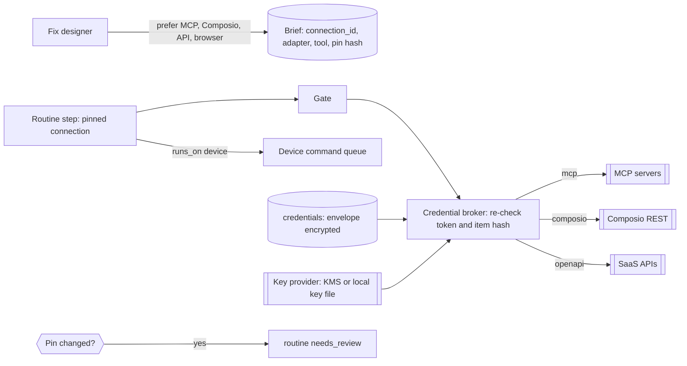

## 11. Routine runtime

`services/runtime`, on the durable runtime. Artifact contract in
[ADR 0026](adr/0026-routine-artifact-contract.md).

- **Routine**: a deployed fix with immutable versions (`routine_versions`), a `definition_hash`, triggers (`schedule`
  cron, `manual`, `webhook` from M6, `event`), limits and a commit mode. States `active`, `paused`, `needs_review`,
  `retired`.
- **Run**: steps from `routine.json` in order. The runtime does all I/O through the connector port and the broker.
  `transform` steps run pure modules in a no-network isolate. `model` steps run in an owned Messages-API loop with no
  tools and structured output only. `read` and `draft` steps run freely within the run budget. `commit` steps
  **return items**; the runtime collects them into a **batch**.
- **Durable workflows end at every human wait.** A run that needs an approval or a device stops its workflow with state
  in `runs`, `batches` and `item_journal`; the answer starts a new workflow ([ADR 0009](adr/0009-durable-execution-on-postgres.md)).
- **Commit mode** `ask_before_commit` (default after deploy): the run stops in `awaiting_approval`; the user sees the
  batch (real values restored on the device) and approves the exact `batch_hash`. `auto_commit`: the policy engine
  decides per item ([ADR 0017](adr/0017-policy-engine-cedar.md)).
- **Item journal**: written before each call. `executor` is `cloud` or `device`. `unknown` is never retried
  automatically; a person may release it (`released_by`, `released_at`), which marks it done for dedupe.
- **Circuit breakers** pause commits for the routine: 2 failed runs in a row; any `unknown` item; batch hash mismatch;
  credential or account change; tool pin change; mail bounce rate over 5%; recipient outside the run's input set.
- **Quiet hours**: a per-routine limit, default 01:00 to 03:59 member-local, editable per routine so a nightly routine
  can run.
- **Graduation** (M6): after 5 consecutive approved runs with no edits and no `failed_before_send` or `unknown` items,
  the policy proposes `auto_commit`; the user confirms ([ADR 0016](adr/0016-no-dry-run.md),
  [OQ-09](OPEN_QUESTIONS.md#oq-09-graduation-threshold)).
- **Repair** (M6): when an API changes or a breaker trips, `POST /v1/routines/{id}/repair` rebuilds from the same brief
  plus the failure evidence: fresh fixture capture, a new held-out check, OK, build, deploy approval. The new version
  starts in `ask_before_commit` with its streak at 0.
- **Measurement**: after each run, hs-1 computes `run_savings` ([ADR 0022](adr/0022-hours-saved-hs-1.md)).
- **Undo**: retiring a routine stops triggers; `setup_change` fixes ship with an undo note.

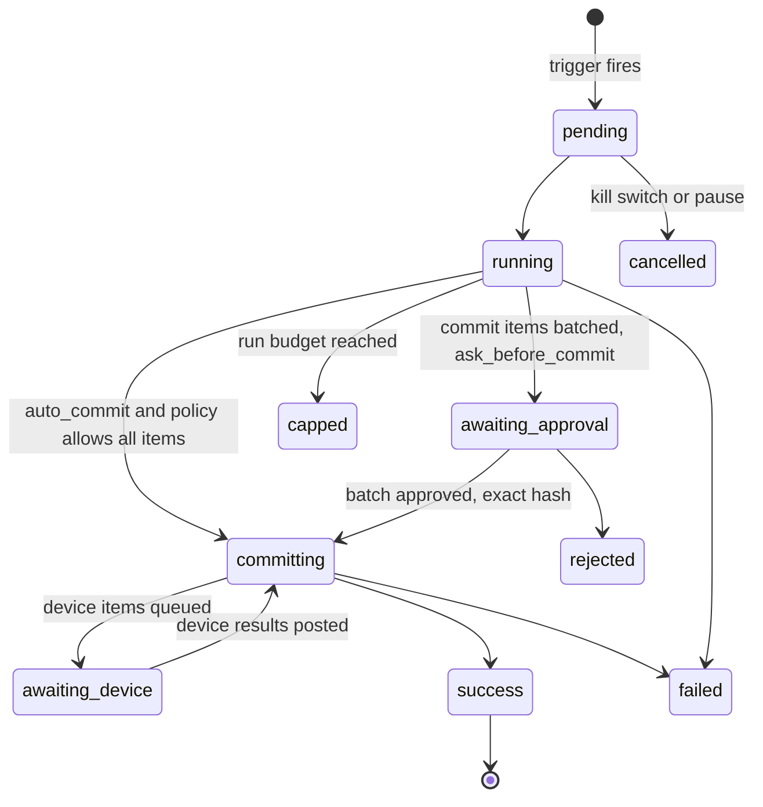

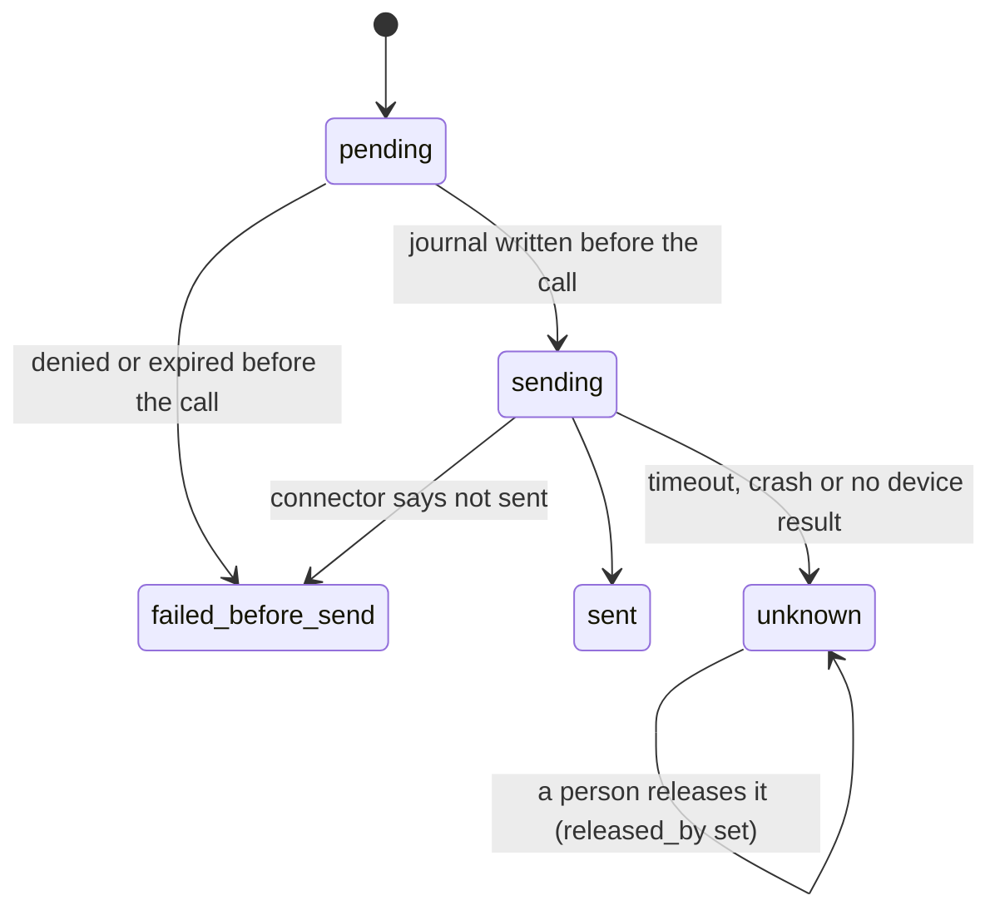

## 12. Execution placement and the Mac actuator

[ADR 0025](adr/0025-execution-placement-and-mac-actuator.md). Every step in `routine.json` has `runs_on: cloud | device`.
A cloud browser has no logged-in session, and Shortcuts, Apple Events, local files and desktop apps cannot be reached
from the cloud.

| Fix kind | Runs | Notes |
|---|---|---|
| `api_integration`, `scheduled_routine`, `agent_workflow` | cloud runtime | OAuth connectors through the broker |
| `script` (script or macOS Shortcut) | cloud if it only uses capabilities; device if it touches local files or apps | device steps use typed commands |
| `browser_automation` | device, in the user's logged-in browser, attended | cloud only for no-MFA service accounts, opt-in |
| `setup_change` | device (the user applies it) | undo note |
| `small_app` | hosted by the web app | not before M8 |

The **actuator** (`OffloadActuator`, a port of PR #42 A§9.5, lands in M6) runs typed commands only:
`shortcut.run {name, input?}`, `appleevent.template {template, params}` (a bundled, reviewed template list),
`ax.action {app, path, action, value?}` (only while the target app is frontmost and its bundle id matches), and
`browser.step {profile, action, selector, value?}` (attended; the user watches and Esc stops it; mechanism chosen in
spike S6). No command takes model-written script text.

Device steps are commit-class. They pass the same gate with the same item hash, and the journal stays on the server.
The runtime puts an approved item on the **device command queue** (`device_commands`). The Mac long-polls
`GET /v1/device/commands`, re-checks the item hash against the approved batch, runs the command, and posts a signed
`step_result` through ingest. If the device is offline the run waits in `awaiting_device`; a command not claimed in
24 hours expires and its item becomes `failed_before_send`; a claimed command with no result in 10 minutes makes its
item `unknown`.

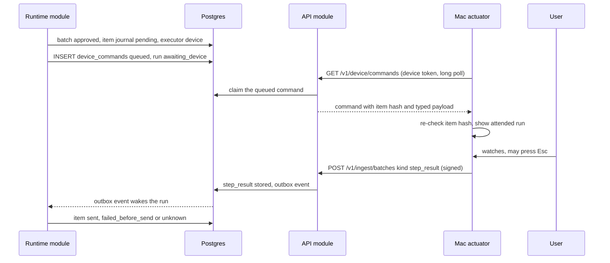

## 13. Governance and audit

- **Policy engine** ([ADR 0017](adr/0017-policy-engine-cedar.md)): hand-written TypeScript rules behind the
  `PolicyEngine` port in `packages/policy`, each with a rule id. Cedar arrives in M9 with EE custom policies.
- **Approvals**: one scheme for `build`, `deploy`, `batch`, `graduation`
  ([ADR 0004](adr/0004-every-external-action-is-gated.md)). Tokens are internal; approvals from the Mac are signed by
  the device key.
- **Audit log**: per-tenant hash chain, written in the same transaction, anchored hourly
  ([ADR 0018](adr/0018-audit-log-hash-chain.md)). Anchors are signed by the service key and stored in the same
  database, so they do not prove anything against the operator. EE adds an external anchor sink (customer S3 with
  object lock).
- **Retention policies**: per data class ([section 16](#16-data-and-privacy)); EE makes them configurable.
- **Identity**: one OIDC provider or magic link in core; WorkOS AuthKit on Offload Cloud from M8; SAML and SCIM in EE
  ([ADR 0014](adr/0014-identity.md)).

| Capability | Core | EE |
|---|---|---|
| Gates, approvals, item journal, kill switches | yes | |
| Built-in TypeScript policy rules, rule id on every decision | yes | |
| Custom Cedar policies, approval chains (N of M), policy simulation | | yes |
| Audit chain, verify, in-app viewer, paging API | yes | |
| SIEM streaming, external anchor sink, legal hold, configurable retention | | yes |
| One OIDC provider or magic link, roles owner/admin/member/auditor | yes | |
| SAML SSO, enforced SSO, SCIM, custom roles | | yes |
| Team tenants: invites, workspaces, shared fixes, team review (default, pending [OQ-13](OPEN_QUESTIONS.md#oq-13-plan-contents-and-prices)) | | yes |
| Data residency choice, BYOC, dedicated deployment | | yes |

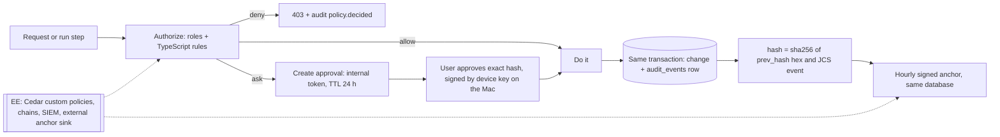

## 14. Tenancy

[ADR 0013](adr/0013-tenancy-and-rls.md). Tenant → workspace → member. RLS on `tenant_id` with `app.tenant_id` set by
`withTenant`, plus a **restrictive member policy** on every table that holds a person's capture-derived or connector
data (C1, C2, C6): rows are visible only when `member_id = app.member_id`, or when an audited aggregate job set
`app.member_scope = 'tenant'`. For a tenant of one this costs nothing; in a team tenant one query bug cannot show an
admin a colleague's screen-derived data.

Rules:
- **No network I/O inside `withTenant`.** Model, connector and sandbox calls happen outside the transaction. The audit
  advisory lock is taken last, just before commit.
- Lookups before the tenant is known (login, session, device, enrollment code, personal access token) go through
  `SECURITY DEFINER` resolver functions that return ids only.
- Cross-tenant jobs (nightly records, retention, anchors, outbox) run as role `offload_jobs`, which can only call
  `jobs_list_tenants()` and `outbox_claim(limit)` and then enter `withTenant` per tenant.
- Tests that touch roles, RLS, partitions or durable workflows run on real Postgres 17 (CI service container).

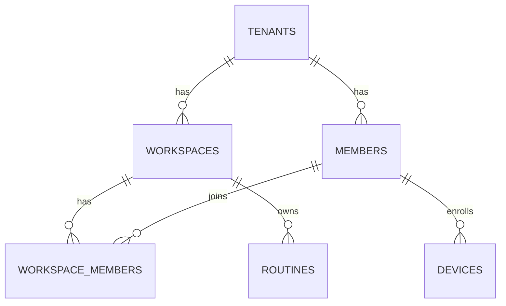

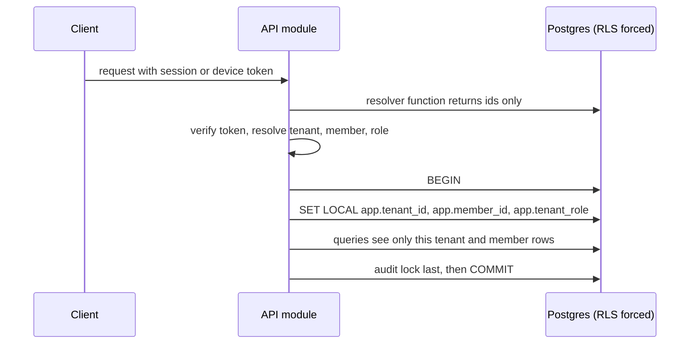

## 15. Deployment

| Mode | What runs | Who |
|---|---|---|
| Offload Cloud, tenant of one | `offload serve` + `offload broker`, managed Postgres 17 + pgvector, S3, E2B, one OIDC provider | Muhammad first |
| Offload Cloud, Pro (M8) | Same, optionally split into four processes; WorkOS AuthKit; team tenants per [OQ-13](OPEN_QUESTIONS.md#oq-13-plan-contents-and-prices) | Pro teams |
| Self-host (core) | Same images; Postgres + S3-compatible storage; `docker` or `container-use` sandboxes; any OIDC or magic link; `local` key provider | Free users, developers |
| Enterprise self-host | Core + `@offload-ee/server-ee` entry + license key | Enterprise |
| Enterprise BYOC / dedicated | Offload-operated stack in the customer's cloud account, or a dedicated database per tenant | Enterprise |

Hosting provider and region for Offload Cloud: [OQ-01](OPEN_QUESTIONS.md#oq-01-cloud-hosting-provider-and-region)
(default AWS `ca-central-1`). `infra/docker-compose` has Postgres for dev; `infra/helm/offload` is a placeholder chart
(real templates in M8). Mac signing, notarization and Sparkle are in [DEPLOYMENT.md](DEPLOYMENT.md).

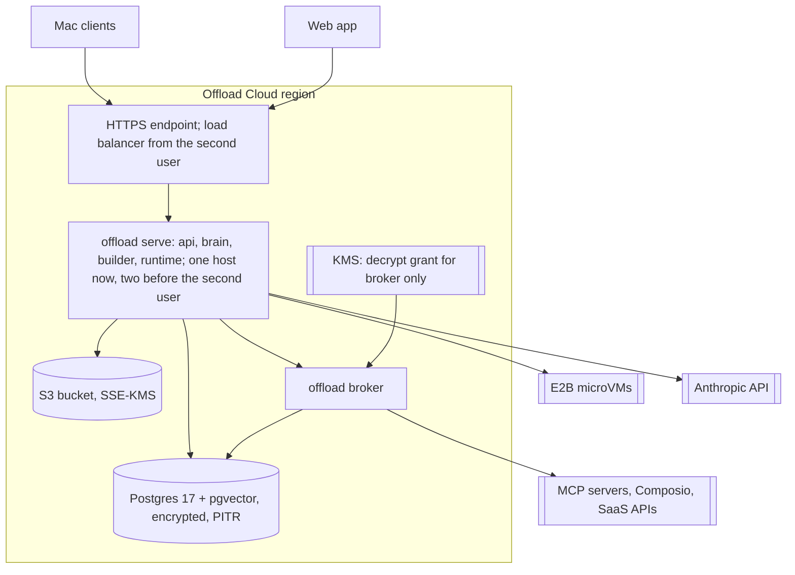

## 16. Data and privacy

Full detail in [SECURITY_PRIVACY.md](SECURITY_PRIVACY.md). Text from the screen is uploaded, masked and pseudonymised.
Pixels are not, unless the user opts in. Summary:

| Class | What | Where | Retention |
|---|---|---|---|
| C0 | Raw frames, unmasked text and titles, the reveal map | Mac only | 7 days, never uploaded |
| C1 | Masked observations: metadata; text snapshots; masked keyframes if opted in | Cloud `observations`, `observation_texts`, `keyframes` | Metadata 30 days; text 7 days ([OQ-02](OPEN_QUESTIONS.md#oq-02-raw-ttl-for-masked-observations-in-the-cloud)) |
| C2 | Derived user model (episodes, records, entities, facts, propositions, profile) | Cloud | Until the user forgets it ([OQ-03](OPEN_QUESTIONS.md#oq-03-keep-the-derived-user-model-long-term)) |
| C3 | Connector credentials, BYOK keys, webhook secrets | Cloud credential vault (broker only) | Until disconnected |
| C4 | Audit events, approvals, receipts, budget ledger, account data | Cloud | 6 years team, 1 year personal (EE configurable) |
| C5 | Build artifacts, briefs, checks | Object storage | Routine retired + 90 days, or failed build + 30 days |
| C6 | Connector content: fixture reads, token maps, instant reads | Cloud, encrypted; tokenised before any sandbox | 30 days from capture |

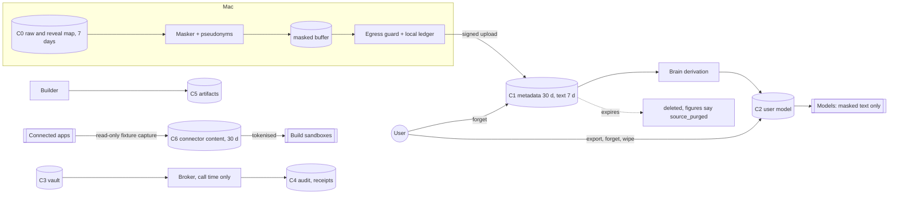

## 17. Model router

[ADR 0021](adr/0021-model-router-and-builders.md). One egress for product model calls in every module. Model ids and
prices are configuration (`services/brain/config/models.json`); prices are never written in docs. Product routes use
only the models below. Claude Fable 5.2 (`claude-fable-5-2`) is a dev-time architect and reviewer model for agents
working on this repo, never a product route, because PR #42 found Fable and Mythos excluded from Anthropic zero data
retention ([OQ-19](OPEN_QUESTIONS.md#oq-19-what-is-fable-52-and-should-it-shape-the-architecture)).

Configuration defaults:

| Tier | Model id | Routes |
|---|---|---|
| Opus | `claude-opus-5-5` | `design` (fix brief), `check_write` (check set, held-out check), `verify`, `understand`, `explain` |
| Sonnet | `claude-sonnet-5-5` | `build` (workers, in the sandbox through the egress proxy), `draft`, `model_step` |
| Haiku | `claude-haiku-5-5` | `classify`, `caption`, `label`, proven `model_step` |
| Local (optional) | exo or Ollama endpoint (`OFFLOAD_LOCAL_MODEL_URL`) | `classify`, `caption`, `embed` for self-hosters; never `build` by default |

Rules: masking second pass on every request (leftover names become per-run placeholders `<person:TAG.N>`); budget per
route, per run and per tenant per month; escalation on refusal, cut-off or failed validation Haiku → Sonnet → Opus;
models return labels from fixed enums and code maps them to numbers ([ADR 0003](adr/0003-numbers-come-from-code.md)).
A model that reads untrusted content has no tools: runtime `model` steps are tool-less, and only build workers use tools,
inside a sandbox with no network, no credentials and tokenised fixtures.

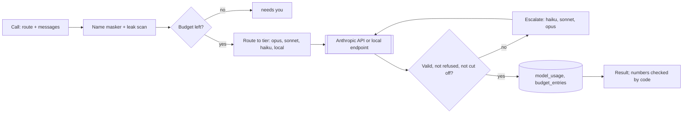

## 18. Failure modes

Adapted from PR #42 A§17 for the cloud brain.

| # | Failure | Detection | Behaviour | Recovery |
|---|---|---|---|---|
| F1 | Screen Recording not granted, withdrawn, or re-asked by macOS | Preflight false; frame request errors | Accessibility capture continues; no OCR, no keyframes; `permission_change` | Re-consent step ends with "Quit and reopen" ([ONBOARDING.md](ONBOARDING.md)) |
| F2 | Accessibility not granted or withdrawn | `AXIsProcessTrusted` false | Titles from the window server if Screen Recording is on; no URLs, no AX text; OCR becomes primary | Re-consent step |
| F3 | Observer crashes or hangs | Heartbeat older than 15 s | App restarts it with backoff 1 to 30 s; menu bar shows "not watching" after three failures | Automatic |
| F4 | Mac offline or API down | Upload errors | Capture continues; uploads queue up to 7 days; device commands wait (`awaiting_device`) | Drains with backoff |
| F5 | Leak or schema failure in the egress guard | Exception in the guard | Batch not sent, counted, ledger entry; persistent failure shows a banner | Fix ships through Sparkle |
| F6 | Sandbox provider outage, model 429/529, egress proxy down | Provider and proxy errors | Build `infra_failed`, retried up to 3 times, not billed to the cap | Automatic, then user retry |
| F7 | Orchestrator crash with a live sandbox | Reaper sees a tagged sandbox past its cap | Sandbox destroyed, `sandbox.reaped` audited | Automatic |
| F8 | Monthly model budget reached | Router budget check | 80%: cheap routes move to local tier if configured; 100%: paid routes stop with "needs you" | Raise the budget or wait |
| F9 | Connector token expired or revoked | 401, auth challenge | Routine pauses; connection shows "reconnect" | Reconnect; run resumes at the first not-attempted item |
| F10 | Tool definition or adapter changed | Pin hash mismatch before a run | Routine `needs_review` | Repair (rebuild) or re-approve |
| F11 | Device command not answered | TTL or claim timeout | Unclaimed after 24 h: `failed_before_send`; claimed with no result in 10 min: `unknown` | Person reviews unknown items |
| F12 | Partial batch failure | Connector error mid-batch | Failing item `failed_before_send` or `unknown`; breaker may trip | Report with per-item state |
| F13 | Durable workflow crash | Process exit | Resumes from the last checkpoint; items in `sending` become `unknown`, never re-sent | Automatic |
| F14 | Keychain master or pseudonym key missing | Unwrap fails | Old local data unreadable by design; pseudonym key restored from another Mac or the recovery code | Re-enroll or start fresh |
| F15 | Clock change, DST, sleep and wake | Wall-clock checks | Day rollover and purge use local calendar days; missed schedules handled once | Automatic |

## 19. End to end: observe to measured saving

```mermaid
sequenceDiagram
  autonumber
  participant U as Muhammad
  participant M as Mac client
  participant A as API module
  participant B as Brain
  participant BL as Builder
  participant S as Sandbox
  participant R as Runtime
  participant K as Broker
  participant T as Tools
  M->>M: observe, mask, pseudonymise, buffer
  M->>A: POST /v1/ingest/batches (signed, masked)
  A->>B: event observations.ingested
  B->>B: spans, tasks, episodes, records, opportunities ranked in code
  U->>A: GET /v1/today
  A-->>U: one suggested fix with how it was counted
  U->>A: POST /v1/opportunities/{id}/answer (build, option)
  B-->>U: needs_connection, connect the apps
  U->>A: POST /v1/connections (OAuth)
  B->>K: fixture capture, read-only reads of past instances
  K->>T: read
  B->>B: brief, tokenised fixtures, check set, held-out check, teeth gate
  B-->>U: ready_for_approval (hashes, estimate, 4.00 USD cap)
  U->>A: POST /v1/fixes/{id}/build-approvals = OK, build
  A->>BL: start build workflow
  BL->>S: worker 1, TDD against the check set
  BL->>S: fresh verification sandbox, frozen + replay + held-out
  BL->>BL: verifier, artifact, signed receipt
  BL-->>U: Build progress, ready to ship, definition in words
  U->>A: POST /v1/builds/{id}/deploy (artifact, receipt, definition hashes)
  A->>R: routine version deployed, ask_before_commit
  R->>K: read and draft steps
  K->>T: read
  R-->>U: batch ready (exact batch hash)
  U->>A: POST /v1/batches/{batch_hash}/approve (signed by device key)
  R->>K: commit items, journal pending, sending, sent
  K->>T: commit
  R->>R: hs-1 run saving
  R->>B: event saving.measured
  B-->>U: Weekly review, measured vs estimated, goals
```

In M2 the same sequence starts at step 7 with a manual opportunity (`POST /v1/opportunities`), and the batch is approved
on a minimal web page.
