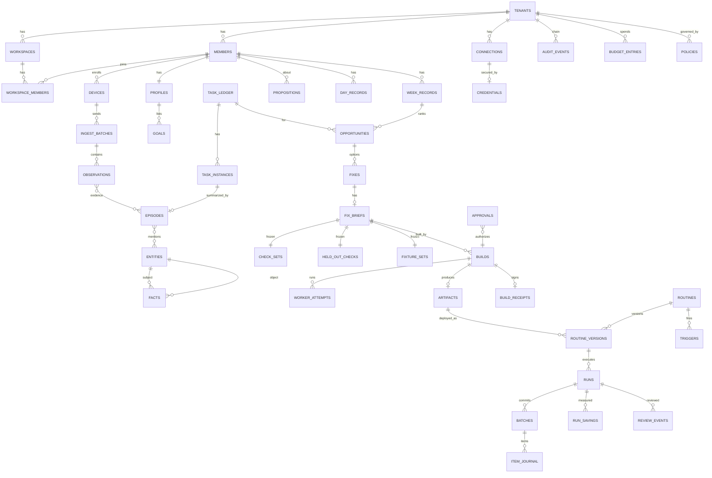

# Data model

Postgres 17 + pgvector is the one required datastore ([ADR 0002](adr/0002-stack-bun-typescript-hono-postgres.md)).
Words follow [GLOSSARY.md](GLOSSARY.md). Shapes on the wire are in [API.md](API.md).

## 1. Conventions

- **Tenancy columns**: every tenant-owned table starts with `tenant_id uuid NOT NULL REFERENCES tenants(id)`, first in
  the primary key or a unique index. RLS `ENABLE` + `FORCE` with policy `tenant_isolation`
  ([ADR 0013](adr/0013-tenancy-and-rls.md)). Tables scoped to a workspace also have `workspace_id uuid NOT NULL`.
- **Ids**: `uuid` (v7, time-ordered) for rows created by the server; ULID text for objects created on devices
  (`object_id`). Human-readable ids keep their prefixes: `task_key` = `k_` + 12 hex, goal ids `g_` + 10 hex.
- **Time**: `timestamptz` everywhere. Days are `date` in the member's timezone (`profiles.timezone`).
- **Money**: `numeric(10,4)` USD. **Durations**: integer seconds (`*_seconds`) or minutes (`*_minutes`) as named.
- **Hashes**: `text` lowercase hex sha256 (64 chars). Canonical JSON = RFC 8785 JCS.
- **Figures**: derived numbers are stored as `jsonb` `Figure { value, unit, arithmetic, evidence[], source_purged_at? }`
  ([ADR 0003](adr/0003-numbers-come-from-code.md)).
- **Bi-temporal fields** (user model): `valid_at` / `invalid_at` (when the fact was true in the world) and
  `recorded_at` / `expired_at` (when Offload believed it). Rows are never updated in place for meaning changes; a new
  row is inserted and the old one gets `expired_at`.
- **Append-only** tables have triggers that refuse UPDATE/DELETE/TRUNCATE except for `offload_retention`:
  `audit_events`, `audit_anchors`, `item_journal_transitions`, `budget_entries`, `purge_log`. `item_journal` itself
  allows only forward state changes (a trigger checks the transition) and no DELETE; see section 7.
- **Retention classes** (column in each table section):

| Class | Rule | Data class |
|---|---|---|
| `R-raw` | Deleted at the raw TTL, default 30 days ([OQ-02](OPEN_QUESTIONS.md#oq-02-raw-ttl-for-masked-observations-in-the-cloud)) | C1 |
| `R-model` | Kept until the user forgets it, or the tenant is deleted ([OQ-03](OPEN_QUESTIONS.md#oq-03-keep-the-derived-user-model-long-term)) | C2 |
| `R-secret` | Until the connection is removed; crypto-shredded on tenant delete | C3 |
| `R-gov` | 6 years for team tenants, 1 year for personal tenants; EE configurable | C4 |
| `R-artifact` | Until the routine is retired + 90 days, or the build failed + 30 days | C5 |
| `R-session` | Until expiry (sessions 12 h, approvals 24 h, enrollment codes 10 min) | C4 |
| `R-ops` | 90 days (ingest batches, outbox, model usage detail) | C4 |

## 2. ER diagram

## 3. Tenancy and identity

| Table | Key | Fields | Retention |
|---|---|---|---|
| `tenants` | `id` | `kind` (`personal`, `team`), `name`, `region`, `plan` (`free`, `pro`, `enterprise`), `reporting_timezone`, `monthly_model_budget_usd`, `created_at`, `deleted_at` | life of tenant. RLS: isolated by `id` |
| `workspaces` | `(tenant_id, id)` | `name`, `created_at`, `archived_at` | life of tenant |
| `members` | `(tenant_id, id)` | `email_hash`, `display_name`, `tenant_role` (`owner`, `admin`, `member`, `auditor`), `state` (`invited`, `active`, `leaving`, `frozen`, `departed`), `idp_subject`, `created_at` | life of tenant; departed + 90 days for personal data |
| `workspace_members` | `(tenant_id, workspace_id, member_id)` | `workspace_role` (`lead`, `member`) | life of membership |
| `sessions` | `(tenant_id, id)` | `member_id`, `token_sha256`, `csrf_sha256`, `created_at`, `last_seen_at`, `expires_at`, `revoked_at` | `R-session` |
| `devices` | `(tenant_id, id)` | `member_id`, `public_jwk` (P-256), `name`, `last_seq`, `enrolled_at`, `revoked_at` | life of device + `R-gov` |
| `device_nonces` | `(tenant_id, device_id, nonce)` | `expires_at` | 10 min |
| `service_principals` | `(tenant_id, id)` | `name`, `purpose` | life of tenant |
| `personal_access_tokens` | `(tenant_id, id)` | `member_id`, `name`, `scopes[]` (for example `mcp`), `token_sha256`, `created_at`, `last_used_at`, `revoked_at` | until revoked + `R-gov` |
| `support_grants` | `(tenant_id, id)` | `granted_by` (owner), `staff_principal`, `reason`, `starts_at`, `expires_at` (max 72 h), `revoked_at` | `R-gov` |
| `schema_migrations` | `version` (global) | `name`, `checksum`, `applied_at` | global, no RLS (allowlisted) |
| `license_state` | `id` (global) | `key_id`, `licensee`, `plan`, `features[]`, `expires_at`, `verified_at` | global, no RLS (allowlisted) |

## 4. User model

All `R-model` unless noted. All have `tenant_id`, `member_id`.

| Table | Key | Fields | Notes |
|---|---|---|---|
| `profiles` | `(tenant_id, member_id)` | `version`, `role`, `industry`, `drains[]` (`email`, `meetings`, `agent_babysitting`, `reporting`, `content`, `admin`, `context_switching`), `schedule` `{days[], start, end}`, `timezone`, `review_slot` `{day, time}` (default Fri 16:00), `autonomy` (`suggest`, `draft`, `run_approved`), `own_name_to_models` (`mask`, `keep`), `keyframes_to_cloud` bool (default false), `learning_paused` bool, `updated_at` | Edits bump `version` |
| `goals` | `(tenant_id, member_id, id)` | `id` = `g_` + sha256(lowercased text)[0:10], `text` (≤ 80 chars), `horizon` (`90d`), `embedding vector(1024)`, `created_at`, `archived_at` | at most 3 active |
| `exclusions` | `(tenant_id, member_id, id)` | `kind` (`bundle_id`, `host`, `title_contains`), `value`, `source` (`builtin`, `user`) | synced to the Mac |
| `task_ledger` | `(tenant_id, member_id, task_key)` | `signatures[]`, `task_kind`, `app_bundle_id`, `host`, `name_words[]` (masked), `name` (masked verb-object), `centroid vector(1024)`, `first_seen_day`, `last_seen_day` | Stable across weeks |
| `task_instances` | `(tenant_id, member_id, id)` | `task_key`, `started_at`, `ended_at`, `active_seconds`, `apps[]`, `observation_ids[]`, `fixture_eligible` bool | `observation_ids` dangle after raw TTL; `active_seconds` kept |
| `episodes` | `(tenant_id, member_id, id)` | `id` = `ep_` + instance or block id, `kind` (`focus_block`, `task_instance`), `started_at`, `ended_at`, `minutes`, `apps[]`, `task_key`, `name` (masked), `evidence` (observation ids), `source_purged_at`, `embedding vector(1024)` | |
| `entities` | `(tenant_id, member_id, id)` | `kind` (`person`, `organization`, `app`, `project`, `tool`, `goal`), `label` (masked or salted hash for people), `confirmed_name` (null until the user confirms), `attributes jsonb` (masked), `embedding vector(1024)`, `recorded_at`, `expired_at` | People are `sha256(salt ‖ normalized identifier)` until confirmed |
| `entity_aliases` | `(tenant_id, entity_id, alias_hash)` | `source`, `match_score` | Entity resolution output |
| `facts` | `(tenant_id, member_id, id)` | `subject_entity_id`, `relation` (`works_on`, `uses`, `talks_to`, `advances`, `repeats`, `blocked_by`, `replaced_by`, `precedes`), `object_entity_id`, `fact_text` (masked), `valid_at`, `invalid_at`, `recorded_at`, `expired_at`, `evidence` (episode ids), `supersedes_id` | Bi-temporal |
| `propositions` | `(tenant_id, member_id, id)` | `id` = `p_` + sha256(key)[0:10] + `_v` + version, `key`, `kind` (`repeats`, `time_share`, `sequence`), `version`, `revision_group`, `text` (masked, template), `confidence` (1–10), `confidence_score` (0–1), `decay` (1–10), `rate`, `evidence jsonb`, `valid_at`, `invalid_at`, `recorded_at`, `expired_at` | Confidence by rule ([ARCHITECTURE section 5](ARCHITECTURE.md#5-cloud-brain-and-user-model)) |
| `day_records` | `(tenant_id, member_id, day)` | `generated_at`, `totals jsonb` (Figures: active minutes, switches, switches per active hour, focus blocks, meeting minutes), `by_kind`, `by_app`, `by_task`, `episode_ids[]`, `source_purged_at` | |
| `week_records` | `(tenant_id, member_id, iso_week)` | `iso_week` (`YYYY-Www`), `hours jsonb`, `focus jsonb`, `tasks jsonb` (per task key: minutes, instances, median minutes, baseline minutes, vs baseline %, status `new`/`recurring`/`gone`), `fixes jsonb` (estimated vs measured), `weeks_observed`, `narrative`, `generated_at` | |
| `month_records` | `(tenant_id, member_id, month)` | `month` (`YYYY-MM`), `persistent[]`, `trend jsonb` (Theil-Sen slope per task key and goal), `drift jsonb`, `realized jsonb`, `narrative` | |
| `quarter_records` | `(tenant_id, member_id, quarter)` | `quarter` (`YYYY-Qn`), same shape as month | |
| `review_answers` | `(tenant_id, member_id, iso_week, subject_key)` | `question_kind`, `answer` (`keep`, `not_now`, `build`, `never`, `yes`, `no`, `other_goal`, `confirm_name`, `dont_track`, `undo`), `goal_id`, `answered_at` | Latest wins |

## 5. Capture

| Table | Key | Fields | Retention |
|---|---|---|---|
| `ingest_batches` | `(tenant_id, device_id, seq)` | `kind`, `object_count`, `received_at`, `receipt jsonb` | `R-ops` |
| `observations` | `(tenant_id, device_id, object_id)` | `member_id`, `ts`, `kind` (`focus`, `idle_start`, `idle_end`, `input_counts`, `text_snapshot`, `pause`, `resume`), `app_bundle_id`, `app_name`, `title` (masked), `host`, `keys`, `clicks`, `text` (masked), `text_hash`, `source` (`live`, `import`), `import_id` | `R-raw`. Partitioned by day |
| `keyframes` | `(tenant_id, device_id, object_id)` | `member_id`, `ts`, `object_key` (S3), `phash`, `width`, `height` | `R-raw`. Only if `keyframes_to_cloud` |
| `imports` | `(tenant_id, member_id, id)` | `source_kind` (`screenwatch`, `screenshots`, `videos`), `first_day`, `last_day`, `created_at`, `wiped_at` | Import space; wiped as a unit |

## 6. Opportunities, fixes and builds

| Table | Key | Fields | Retention |
|---|---|---|---|
| `opportunities` | `(tenant_id, id)` | `member_id`, `workspace_id`, `task_key`, `iso_week`, `rank`, `score`, `factors jsonb` (weekly hours saved, persistence, goal weight, alignment, confidence, payback weeks, decline penalty, each a Figure), `state` (`open`, `chosen`, `not_now`, `never`, `left_alone`, `designing`, `needs_you`, `ready_for_approval`, `building`, `ready_to_ship`, `build_failed`, `shipped`), `created_at` | `R-model` |
| `fixes` | `(tenant_id, id)` | `opportunity_id`, `option_no` (1–3), `kind` (fix kind), `recommended` bool, `title`, `detail`, `estimate` (Figure, hours/week), `confidence`, `effort_hours`, `chosen_at` | `R-model` |
| `fix_briefs` | `(tenant_id, id)` | `fix_id`, `brief jsonb`, `brief_hash`, `design_spend_usd`, `created_at` | `R-artifact` |
| `check_sets` | `(tenant_id, id)` | `brief_id`, `language` (`python`, `typescript`), `object_key`, `check_set_hash`, `teeth_gate` (`passed`, `failed`), `writer_model` | `R-artifact` |
| `held_out_checks` | `(tenant_id, id)` | `brief_id`, `object_key`, `held_out_hash`, `teeth_gate`, `writer_model` | `R-artifact`. Never readable by workers |
| `fixture_sets` | `(tenant_id, id)` | `brief_id`, `instance_ids[]`, `object_key`, `fixture_set_hash`, `count` | `R-artifact` |
| `approvals` | `(tenant_id, id)` | `kind` (`build`, `deploy`, `batch`, `graduation`), `subject_id`, `bound_hashes jsonb`, `token_sha256`, `approver_member_id`, `approver_kind` (`person`, `policy`), `rule_id`, `created_at`, `expires_at` (created + 24 h), `claimed_at` | `R-gov`. Append-only except `claimed_at` set once |
| `builds` | `(tenant_id, id)` | `brief_id`, `approval_id`, `state` (`queued`, `building`, `verifying`, `fanning_out`, `ready`, `failed`, `capped`, `tampered`, `cancelled`), `cap_usd` (4.0000), `spent_usd`, `winner_attempt_id`, `started_at`, `ended_at` | `R-gov` |
| `worker_attempts` | `(tenant_id, id)` | `build_id`, `ordinal` (1 = first worker, 2–4 = fan-out), `sandbox_provider`, `sandbox_id`, `model`, `tries`, `turns`, `spent_usd`, `wall_seconds`, `frozen_pass`, `replay_pass`, `held_out_pass`, `mutation_score`, `diff_lines`, `proof jsonb`, `outcome` (`pass`, `fail`, `cap`, `tamper`, `error`) | `R-gov` |
| `artifacts` | `(tenant_id, id)` | `build_id`, `object_key`, `artifact_sha256`, `manifest jsonb`, `bytes` | `R-artifact` |
| `build_receipts` | `(tenant_id, build_id)` | `receipt jsonb`, `receipt_hash`, `signature`, `key_id` | `R-gov` |

## 7. Routines and runs

| Table | Key | Fields | Retention |
|---|---|---|---|
| `routines` | `(tenant_id, id)` | `workspace_id`, `owner_member_id`, `fix_id`, `name`, `state` (`active`, `paused`, `retired`), `commit_mode` (`ask_before_commit`, `auto_commit`), `clean_run_streak`, `created_at`, `retired_at` | `R-gov` |
| `routine_versions` | `(tenant_id, routine_id, version)` | `artifact_id`, `deploy_approval_id`, `definition jsonb`, `definition_hash`, `policy jsonb` (limits, capabilities, budget per run), `created_at` | Immutable |
| `triggers` | `(tenant_id, id)` | `routine_id`, `kind` (`schedule`, `webhook`, `event`), `cron`, `timezone`, `webhook_secret_ref`, `event_type`, `enabled` | life of routine |
| `runs` | `(tenant_id, id)` | `routine_id`, `version`, `trigger_id`, `state` (`pending`, `running`, `awaiting_approval`, `committing`, `success`, `failed`, `cancelled`, `rejected`, `capped`), `durable_workflow_id`, `spent_usd`, `started_at`, `ended_at` | `R-gov` |
| `batches` | `(tenant_id, batch_hash)` | `run_id`, `item_count`, `state` (`pending`, `approved`, `committing`, `done`, `rejected`), `approval_id` | `R-gov` |
| `item_journal` | `(tenant_id, id)` | `batch_hash`, `run_id`, `item_ref` (sha256(routine_id NUL item_key)[0:16]), `item_hash`, `capability`, `connection_id`, `state` (`pending`, `sending`, `sent`, `failed_before_send`, `unknown`), `released_by`, `updated_at` | `R-gov`. State changes only forward; every change also inserted in `item_journal_transitions` |
| `item_journal_transitions` | `(tenant_id, item_id, seq)` | `from_state`, `to_state`, `at` | Append-only |
| `review_events` | `(tenant_id, id)` | `run_id`, `member_id`, `review_seconds`, `edit_seconds`, `fix_seconds`, `items_edited`, `decision` (`approved`, `approved_with_edits`, `rejected`, `partial`, `policy_committed`), `surface` (`mac`, `web`) | `R-gov` |
| `baselines` | `(tenant_id, routine_id, version)` | `median_seconds`, `q1`, `q3`, `n`, `grade` (`A`, `B`, `C`), `source` (`observed`, `user_estimate`, `default`), `inputs_digest` | `R-gov` |
| `run_savings` | `(tenant_id, run_id)` | `saved_seconds`, `residual_seconds`, `baseline_seconds`, `items_succeeded`, `note`, `computation` (`hs-1`), `inputs_digest` | `R-gov` |
| `circuit_breaker_trips` | `(tenant_id, id)` | `routine_id`, `reason`, `at`, `cleared_by`, `cleared_at` | `R-gov` |
| `kill_switches` | `(tenant_id, id)` | `scope` (`tenant`, `workspace`, `member`, `routine`), `scope_id`, `set_by`, `set_at`, `cleared_at` | `R-gov` |

## 8. Connectors, governance, measurement, privacy

| Table | Key | Fields | Retention |
|---|---|---|---|
| `connections` | `(tenant_id, id)` | `workspace_id`, `member_id` (null = workspace connection), `adapter` (`mcp`, `composio`, `openapi`, `browser`), `provider`, `capabilities[]`, `external_ref`, `account_hash`, `state`, `created_at` | life of connection |
| `credentials` | `(tenant_id, connection_id)` | `ciphertext`, `nonce`, `wrapped_dek`, `kms_key_ref`, `created_at`, `rotated_at` | `R-secret` |
| `policies` | `(tenant_id, id)` | `source` (`builtin`, `custom`), `set` (`deny`, `auto`, `ask`), `cedar` text, `version`, `enabled`, `created_by` | `R-gov`. Custom = EE |
| `audit_events` | `(tenant_id, seq)` | `id` (ULID), `at`, `principal_id`, `action`, `subject_type`, `subject_id`, `rule_id`, `details jsonb` (ids and hashes only), `prev_hash`, `hash`; `UNIQUE (tenant_id, prev_hash)` | `R-gov`. Append-only |
| `audit_anchors` | `(tenant_id, seq)` | `head_hash`, `signed_at`, `signature`, `key_id` | `R-gov`. Append-only |
| `budget_entries` | `(tenant_id, id)` | `scope` (`build`, `design`, `run`, `brain`), `scope_id`, `model`, `input_tokens`, `output_tokens`, `cache_read_tokens`, `sandbox_seconds`, `usd`, `at` | `R-gov`. Append-only |
| `model_usage` | `(tenant_id, day, model, route)` | `calls`, `input_tokens`, `output_tokens`, `usd` | `R-ops` |
| `notices`, `notice_acks`, `feature_enablements` | `(tenant_id, id)` | team monitoring notices and sensitive-feature records (old ADR 0108 fields) | notices 3 years; acks `R-gov` |
| `purge_log` | `(tenant_id, id)` | `scope` (`entity`, `range`, `all`, `import`, `raw_ttl`), `scope_ref`, `rows_deleted jsonb`, `requested_by`, `at` | `R-gov`. Append-only |
| `webhook_endpoints` | `(tenant_id, id)` | `url`, `event_types[]`, `secret_ref` (vault), `created_by`, `disabled_at` | life of endpoint |
| `exports` | `(tenant_id, id)` | `member_id`, `kind` (`member_data`, `audit` (EE)), `object_key`, `state`, `created_at`, `expires_at` (7 days) | 7 days |
| `events_outbox` | `(id)` + `tenant_id` | `type`, `version`, `payload jsonb`, `created_at`, `delivered_at` | `R-ops` |

The durable runtime keeps its own state in schema `durable` ([ADR 0009](adr/0009-durable-execution-on-postgres.md)).
Every durable workflow input includes `tenant_id`.

## 9. Indexes and vectors

- `observations (tenant_id, member_id, ts)`; partition per day for cheap raw-TTL drops.
- pgvector HNSW indexes on `episodes.embedding`, `entities.embedding`, `task_ledger.centroid`, `goals.embedding`
  (cosine). Queries always filter by `tenant_id` and `member_id` first.
- `audit_events (tenant_id, seq)`, `item_journal (tenant_id, batch_hash)`, `runs (tenant_id, routine_id, started_at)`.
