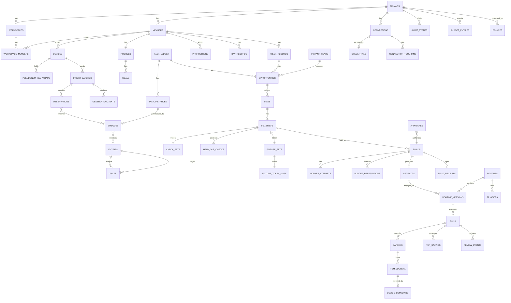

# Data model

Postgres 17 + pgvector is the one required datastore ([ADR 0002](adr/0002-stack-bun-typescript-hono-postgres.md)).
Words follow [GLOSSARY.md](GLOSSARY.md). Shapes on the wire are in [API.md](API.md).

## 1. Conventions

- **Tenancy columns**: every tenant-owned table starts with `tenant_id uuid NOT NULL REFERENCES tenants(id)`, first in
  the primary key or a unique index. RLS `ENABLE` + `FORCE` with policy `tenant_isolation`
  ([ADR 0013](adr/0013-tenancy-and-rls.md)). Tables scoped to a workspace also have `workspace_id uuid NOT NULL`.
- **Member isolation**: every table that holds C1, C2 or C6 data (marked **MI** below) has `member_id uuid NOT NULL`
  and a second, `AS RESTRICTIVE` policy `member_isolation USING (member_id = nullif(current_setting('app.member_id',
  true), '')::uuid OR current_setting('app.member_scope', true) = 'tenant')`. Only audited aggregate jobs set
  `app.member_scope = 'tenant'`. For a tenant of one this costs nothing; in a team tenant a query bug cannot show one
  member another member's screen-derived data.
- **Session settings** set by `withTenant` (one transaction, `SET LOCAL`): `app.tenant_id`, `app.principal_id`,
  `app.member_id`, `app.tenant_role`, `app.member_scope` (`member` by default, or `tenant`). **No network I/O inside `withTenant`**:
  model calls, connector calls and refreshes happen outside the transaction. The audit advisory lock is taken last.
- **Ids**: row ids are `uuid` (v7, time-ordered), including `device_id` everywhere. Objects created on devices carry a
  ULID `object_id`. Human-readable ids keep their prefixes: task key `k_` + 12 hex; goal `g_` + first 10 hex of
  sha256(lowercased text ‖ `created_at` RFC 3339) so re-adding an archived goal gets a new id; episode `ep_` + instance
  or block id; proposition `p_` + 10 hex + `_v` + version; pseudonym `h_` + 16 hex
  ([ADR 0028](adr/0028-stable-keyed-pseudonyms.md)); fixture token `tok_` + 12 hex
  ([ADR 0027](adr/0027-fixture-capture-and-connector-content.md)). Wire-only ids (not stored as row keys): `req_` +
  ULID (request id), `fig_` + first 16 hex of sha256(JCS(figure without `id`)).
- **Time**: `timestamptz` everywhere. Days are `date` in the member's timezone (`profiles.timezone`), except the
  partition key `day` of capture tables, which is the UTC date of the object's `ts`, computed by the server.
- **Money**: `numeric(10,4)` USD. **Durations**: integer seconds (`*_seconds`) or minutes (`*_minutes`) as named.
- **Hashes**: `text` lowercase hex sha256 (64 chars). Canonical JSON = RFC 8785 JCS. `email_hash =
  sha256Hex(lowercase(trim(email)))`.
- **Figures**: derived numbers are stored as `jsonb` `Figure { id, value, unit, arithmetic, evidence[],
  source_purged_at }` where `source_purged_at` is required and nullable ([ADR 0003](adr/0003-numbers-come-from-code.md)).
  Every figure written into a record is also indexed in `figure_index` so `GET /v1/figures/{figure_id}/evidence` can
  find it.
- **Bi-temporal fields** (user model): `valid_at` / `invalid_at` (when the fact was true in the world) and
  `recorded_at` / `expired_at` (when Offload believed it). Rows are never updated in place for meaning changes; a new
  row is inserted and the old one gets `expired_at`.
- **Append-only tables** (the one list; [ADR 0013](adr/0013-tenancy-and-rls.md) and slice m1-03 link here). A trigger
  refuses UPDATE, DELETE and TRUNCATE except for `offload_retention` past retention:
  - `audit_events`, `audit_anchors`, `item_journal_transitions`, `budget_entries`, `purge_log`: no UPDATE, no DELETE.
  - `item_journal`: no DELETE; UPDATE only for a forward state change (trigger checks the edge, see
    [section 7](#7-routines-and-runs)) and to set `released_by`/`released_at` once.
  - `approvals`: no DELETE; UPDATE only to set `claimed_at` once and `released_at` once
    ([ADR 0031](adr/0031-build-infrastructure-failures.md)).
- **Partitions**: capture tables (`observations`, `observation_texts`) are `PARTITION BY RANGE (day)` with a `DEFAULT`
  partition. The daily `retentionPurge` durable workflow creates the next 7 days of partitions and enables and forces
  RLS (both policies) on each partition when it is created.
  It calls `ensurePartitions(tx, fromDay, days)`, backed by the `SECURITY DEFINER` function
  `ensure_partitions(from_day, days)`: partitions are named `<table>_pYYYYMMDD`, rows already in `DEFAULT` for that
  day move into the new partition, and the call is idempotent.
- **Content columns**: only columns on the content-column allowlist may hold C1, C2 or C6 text. The allowlist is a file
  in `packages/db` and a canary test enforces it ([ADR 0035](adr/0035-mac-egress-guard-and-ledger.md)).
- **Retention classes** (column in each table section). TTLs come from config (`packages/db/src/config.ts`), never
  hard-coded in queries:

| Class | Rule | Data class | Config |
|---|---|---|---|
| `R-raw` | Deleted 30 days after `ts` ([OQ-02](OPEN_QUESTIONS.md#oq-02-raw-ttl-for-masked-observations-in-the-cloud)) | C1 metadata | `OFFLOAD_RAW_TTL_DAYS` (30) |
| `R-text` | Deleted 7 days after `ts` (OQ-02) | C1 text snapshots | `OFFLOAD_TEXT_TTL_DAYS` (7) |
| `R-content` | Deleted 30 days after capture (OQ-02) | C6 connector content | `OFFLOAD_CONTENT_TTL_DAYS` (30) |
| `R-model` | Kept until the user forgets it, or the tenant is deleted ([OQ-03](OPEN_QUESTIONS.md#oq-03-keep-the-derived-user-model-long-term)) | C2 | |
| `R-secret` | Until the connection is removed; crypto-shredded on tenant delete | C3 | |
| `R-gov` | 6 years for team tenants, 1 year for personal tenants; EE configurable | C4 | |
| `R-artifact` | Until the routine is retired + 90 days, or the build failed + 30 days | C5 | |
| `R-session` | Until expiry (sessions 12 h, magic links 15 min, invites 7 days, enrollment codes 10 min, nonces 2 min). Approvals are valid for 24 h but kept as `R-gov` | C4 | |
| `R-ops` | 90 days (ingest batches, outbox, model usage detail); idempotency keys 24 h | C4 | |

## 2. ER diagram

## 3. Tenancy and identity

Bootstrap reads happen before `app.tenant_id` is known, so they go through `SECURITY DEFINER` functions owned by
`offload_migrator` that return ids only. `offload_app` has EXECUTE on them and nothing else bypasses RLS:
`auth_resolve_identity(idp_subject) → (tenant_id, member_id)`, `auth_resolve_session(token_sha256) → (tenant_id,
member_id, tenant_role, expires_at, last_seen_at)`, `auth_resolve_device(device_id) → (tenant_id, member_id,
revoked_at)`, `auth_resolve_enrollment_code(code_sha256) → (tenant_id, member_id, code_challenge, redirect_uri,
expires_at, used_at)`, `auth_resolve_pat(token_sha256) → (tenant_id, member_id, scopes, revoked_at)`. Unknown keys
return no row. Cross-tenant jobs run as `offload_jobs`, which may only EXECUTE `jobs_list_tenants() → setof tenant_id` and
`outbox_claim(limit)`, then work per tenant inside `withTenant`.

**Implementation (m1-03).** Migrations are plain SQL in `packages/db/migrations/NNNN_name.sql`, applied in order by
`migrate(client)` as `offload_migrator` and checksummed in `schema_migrations`; a changed applied file fails with
`MigrationChecksumError`. The four roles are created once by `bootstrapRoles(adminClient)` (an administrator runs it
before the first migration). `offload_migrator` has `BYPASSRLS` because every table forces RLS and the resolver
functions it owns run before a tenant is known; `offload_app`, `offload_retention` and `offload_jobs` do not.
- `withTenant(pool, { tenantId, principalId, memberId, tenantRole, memberScope? }, fn)` gives `fn` a `tx` with
  `query` only. `memberId` is `null` for service work (durable workflows run as principal `durable`, role `service`);
  member-isolated tables then show no rows unless `memberScope` is `tenant`. `withTransaction(pool, fn)` is the same
  without a tenant, for `createPersonalTenant`. A `fetch` made while `fn` runs throws `NetworkIoInTransactionError`
  once `installNetworkGuard()` has run (tests install it).
- Resolvers return no row for a deleted tenant or a `departed` or `frozen` member, and `auth_resolve_session` none
  for a revoked session. Every `SECURITY DEFINER` function runs with `search_path = pg_catalog, public, pg_temp`, and
  `bootstrapRoles` revokes TEMP on the database from PUBLIC, so a temp table cannot shadow a table inside one.
- Ids in `withTenant` are lower-case uuids (one spelling per tenant, so the audit lock key is stable); `principalId`
  is an id and `tenantRole` one of the tenant roles or `service`. `members.idp_subject`, `sessions.token_sha256`, `devices.id`,
  `device_enrollment_codes.code_sha256` and `personal_access_tokens.token_sha256` are unique across tenants.
- `outbox_claim(limit)` (at most 1000) marks a claim by inserting the `outbox_deliveries` row with consumer
  `workflow:outbox_dispatch`; claimed events are not returned again.
- `MEMBER_ISOLATED_TABLES`, `APPEND_ONLY_TABLES` and `RLS_GLOBAL_ALLOWLIST` (`packages/db/src/tables.ts`) are the
  lists of record in code; tests compare them with the policies and triggers in the database.
- `offload_retention` has SELECT and DELETE on the capture, session and ops tables and the append-only set, INSERT on
  `purge_log` and `audit_anchors`, and EXECUTE on `ensure_partitions(from_day, days)` and
  `retention_drop_partition(partition, cutoff)`, which drops a daily capture partition only when its whole range is
  before a cutoff in the past. The retention workflow (m3-01) picks the cutoffs from the config TTLs.
- `refuse_mutation()` lets `offload_retention` DELETE only: `audit_events` rows from the oldest end and strictly below
  the tenant's latest anchor, `audit_anchors` rows that have a newer anchor, and `purge_log` rows. The chain head and
  the latest anchor always stay.
- Tests reset schema `public` only in a disposable database: its name ends in `test`, or it carries the comment
  `offload:disposable` (`assertDisposableDatabase` in `packages/testkit`).

| Table | Key | Fields | Retention |
|---|---|---|---|
| `tenants` | `id` | `kind` (`personal`, `team`), `name`, `region`, `plan` (`free`, `pro`, `enterprise`), `reporting_timezone`, `monthly_model_budget_usd` (default 50.0000, [OQ-05](OPEN_QUESTIONS.md#oq-05-model-provider-terms-and-monthly-model-budget)), `created_at`, `deleted_at` | life of tenant. RLS: `id = app.tenant_id`; `createPersonalTenant` sets `app.tenant_id` to the new id before inserting. `kind = 'team'` rows are created only through `ee/packages/teams` (decided, [OQ-13](OPEN_QUESTIONS.md#oq-13-plan-contents-and-prices)) |
| `workspaces` | `(tenant_id, id)` | `name`, `created_at`, `archived_at` | life of tenant |
| `members` | `(tenant_id, id)` | `email` (plaintext, account data, needed for login match and invites), `email_hash`, `display_name`, `tenant_role` (`owner`, `admin`, `member`, `auditor`), `state` (`invited`, `active`, `leaving`, `frozen`, `departed`), `idp_subject`, `created_at` | life of tenant; departed + 90 days for personal data. Helpers `setMemberRole`, `setMemberState` throw `LastOwnerError { code: "last_owner" }` |
| `workspace_members` | `(tenant_id, workspace_id, member_id)` | `workspace_role` (`lead`, `member`) | life of membership |
| `invites` | `(tenant_id, id)` | `email_hash`, `tenant_role`, `workspace_ids[]`, `token_sha256`, `invited_by`, `expires_at` (7 days), `accepted_at` | `R-session`. Team tenants only (M8) |
| `sessions` | `(tenant_id, id)` | `member_id`, `token_sha256`, `csrf_sha256`, `created_at`, `last_seen_at`, `expires_at`, `revoked_at` | `R-session`. Web app only; the Mac UI uses device tokens |
| `devices` | `(tenant_id, id)` | `member_id`, `public_jwk` (P-256), `key_storage` (`secure_enclave`, `keychain`), `name`, `last_seq`, `enrolled_at`, `revoked_at` | life of device + `R-gov` |
| `device_enrollment_codes` | `(tenant_id, code_sha256)` | `member_id`, `code_challenge` (S256), `redirect_uri`, `expires_at` (10 min), `used_at` | `R-session`. Single use |
| `device_nonces` | `(tenant_id, device_id, nonce)` | `audience` (`device`, `member`), `expires_at`, `used_at` | `R-session` (2 min) |
| `pseudonym_key_wraps` | `(tenant_id, device_id)` | `wrapped_key` (ECDH P-256 + HKDF-SHA256 + AES-256-GCM to this device), `wrapped_by_device_id` (null when unwrapped from the recovery code), `method` (`device`, `recovery_code`), `recovery_wrap` (scrypt-wrapped copy, one per tenant, on the first device row only), `created_at` | life of device. The server never holds the key in the clear ([ADR 0028](adr/0028-stable-keyed-pseudonyms.md)) |
| `service_principals` | `(tenant_id, id)` | `name`, `purpose` | life of tenant. Internal, no API |
| `personal_access_tokens` | `(tenant_id, id)` | `member_id`, `name`, `scopes[]` (for example `mcp`), `token_sha256`, `created_at`, `last_used_at`, `revoked_at` | until revoked + `R-gov` |
| `support_grants` | `(tenant_id, id)` | `granted_by` (owner), `staff_principal`, `reason`, `starts_at`, `expires_at` (max 72 h), `revoked_at` | `R-gov`. Core |
| `consents` | `(tenant_id, id)` | `member_id`, `device_id`, `notice_id` (`what-leaves-your-mac`), `notice_version`, `given_at`, `withdrawn_at` | `R-gov`. Core (M3). Upload consent; ingest checks for a row with the current version and no `withdrawn_at` |
| `idempotency_keys` | `(tenant_id, key)` | `request_sha256`, `status`, `response jsonb`, `created_at` | `R-ops` (24 h) |
| `magic_links` | `token_sha256` (global) | `email_hash`, `return_to`, `expires_at` (15 min), `used_at` | `R-session`. Self-host login only. Global, no RLS (allowlisted): it is read before any tenant is known and holds no tenant data |
| `schema_migrations` | `version` (global) | `name`, `checksum`, `applied_at` | global, no RLS (allowlisted) |
| `license_state` | `key_id` (global) | `licensee`, `plan`, `features[]`, `seats`, `issued_at`, `expires_at`, `verified_at`. One row per verified key, at most one unexpired key per `plan`; a tenant's entitlements come from the key whose `plan` equals `tenants.plan`, the same in Offload Cloud and self-host ([ADR 0037](adr/0037-hosting-cloud-and-self-host-parity.md#license-key-gating-is-identical-in-both-modes)) | global, no RLS (allowlisted) |

## 4. User model

All `R-model` unless noted. All have `tenant_id`, `member_id` and carry `member_isolation` (**MI**).

| Table | Key | Fields | Notes |
|---|---|---|---|
| `profiles` | `(tenant_id, member_id)` | `version`, `role`, `industry`, `drains[]` (`email`, `meetings`, `agent_babysitting`, `reporting`, `content`, `admin`, `context_switching`), `schedule` `{days[], start, end}`, `timezone`, `review_slot` `{day, time}` (default Fri 16:00), `autonomy` (`suggest`, `draft`, `run_approved`), `own_name_to_models` (`mask`, `keep`), `keyframes_to_cloud` bool (default false), `learning_paused` bool, `updated_at` | MI. Edits bump `version` |
| `goals` | `(tenant_id, member_id, id)` | `id` (see conventions), `text` (≤ 80 chars), `horizon` (`90d`), `embedding vector(1024)`, `created_at`, `archived_at` | MI. At most 3 active |
| `exclusions` | `(tenant_id, member_id, id)` | `kind` (`bundle_id`, `host`, `title_contains`), `value`, `source` (`builtin`, `user`) | MI. Synced to the Mac. Match: `host` exact or dot-suffix, `bundle_id` exact, `title_contains` case-insensitive. Built-ins from `packages/masking/src/exclusions.builtin.json` |
| `task_ledger` | `(tenant_id, member_id, task_key)` | `signatures[]`, `task_kind`, `app_bundle_id`, `host`, `name_words[]` (masked), `name` (masked verb-object), `centroid vector(1024)`, `first_seen_day`, `last_seen_day` | MI. Stable across weeks |
| `task_instances` | `(tenant_id, member_id, id)` | `task_key`, `started_at`, `ended_at`, `active_seconds`, `apps[]`, `observation_ids[]`, `pseudonyms[]` (the `h_` ids it touched) | MI. `observation_ids` dangle after the raw TTL; `active_seconds` kept |
| `episodes` | `(tenant_id, member_id, id)` | `id` (`ep_`…), `kind` (`focus_block`, `task_instance`), `started_at`, `ended_at`, `minutes`, `apps[]`, `task_key`, `name` (masked), `evidence` (observation ids), `source_purged_at`, `embedding vector(1024)` | MI |
| `entities` | `(tenant_id, member_id, id)` | `kind` (`person`, `organization`, `app`, `project`, `tool`, `goal`, `document`), `label` (masked, or the pseudonym `h_…` for people and documents), `confirmed_name` (null until the user confirms), `dont_track` bool, `attributes jsonb` (masked), `embedding vector(1024)`, `recorded_at`, `expired_at` | MI. People and documents are keyed by device pseudonyms ([ADR 0028](adr/0028-stable-keyed-pseudonyms.md)) |
| `entity_aliases` | `(tenant_id, member_id, entity_id, alias_hash)` | `source`, `match_score` | MI. Entity resolution output |
| `facts` | `(tenant_id, member_id, id)` | `subject_entity_id`, `relation` (`works_on`, `uses`, `talks_to`, `advances`, `repeats`, `blocked_by`, `replaced_by`, `precedes`), `object_entity_id`, `fact_text` (masked), `valid_at`, `invalid_at`, `recorded_at`, `expired_at`, `evidence` (episode ids), `supersedes_id` | MI. Bi-temporal (M7) |
| `propositions` | `(tenant_id, member_id, id)` | `id` (`p_`…), `key`, `kind` (`repeats`, `time_share`, `sequence`), `version`, `revision_group`, `text` (masked, template), `confidence` (1–10), `confidence_score` (0–1), `decay` (1–10), `rate`, `evidence jsonb`, `valid_at`, `invalid_at`, `recorded_at`, `expired_at` | MI. Confidence by rule ([ARCHITECTURE section 5](ARCHITECTURE.md#5-cloud-brain-and-user-model)) |
| `day_records` | `(tenant_id, member_id, day)` | `generated_at`, `totals jsonb` (Figures: active minutes, switches, switches per active hour, focus blocks, meeting minutes), `by_kind`, `by_app`, `by_task`, `episode_ids[]`, `source_purged_at` | MI. The Today day grid and switch bursts are computed from episodes at read time, not stored |
| `week_records` | `(tenant_id, member_id, iso_week)` | `iso_week` (`YYYY-Www`), `hours jsonb`, `focus jsonb`, `tasks jsonb` (per task key: minutes, instances, median minutes, baseline minutes, vs baseline %, status `new`/`recurring`/`gone`), `fixes jsonb` (estimated vs measured), `weeks_observed`, `narrative`, `generated_at` | MI |
| `month_records` | `(tenant_id, member_id, month)` | `month` (`YYYY-MM`), `persistent[]`, `trend jsonb` (Theil-Sen slope per task key and goal), `drift jsonb`, `realized jsonb`, `outcomes jsonb` (per shipped fix: `pending`, `on_track`, `partial`, `under`, `unmeasured`, and the "Didn't pay off: undo?" flag), `narrative` | MI (M7) |
| `quarter_records` | `(tenant_id, member_id, quarter)` | `quarter` (`YYYY-Qn`), same shape as month | MI (M7) |
| `figure_index` | `(tenant_id, member_id, figure_id, record_kind, record_key)` (identical figures in two records share an id) | `record_kind` (`day`, `week`, `month`, `quarter`, `opportunity`, `run_saving`), `record_key`, `json_pointer`, `created_at` | MI. Same retention as its record |
| `review_answers` | `(tenant_id, member_id, iso_week, subject_key)` | `question_kind`, `answer` (`keep`, `not_now`, `build`, `never`, `leave_alone`, `yes`, `no`, `other_goal`, `confirm_name`, `dont_track`, `undo`), `goal_id`, `answered_at` | MI. Latest wins. `not_now` lasts 4 weeks |

User model storage as built (slices p43a and p43b; migration `services/brain/sql/0001_user_model.sql`, adopted
by `packages/db` later): vectors are `real[]` until pgvector is installed; `goals.position` keeps the user's order and
a trigger refuses a fourth active goal; `episodes.day`; `week_records.from_day`, `to_day`, `days_recorded[]`;
`month_records` and `quarter_records` also hold `weeks[]`, `hours`, `by_task`, `notes[]` and `generated_at`;
`propositions` has one current version per `key` and `invalid_at ≥ valid_at`; `opportunities.goal_id`. `offload_app`
has no DELETE on these tables except `figure_index` and `opportunities`. A day's episodes are read through
`day_records.episode_ids`, never by `episodes.day` alone: a re-analysed day can leave older episode rows that only
forget removes. Day records, episodes and the ledger use the profile's timezone; the member update job refuses a
window built in another one.

## 5. Capture

| Table | Key | Fields | Retention |
|---|---|---|---|
| `ingest_batches` | `(tenant_id, device_id, seq)` | `kind`, `body_sha256` (sha256 of the exact request bytes), `object_count`, `received_at`, `receipt jsonb` | `R-ops` |
| `observations` | `(tenant_id, device_id, object_id, day)` | `day date NOT NULL` (UTC date of `ts`, server-computed; partition key; for `source = 'import'` the UTC date of ingest, so TTLs count from the import), `member_id`, `ts`, `kind` (`focus`, `idle_start`, `idle_end`, `input_counts`, `pause`, `resume`, `permission_change`), `app_bundle_id`, `app_name`, `title` (masked, pseudonymised), `host`, `doc` (`h_` pseudonym of the URL path or document id), `keys`, `clicks`, `reason`, `perm jsonb`, `source` (`live`, `import`), `import_id` | `R-raw`. MI. `PARTITION BY RANGE (day)` + `DEFAULT`. `ts` is immutable, so a retry hits the same row: `ON CONFLICT (tenant_id, device_id, object_id, day) DO NOTHING` |
| `observation_texts` | `(tenant_id, device_id, object_id, day)` | `day`, `member_id`, `ts`, `text` (masked, pseudonymised, ≤ 8000 chars), `text_hash`, `text_source` (`ax`, `ocr`), `app_bundle_id`, `source`, `import_id` | `R-text`. MI. Partitioned like `observations`. Holds `text_snapshot` objects only |
| `keyframes` | `(tenant_id, device_id, object_id)` | `member_id`, `ts`, `object_key` (S3), `phash`, `width`, `height`, `bytes`, `sha256` | `R-raw`. MI. Only if `keyframes_to_cloud` (M5). The purge job deletes rows past TTL and their objects |
| `imports` | `(tenant_id, member_id, id)` | `source_kind` (`screenwatch`, `screenshots`, `videos`), `first_day`, `last_day`, `created_at`, `wiped_at` | MI. Import space; wiped as a unit |
| `review_events` | `(tenant_id, device_id, object_id)` | `member_id`, `ts`, `run_id`, `review_seconds`, `edit_seconds`, `fix_seconds`, `items_edited`, `decision` (`approved`, `approved_with_edits`, `rejected`, `partial`, `policy_committed`), `surface` (`mac`, `web`) | `R-gov`. Web approvals write with the web session's synthetic `device_id` = nil uuid and a server ULID |
| `notice_acks` | `(tenant_id, device_id, object_id)` | `member_id`, `ts`, `notice_id`, `notice_version` | `R-gov`. EE (M9) |

## 6. Opportunities, fixes and builds

| Table | Key | Fields | Retention |
|---|---|---|---|
| `instant_reads` | `(tenant_id, member_id, id)` | `connection_id`, `window_days` (30), `summary jsonb` (counts and cadences only, tokenised), `created_at` | `R-content`. MI. C6 ([ADR 0036](adr/0036-opportunity-sources-and-instant-read.md)) |
| `opportunities` | `(tenant_id, id)` | `member_id`, `workspace_id`, `source` (`finder`, `manual`, `instant_read`, `agent`), `task_key` (null for manual), `title` (masked), `description` (masked), `iso_week`, `rank`, `score`, `factors jsonb` (weekly hours saved, persistence, goal weight, alignment, confidence, payback weeks, decline penalty, each a Figure), `state` (`open`, `chosen`, `needs_connection`, `capturing_fixtures`, `designing`, `needs_you`, `ready_for_approval`, `building`, `ready_to_ship`, `build_failed`, `shipped`, `not_now`, `never`, `left_alone`), `not_now_until`, `created_at` | `R-model`. MI. `manual` and `agent` text is masked server-side and leak scanned before storage |
| `fixes` | `(tenant_id, id)` | `workspace_id`, `opportunity_id`, `option_no` (1–3), `kind` (fix kind), `recommended` bool, `title`, `detail`, `estimate` (Figure, hours/week), `confidence`, `effort_hours`, `chosen_at` | `R-model` |
| `fix_briefs` | `(tenant_id, id)` | `fix_id`, `revision` (repair bumps it), `brief jsonb` (includes per step `connection_id`, adapter, tool name, tool pin hash, `runs_on`), `brief_hash`, `design_spend_usd`, `created_at` | `R-artifact` |
| `check_sets` | `(tenant_id, id)` | `brief_id`, `language` (`typescript`), `object_key`, `check_set_hash`, `teeth_gate` (`passed`, `failed`), `writer_model` | `R-artifact` |
| `held_out_checks` | `(tenant_id, id)` | `brief_id`, `build_id` (each build of a brief gets a fresh one, [ADR 0029](adr/0029-build-verdicts.md)), `object_key`, `held_out_hash`, `teeth_gate`, `writer_model` | `R-artifact`. Never readable by workers. A held-out hash is used as soon as any build of the brief is bound to it; OK, build with a used one is `409 state_conflict` |
| `fixture_sets` | `(tenant_id, id)` | `member_id`, `brief_id`, `instance_refs[]`, `object_key` (tokenised reads + expected commit items, encrypted), `fixture_set_hash`, `count`, `captured_at` | `R-content` for the object, row `R-artifact`. MI |
| `fixture_token_maps` | `(tenant_id, fixture_set_id)` | `member_id`, `ciphertext` (token → value map, encrypted by the broker key), `key_ref` | `R-content`. MI. Never enters a sandbox |
| `approvals` | `(tenant_id, id)` | `kind` (`build`, `deploy`, `batch`, `graduation`), `subject_id`, `bound_hashes jsonb`, `token_sha256` (internal token, never shown), `approver_member_id`, `approver_device_id` (set when approved from the Mac with a device signature), `approver_kind` (`person`, `policy`), `rule_id`, `created_at`, `expires_at` (created + 24 h), `claimed_at`, `released_at` | `R-gov`. Append-only rules in [section 1](#1-conventions) |
| `builds` | `(tenant_id, id)` | `fix_id`, `brief_id`, `approval_id`, `state` (`queued`, `building`, `verifying`, `fanning_out`, `repairing`, `ready`, `failed`, `capped`, `tampered`, `cancelled`, `infra_failed`), `cap_usd` (4.0000), `spent_usd`, `fanout_workers` (1 in M2, 3 from M6), `infra_retries`, `bound_hashes jsonb` (the four hashes and `cap_usd` the build approval binds), `stages jsonb` (stage name, state, started, ended, note in plain words), `winner_attempt_id`, `artifact_sha256`, `receipt_hash`, `definition_hash`, `created_at`, `heartbeat_at` (set on every write; a live build whose heartbeat is older than the stale limit is ended `infra_failed` by the next OK, build), `started_at`, `ended_at`, `deployed_at` (set once by the deploy approval) | `R-gov`. **Build lock**: partial unique index on `(tenant_id, brief_id)` where `state` is `queued`, `building`, `verifying`, `fanning_out` or `repairing` |
| `worker_attempts` | `(tenant_id, id)` | `build_id`, `ordinal` (1 = first worker, 2+ = fan-out), `sandbox_provider`, `sandbox_id`, `model`, `tries`, `turns`, `spent_usd`, `wall_seconds`, `frozen_pass`, `replay_pass`, `held_out_pass` (all from the fresh verification sandbox), `verifier_verdict` (`pass`, `fail`, null), `repaired` bool, `diff_lines`, `check_groups jsonb` (group name, passed, failed), `proof jsonb`, `outcome` (`running` from the moment the worker starts, then `pass`, `fail`, `cap`, `tamper`, `error`), `artifact_sha256`, `artifact_bytes`, `artifact_files jsonb` (paths), `note` (plain words) | `R-gov` |
| `budget_reservations` | `(tenant_id, id)` | `build_id`, `attempt_id`, `call_id`, `kind` (`model`, `sandbox`), `reserved_usd`, `created_at`, `settled_at` (a worker attempt's whole cap is one reservation, `call_id = attempt:<attempt_id>`, settled into `budget_entries` with the same idempotency key) | `R-ops`. Created under a row lock on the `builds` row ([ADR 0030](adr/0030-build-budget-at-egress-proxy.md)). The builder's tables are in `services/builder/sql/` until `packages/db` adopts them |
| `artifacts` | `(tenant_id, id)` | `build_id`, `object_key`, `artifact_sha256`, `manifest jsonb` (`routine.json` + file list, [ADR 0026](adr/0026-routine-artifact-contract.md)), `bytes` | `R-artifact` |
| `build_receipts` | `(tenant_id, build_id)` | `receipt jsonb`, `receipt_hash`, `signature`, `key_id` (`signature` and `key_id` stay null until receipt signing lands, m2-07) | `R-gov` |

## 7. Routines and runs

| Table | Key | Fields | Retention |
|---|---|---|---|
| `routines` | `(tenant_id, id)` | `workspace_id`, `owner_member_id`, `fix_id`, `name`, `state` (`active`, `paused`, `needs_review`, `retired`), `commit_mode` (`ask_before_commit`, `auto_commit`), `clean_run_streak`, `graduation_approval_id`, `created_at`, `retired_at` | `R-gov` |
| `routine_versions` | `(tenant_id, routine_id, version)` | `artifact_id`, `deploy_approval_id`, `definition jsonb` (resolved `routine.json`), `definition_hash` (bound by the deploy approval, [ADR 0032](adr/0032-deploy-approval-binds-definition.md)), `policy jsonb` (limits, capabilities, budget per run, `quiet_hours`), `created_at` | Immutable |
| `triggers` | `(tenant_id, id)` | `routine_id`, `kind` (`schedule`, `webhook`, `event`, `manual`), `cron`, `timezone`, `webhook_secret_ref`, `event_type`, `enabled` | life of routine |
| `runs` | `(tenant_id, id)` | `routine_id`, `version`, `trigger_id`, `state` (`pending`, `running`, `awaiting_approval`, `awaiting_device`, `committing`, `success`, `failed`, `rejected`, `cancelled`, `capped`), `durable_workflow_id`, `spent_usd`, `started_at`, `ended_at` | `R-gov` |
| `batches` | `(tenant_id, batch_hash)` | `run_id`, `item_count`, `state` (`pending`, `approved`, `committing`, `done`, `rejected`), `approval_id` | `R-gov` |
| `item_journal` | `(tenant_id, id)` | `batch_hash`, `run_id`, `item_ref` (sha256(routine_id NUL item_key)[0:16]), `item_hash`, `capability`, `connection_id`, `executor` (`cloud`, `device`), `state` (`pending`, `sending`, `sent`, `failed_before_send`, `unknown`), `released_by`, `released_at`, `updated_at` | `R-gov`. Edges: `pending→sending`, `pending→failed_before_send`, `sending→sent`, `sending→failed_before_send`, `sending→unknown`. No `released` state: setting `released_by` marks a person's release of an `unknown` item (done for dedupe). Every change is also inserted in `item_journal_transitions` |
| `item_journal_transitions` | `(tenant_id, item_id, seq)` | `from_state`, `to_state`, `at` | Append-only |
| `device_commands` | `(tenant_id, id)` | `device_id`, `item_id`, `run_id`, `command` (`shortcut.run`, `appleevent.template`, `ax.action`, `browser.step`), `payload jsonb` (typed args, real values), `item_hash`, `state` (`queued`, `claimed`, `done`, `failed`, `expired`), `created_at`, `claimed_at`, `expires_at` (created + 24 h), `finished_at` | `R-gov` (payload dropped after `finished_at` + 7 days). M6 ([ADR 0025](adr/0025-execution-placement-and-mac-actuator.md)). Expired → item `failed_before_send`; claimed with no result in 10 min → item `unknown` |
| `baselines` | `(tenant_id, routine_id, version)` | `median_seconds`, `q1`, `q3`, `n`, `grade` (`A`, `B`, `C`), `source` (`observed`, `user_estimate`, `default`), `inputs_digest` | `R-gov` |
| `run_savings` | `(tenant_id, run_id)` | `saved_seconds`, `residual_seconds`, `baseline_seconds`, `items_sent`, `note`, `computation` (`hs-1`), `inputs_digest` | `R-gov` |
| `fix_outcomes` | `(tenant_id, routine_id)` | `shipped_at`, `estimated_minutes_per_week`, `baseline_minutes_per_week`, `weeks jsonb` (4 weeks: measured minutes or `source_purged`), `flag` (`pending`, `on_track`, `partial`, `under`, `unmeasured`), `ratio`, `arithmetic` | `R-gov` ([ADR 0022](adr/0022-hours-saved-hs-1.md)) |
| `circuit_breaker_trips` | `(tenant_id, id)` | `routine_id`, `reason` (`two_failed_runs`, `unknown_item`, `batch_hash_mismatch`, `credential_changed`, `tool_pin_changed`, `bounce_rate`, `recipient_not_allowed`), `at`, `cleared_by`, `cleared_at` | `R-gov`. Read through `GET /v1/routines/{id}` |
| `kill_switches` | `(tenant_id, id)` | `scope` (`tenant`, `workspace`, `member`, `routine`), `scope_id`, `set_by`, `set_at`, `cleared_at` | `R-gov` |

## 8. Connectors, governance, measurement, privacy

| Table | Key | Fields | Retention |
|---|---|---|---|
| `connections` | `(tenant_id, id)` | `workspace_id`, `member_id` (null = workspace connection), `adapter` (`mcp`, `composio`, `openapi`, `browser`), `provider`, `account_label` (shown on the deploy card), `capabilities[]`, `external_ref` (Composio connected account id, MCP grant id), `account_hash`, `state` (`active`, `needs_reauth`, `revoked`), `created_at` | life of connection |
| `connection_tool_pins` | `(tenant_id, connection_id, tool_name)` | `pin_hash` (sha256 of JCS `{name, description, input_schema}`), `pinned_at` | life of connection. A change pauses routines that use it (`needs_review`, [ADR 0033](adr/0033-pinned-connector-resolution-and-launch-catalog.md)) |
| `credentials` | `(tenant_id, connection_id)` | `ciphertext`, `nonce`, `wrapped_dek`, `key_provider` (`aws-kms`, `gcp-kms`, `local`), `key_ref`, `scopes[]`, `expires_at`, `refresh_state` (`ok`, `refreshing`, `failed`, `revoked`), `refresh_lease_until`, `last_refreshed_at`, `created_at`, `rotated_at` | `R-secret`. Only the broker can decrypt; KMS encryption context = `tenant_id` ([ADR 0034](adr/0034-credential-broker-and-key-providers.md)) |
| `policies` | `(tenant_id, id)` | `source` (`builtin`, `custom`), `set` (`deny`, `auto`, `ask`), `engine` (`ts`, `cedar`), `rule_id`, `body` (Cedar text for custom), `version`, `enabled`, `created_by` | `R-gov`. Built-in rules are TypeScript; custom (Cedar) = EE, M9 |
| `audit_events` | `(tenant_id, seq)` | `id` (ULID), `at`, `principal_id` (an id as text: member, device, service principal or `durable`), `action`, `subject_type`, `subject_id`, `rule_id`, `details jsonb` (ids and hashes only: strings without spaces, at most 128 characters, 2048 bytes in all), `prev_hash`, `hash`; `UNIQUE (tenant_id, prev_hash)` | `R-gov`. Append-only. `hash = sha256Hex(prev_hash ‖ JCS(event_without_hash))` with `prev_hash` as its 64-char hex ASCII ([ADR 0018](adr/0018-audit-log-hash-chain.md)); `event_without_hash` = `{tenant_id, seq, id, at, principal_id, action, subject_type, subject_id, rule_id, details, prev_hash}`, `seq` as a number, `at` as RFC 3339 UTC with milliseconds, absent fields `null`. Chain writer `appendAudit(tx, event)` and `verifyAuditChain(tx)` (`{ ok, checked, first_bad_seq? }`) in `packages/db/src/audit.ts` from M1 |
| `audit_anchors` | `(tenant_id, seq)` | `head_hash`, `signed_at`, `signature`, `key_id`, `sink_ref` (EE external anchor sink, null in core) | `R-gov`. Append-only |
| `budget_entries` | `(tenant_id, id)` | `idempotency_key` (`UNIQUE (tenant_id, idempotency_key)`; call id or step id), `scope` (`build`, `design`, `run`, `brain`, `infra`), `scope_id` (for builds: `scope = 'build'`, `scope_id = build_id`), `model`, `input_tokens`, `output_tokens`, `cache_read_tokens`, `sandbox_seconds`, `usd`, `at` | `R-gov`. Append-only. `infra` entries never count toward the build cap |
| `model_usage` | `(tenant_id, day, model, route)` | `calls`, `input_tokens`, `output_tokens`, `usd` | `R-ops`. Read through `GET /v1/budget` |
| `notices`, `feature_enablements` | `(tenant_id, id)` | team monitoring notices and sensitive-feature records (old ADR 0108 fields) | **EE** (M9, [OQ-15](OPEN_QUESTIONS.md#oq-15-monitoring-law-features-for-teams)). notices 3 years; enablements `R-gov` |
| `purge_requests` | `(tenant_id, id)` | `member_id`, `scope` (`entity`, `range`, `all`, `import`), `scope_ref`, `state` (`queued`, `running`, `done`, `failed`), `requested_by`, `created_at`, `finished_at` | `R-gov` |
| `purge_log` | `(tenant_id, id)` | `purge_request_id` (null for TTL jobs), `scope` (`entity`, `range`, `all`, `import`, `raw_ttl`, `text_ttl`, `content_ttl`), `scope_ref`, `rows_deleted jsonb`, `requested_by` (a principal id as text: a member, or `retention` for TTL jobs), `at` | `R-gov`. Append-only |
| `webhook_endpoints` | `(tenant_id, id)` | `url`, `event_types[]`, `secret_ref` (vault), `created_by`, `disabled_at` | life of endpoint (M8) |
| `exports` | `(tenant_id, id)` | `member_id`, `kind` (`member_data`), `object_key`, `state`, `created_at`, `expires_at` (7 days) | 7 days |
| `events_outbox` | `(tenant_id, id)` | `type`, `version`, `payload jsonb` (ids only), `created_at` | `R-ops`. RLS on. The dispatcher reads through `outbox_claim(limit)` as `offload_jobs` |
| `outbox_deliveries` | `(tenant_id, event_id, consumer)` | `consumer` (`workflow:<name>`, `webhook:<endpoint_id>`), `attempts`, `delivered_at`, `last_error_code` | `R-ops`. Understanding (m5-01) writes consumer `workflow:understanding`: one row per `observations.ingested` event, `delivered_at` set once it ran (or had nothing to do), `last_error_code` a code only |

The durable runtime keeps its own state in schema `durable` ([ADR 0009](adr/0009-durable-execution-on-postgres.md)),
outside RLS and allowlisted by name. Rule and test: workflow inputs and step outputs hold **ids only, never content**;
rows for a tenant are purged on forget-all and tenant wipe. Every workflow input includes `tenant_id`. Workflows end at
every human wait (approval, batch, device) and a new workflow starts on the answer; state lives in the tables above.

## 9. EE tables

Created by core migrations so the schema is one; written only by `ee/` code with a valid license key
([ADR 0015](adr/0015-open-core-layout-and-license-gating.md)).

| Table | Key | Fields | Retention |
|---|---|---|---|
| `sso_configs` | `(tenant_id)` | `saml_metadata_url`, `enforced` bool, `domains[]`, `updated_by`, `updated_at` | life of tenant (M9) |
| `scim_groups` | `(tenant_id, id)` | `external_id`, `display_name`, `workspace_id`, `updated_at` | life of tenant (M9) |
| `audit_streams` | `(tenant_id, id)` | `kind` (`webhook`, `s3`), `target`, `secret_ref`, `enabled`, `last_delivered_seq` | life of stream (M9) |
| `anchor_sinks` | `(tenant_id, id)` | `kind` (`s3_object_lock`, `email`), `target`, `enabled`, `last_anchor_seq` | life of sink (M9) |

Team tenant rows (`tenants.kind = 'team'`, `invites`, extra `workspaces`) are core tables written only through
`ee/packages/teams` (M8; decided, [OQ-13](OPEN_QUESTIONS.md#oq-13-plan-contents-and-prices)).

## 10. Indexes and vectors

- `observations (tenant_id, member_id, ts)` and `observation_texts (tenant_id, member_id, ts)`; partitions per `day`
  make TTL drops cheap.
- Vectors (`episodes.embedding`, `entities.embedding`, `task_ledger.centroid`, `goals.embedding`, cosine): **exact
  scan** with `tenant_id` and `member_id` filters until recall and latency are measured. No HNSW at tenant-of-one
  scale: HNSW with these filters gives poor recall on small per-member sets.
- `audit_events (tenant_id, seq)`, `item_journal (tenant_id, batch_hash)`, `runs (tenant_id, routine_id, started_at)`,
  `device_commands (tenant_id, device_id, state)`, `budget_reservations (tenant_id, build_id) WHERE settled_at IS NULL`.
