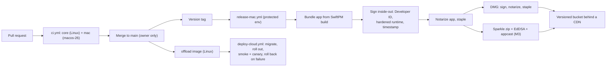
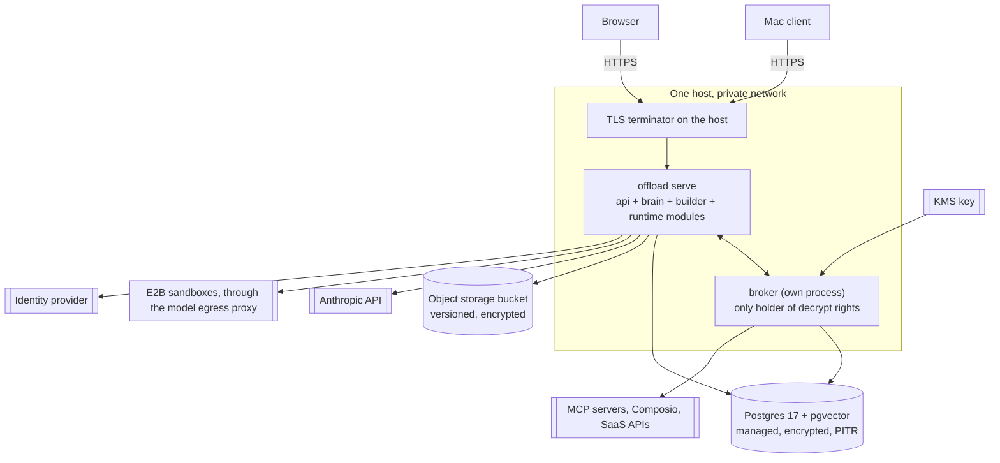

# Deployment

How Offload v2 gets onto a Mac, into the cloud for the tenant of one, and onto a self-hoster's machines; what CI
does; which environments exist; how secrets are handled; and what the owner must do first. Words follow
[GLOSSARY.md](GLOSSARY.md). Ported where still valid from PR #42 `docs/DEPLOYMENT.md` (`D§`), the
`ci/mac-release-workflow` branch and PR #41 ([MIGRATION.md section 5](MIGRATION.md#5-per-pr-port-plans)). Shell
commands are the intended recipe, confirmed on the first signed build (spike S1); anything not yet confirmed says so.

## 1. Overview

| Question | Answer |
|---|---|
| How do people get the Mac client? | A Developer ID signed, notarized, stapled disk image (`Offload-<version>.dmg`) with `Offload.app` and an Applications shortcut. Not the Mac App Store: the App Store requires the App Sandbox, which blocks the Accessibility API on other apps |
| How does it update? | Sparkle 2 from M3, when the Mac app starts running every day: signed appcast, EdDSA-signed archives, a beta channel, phased rollout. Before that, a new DMG |
| What must never change? | The bundle id and the Apple Team ID. macOS ties Accessibility and Screen Recording grants to them |
| Where does the cloud run first? | One host for the tenant of one: `offload serve` (the four modules in one process) plus the separate `offload broker` process, managed Postgres 17 with pgvector, an object storage bucket, a KMS key, in the region from [OQ-01](OPEN_QUESTIONS.md#oq-01-cloud-hosting-provider-and-region) (default AWS `ca-central-1`) |
| How do self-hosters run it? | `infra/docker-compose` now: Postgres 17 + pgvector; `offload serve`, `offload broker` and S3-compatible storage are added as they gain code; Helm chart at M8 |
| What builds it? | GitHub Actions. Linux for TypeScript, `macos-26` for Swift and the Mac release. Release signing secrets live only in a protected environment |
| What blocks the Mac CI today? | The GitHub token used on the old repo lacks the `workflow` scope, so workflow files could not be pushed; the macOS build is blocked until the owner re-authenticates ([section 6.4](#64-blocker-the-workflow-scope)) |



## 2. Identity: bundle id, Team ID and permissions

**Facts that drive everything here**
- macOS identifies an app for privacy grants (TCC) by its designated requirement. For Developer ID code that is the
  **bundle id plus the Team ID**, not the certificate or the version. An update signed the same way keeps its
  Accessibility and Screen Recording grants (D§5.6).
- An **ad hoc signature** has a requirement tied to that exact build, so every rebuild loses its grants. This was the
  old repo's tester friction (`app/build.sh` ad hoc builds; the `ci/mac-release-workflow` artifact was ad hoc signed).
- `swift build` output is a bare executable, not an app bundle. Run from Terminal, its grants land on Terminal and
  reset on rebuild. So the capture milestone's exit (M3: a full working day captured on the owner's Mac) needs a
  **bundled, consistently signed app**. Signing is not an M8 task.

**Rules**
- One bundle id, decided before the first signed build, on a domain the owner controls. Default: `ai.offload.mac`,
  dev builds `ai.offload.mac.dev` ([OQ-16](OPEN_QUESTIONS.md#oq-16-mac-distribution-and-signing), operator item O2). If
  the owner does not control `offload.ai`, use a reverse-DNS id under `consultance.ai` instead; either way it is
  locked once.
- Development builds use `<bundle-id>.dev`, so a developer's grants, Keychain items and local buffer never collide
  with an installed release build. Dev builds are signed with a stable Apple Development identity (or one stable
  self-signed identity per developer Mac), never ad hoc, so grants persist across rebuilds.
- The Keychain service name and the local buffer folder derive from the bundle id (`<bundle-id>` and
  `~/Library/Application Support/<bundle-id>/`), so dev and release never share keys or data.
- The Team ID comes from enrolling consultance.ai as an organization in the Apple Developer Program
  ([section 10](#10-operator-items), O1). It never changes for the life of the product.
- Release builds are never ad hoc signed.

**Spike S1 (before M3 exit, needs O1 or at least an Apple Development identity)**: on a signed build, record what
System Settings lists for Accessibility and Screen Recording when capture runs inside the app process; update to a
second build and re-check; if two certificates exist, update across them; build the per-macOS-version table of
Settings deep links (14, 15, 26) with fallbacks; capture the real system dialogs for onboarding copy. Spike S2:
measure how often macOS re-asks for screen-capture consent for Offload's capture pattern (at most one single-window
frame per 30 s, only when Accessibility text is thin) on macOS 15 and 26.

## 3. Signing, notarization and the disk image

### 3.1 Bundle layout

```
Offload.app/Contents/
  Info.plist
  MacOS/Offload                 the Mac client (capture, masking, uploader, UI in one process)
  Frameworks/Sparkle.framework  from M3
  Resources/                    assets, localized strings, third-party notices
```

No bun, no brain, no JIT entitlements: the old bundle's `Helpers/bun`, `brain.entitlements` and bundled brain are
gone ([MIGRATION.md section 2.5](MIGRATION.md#25-app-swiftui--appsmac)). SwiftPM builds the executable; a bundling
step in the release workflow and in the CI `mac` job assembles `Contents/`, writes `Info.plist`, and copies
resources. Rules checked on every built bundle: no Mach-O under `Resources/`; every executable signed; a third-party
notices file present; size budget (planning figure 50 MB, replaced by a measurement).

### 3.2 Info.plist keys

| Key | Value |
|---|---|
| `CFBundleIdentifier` | the locked bundle id ([section 2](#2-identity-bundle-id-team-id-and-permissions)) |
| `CFBundleShortVersionString`, `CFBundleVersion` | `MAJOR.MINOR.PATCH`; a build number from the CI run that only ever increases (Sparkle compares it) |
| `LSMinimumSystemVersion` | `14.0` ([ADR 0024](adr/0024-client-stacks.md)) |
| `LSUIElement` | `true` (menu bar app) |
| `NSScreenCaptureUsageDescription` | "Offload reads what's on screen, on this Mac, to understand your work." |
| `SUFeedURL`, `SUPublicEDKey`, `SURequireSignedFeed`, `SUVerifyUpdateBeforeExtraction` | from M3 ([section 4](#4-updates-sparkle-2-from-m3)) |
| `LSApplicationCategoryType` | `public.app-category.productivity` |

### 3.3 Entitlements

Hardened runtime on. Accessibility and Screen Recording are permission grants, not entitlements, so the app needs no
entitlement for capture. The uploader is ordinary outbound HTTPS from a non-sandboxed app.

From M6 the actuator (`OffloadActuator`, linked into the app) can send reviewed Apple Event templates to other apps
([ARCHITECTURE section 12](ARCHITECTURE.md#12-execution-placement-and-the-mac-actuator)). Under the hardened runtime
that needs `com.apple.security.automation.apple-events` and an `NSAppleEventsUsageDescription` ("Offload carries out
steps you approve in other apps."). Both are added in the actuator slice, not before.

### 3.4 Signing order

Inside-out, never `--deep` (D§3.2). Every `codesign` call uses `--options runtime --timestamp` and the Developer ID
Application identity.
1. From M3: Sparkle's nested helpers one by one, then `Sparkle.framework`. The app is not sandboxed, so Sparkle's XPC
   services can be removed before signing.
2. `Offload.app`.

### 3.5 Notarize, staple, package

```bash
# 1. Notarize and staple the app (the app carries its own ticket)
ditto -c -k --sequesterRsrc --keepParent Offload.app Offload-notarize.zip
xcrun notarytool submit Offload-notarize.zip \
  --key "$ASC_KEY_PATH" --key-id "$ASC_KEY_ID" --issuer "$ASC_ISSUER_ID" --wait
xcrun stapler staple Offload.app && xcrun stapler validate Offload.app

# 2. Disk image for first installs: stapled app + Applications shortcut
hdiutil create -volname "Offload" -srcfolder stage/ -ov -format UDZO "Offload-$VERSION.dmg"
codesign --sign "$SIGN_IDENTITY" --timestamp "Offload-$VERSION.dmg"
xcrun notarytool submit "Offload-$VERSION.dmg" --key "$ASC_KEY_PATH" --key-id "$ASC_KEY_ID" --issuer "$ASC_ISSUER_ID" --wait
xcrun stapler staple "Offload-$VERSION.dmg"

# 3. From M3: Sparkle archive is a zip of the stapled app
ditto -c -k --sequesterRsrc --keepParent Offload.app "Offload-$VERSION.zip"
```

- On failure, `xcrun notarytool log <submission-id>` is uploaded as an artifact.
- Stapling lets the first launch pass Gatekeeper offline. A zip cannot be stapled or signed; a disk image can.
- Apple's notary service usually answers within minutes and allows 75 submissions a day (D§4.1).
- Verify on the runner and again on a clean Mac:

```bash
codesign --verify --strict --verbose=2 Offload.app
codesign -d --verbose=4 Offload.app        # identity, Team ID, runtime flag, timestamp
spctl --assess --type execute --verbose=4 Offload.app   # expect: accepted, source=Notarized Developer ID
xcrun stapler validate Offload.app
```

**Certificates.** A Developer ID Application certificate is valid for one year; renew 30 days ahead. Software
signed with a secure timestamp keeps running after expiry; a new certificate is only needed for new releases. A
renewed certificate under the same Team ID keeps the designated requirement, so grants should persist (confirmed in
spike S1). A revoked certificate blocks every build signed with it, so the private key lives only in the CI secret
store and one offline backup.

### 3.6 Before Developer ID exists

Until O1 lands, the owner's own Mac runs a `.dev` build signed with his Apple Development identity (a free personal
team is enough for one Mac), built locally from `apps/mac`. Grants persist across rebuilds because the identity is
stable. Nobody else installs it. This is enough for M3 on the tenant of one; any second Mac needs the notarized DMG.

## 4. Updates (Sparkle 2, from M3)

From PR #42 D§5, still valid.
- **Integration.** Sparkle 2 through SwiftPM, version and checksum pinned (PR #42 named 2.10.1; check the current 2.x
  and its security fixes when integrating, and review the pin monthly). Sparkle is MIT; it goes into
  [NOTICE](../NOTICE) with the change. A new dependency needs an ADR.
- **Behaviour.** `SPUStandardUpdaterController`: a daily check, "Check for Updates…" in the menu, Sparkle's standard
  UI. Before installing, the app flushes the upload queue and stops capture cleanly.
- **Keys.** EdDSA private key (from `generate_keys`) signs archives, deltas and the feed; it lives only in the
  protected `release` environment plus one offline backup. Public key in `SUPublicEDKey`. Never rotate the Apple
  certificate and the EdDSA key in the same release.
- **Feed.** One appcast at `https://downloads.<domain>/appcast.xml`, generated by `generate_appcast`, with deltas.
  Static files in a versioned private bucket behind a CDN; the update check carries no identity.
- **Channels.** Tester items carry `sparkle:channel` "beta"; the app opts in from Settings ("Get early builds").
  Security fixes are marked `sparkle:criticalUpdate`.
- **Rollout.** Beta first; after at least 24 hours with no blocker, promote to stable with
  `sparkle:phasedRolloutInterval` (seven groups). For the tenant of one this is a formality; it matters from the
  first outside tester.
- **Halt and roll forward.** Sparkle only moves forward. Halt = remove the item from the appcast. Roll forward =
  publish the previous good code as a higher version, critical if needed. Keep the last five archives.
- **Permissions across updates.** Same bundle id and Team ID, so grants stay. After each update the app checks both
  permissions and shows the quiet repair banner if one is missing ([ONBOARDING.md section 11](ONBOARDING.md#11-coming-back-re-consent-lost-permissions-restarts)).

## 5. Install and test guide

Rewrite of PR #41's `INSTALL_AND_TEST.md` and the old `app/INSTALL-TESTERS.md` for a notarized build. Ships as
`INSTALL_AND_TEST.md` next to each release artifact.

1. **Download** `Offload-<version>.dmg` from the release (or the CI artifact `Offload-mac-<sha>` for a test build).
2. **Open the disk image**, drag Offload to Applications, open it from Applications. Expect one macOS confirmation
   ("downloaded from the internet"). No trip to System Settings to allow an unidentified developer; if you see one,
   the build is not notarized: stop and report it.
3. **Permissions.** Turn on Accessibility, then Screen Recording, from the onboarding screen; each row ticks within
   2 seconds. Quit and reopen when asked.
4. **First proof.** Keep working for a minute; the "last 10 minutes" line appears with your real apps. Nothing has
   been sent yet.
5. **Sign in** in the browser, read "What leaves your Mac", choose **Start sending** (or keep it local).
6. **What to expect.** Today fills after the first upload (every 5 minutes). A first suggested fix usually needs two
   or three working days, or a first read from two connected apps. The weekly review lands at your review slot.
7. **Logs.** Settings, Help, **Save a diagnostic file** writes a content-free bundle (versions, permission states,
   upload ledger counts, error classes; no screen text, no titles). Send that file; never send the local buffer.
8. **Remove.** Settings, Privacy, **Delete everything on this Mac**, then drag the app to the Bin. Cloud data is
   removed from Settings, Privacy, **Delete my data in the cloud** (`POST /v1/me/forget`, scope `all`).

## 6. CI

### 6.1 Runners (facts as of 2026-11-14)

| Job | Runner | Notes |
|---|---|---|
| `core`: bun install, typecheck, tests, license boundary, slices, doc links, copy, secrets | `ubuntu-24.04` | As in `.github/workflows/ci.yml` today. Bun pinned |
| `mac`: Swift build and test, bundle, snapshot tests | `macos-26` | PR #41's app build and every app Swift test passed on `macos-26` (GA 2026-02, macOS 26 SDK). Hosted macOS 14 images were retired on 2026-11-02, so the macOS 14 minimum is checked on a self-hosted or local Mac |
| `release-mac`: sign, notarize, staple, DMG, Sparkle (M3) | `macos-26`, hosted only | A clean machine per run; signing secrets never touch a persistent runner |
| Postgres-backed tests (RLS, roles, partitions, durable runtime) | `ubuntu-24.04` with a Postgres 17 + pgvector service container | Real Postgres in CI, not an embedded substitute |

Hosted macOS minutes cost about ten times Linux minutes; path filters keep the `mac` job to changes under `apps/mac`,
`packages/contracts` (generated Swift types) and the workflow files. The old repo ran out of hosted minutes
(old `LAUNCH.md`); CI capacity is an operator item (O12).

### 6.2 Job shape for the `mac` job and `release-mac.yml`

Ported from `ci/mac-release-workflow` (`3833218`), which was never pushed:
- `runs-on: macos-26`; `sudo xcode-select -s /Library/Developer/CommandLineTools`; print `swiftc --version`,
  `xcrun --show-sdk-version`, `sw_vers`, `uname -m`.
- Pinned bun with a lockfile cache (for contract generation); `bun install --frozen-lockfile`.
- Build, bundle, sign (ad hoc in PR CI, Developer ID only in `release-mac.yml`), `codesign --verify --strict`, zip with
  `ditto -c -k --sequesterRsrc --keepParent`.
- **Upload the artifact before the tests**, so a red test never hides a build you can install.
- **Smoke-test the installed app from a copy outside the repo**: copy with `ditto` into a temp folder, run it with an
  empty environment (`env -i HOME=<temp> PATH=/usr/bin:/bin:/usr/sbin:/sbin`) in a self-check mode that starts
  capture against a fake permission source and exits 0.
- Each suite is its own step with its own `timeout-minutes` and `continue-on-error: true`; a final step fails the job
  if any suite failed and prints each outcome.
- Job timeout 150 minutes with its own budget for the slice loop (the old 45-minute mac job timed out in its slice
  loop because every slice verify rebuilt the app).
- `concurrency` per ref with `cancel-in-progress`; `permissions: contents: read`; `TZ=UTC`, `LANG`/`LC_ALL=en_US.UTF-8`.

### 6.3 Workflows

| Workflow | Trigger | Jobs |
|---|---|---|
| `ci.yml` | pull request, push to `main` | `core`, `mac` (path-filtered), Postgres-backed tests |
| `release-mac.yml` | version tag or manual, `release` environment with a required reviewer | Bundle, sign, notarize, staple, DMG, checksums, notices file, debug symbols; from M3 the Sparkle archive, EdDSA signature, appcast entry and deltas, published to the beta channel |
| `promote-mac.yml` (M3) | manual | Promote beta to stable with phased rollout, halt, or re-release a previous build as a higher version |
| `deploy-cloud.yml` | push to `main` (when the cloud exists), manual approval for production | Build and scan the image, migrate, roll out, smoke and canary checks, roll back on failure ([section 7.3](#73-deploy-pipeline)) |
| `nightly.yml` | schedule | Masking evaluation corpus, dependency and secret scans, the canary no-content-logging check against the live cloud |

Actions are pinned by commit hash. No secret is exposed to `pull_request` workflows, and no workflow with secrets
runs code from a fork.

### 6.4 Blocker: the `workflow` scope

- On the old repo, the GitHub token lacked the `workflow` scope, so `.github/workflows/mac-release.yml`
  (`ci/mac-release-workflow`) and `builder-mac.yml` (PR #45, parked as `slices/s35-build-loop/builder-mac.yml.proposed`)
  could not be pushed. The macOS CI build of the old app is blocked until the owner re-authenticates with that scope
  (`gh auth refresh -s workflow`, run by the owner).
- v2 is a local repository with no remote. When it gets one, the same scope is needed before `ci.yml` and
  `release-mac.yml` can be pushed. Agents never create remotes or push ([CLAUDE.md](../CLAUDE.md)).
- Until then, the Swift side is verified on the owner's Mac (`swift build && swift test` in `apps/mac`, then the
  bundling script) and recorded in the slice's verify output.

## 7. Cloud deploy for the tenant of one

### 7.1 Topology

The smallest setup that keeps the security design intact: managed Postgres for encryption at rest and point-in-time
recovery, a KMS key for envelope encryption, and one host for the services.



| Piece | Choice for the tenant of one | Notes |
|---|---|---|
| Region | [OQ-01](OPEN_QUESTIONS.md#oq-01-cloud-hosting-provider-and-region) default AWS `ca-central-1` | Everything in one region |
| Compute | One VM or container host running two containers: `offload serve` (the api, brain, builder and runtime modules in one process) and `offload broker` ([ADR 0023](adr/0023-service-layout.md)) | The broker is a separate process because it alone may decrypt connector credentials. Splitting modules into processes is a deploy change, an option at M8. Two hosts behind a load balancer before the first user other than the owner |
| Database | Managed Postgres 17 with pgvector, encrypted with a customer-managed key, no public address, TLS required, automated backups with point-in-time recovery (7 days) | Encryption is chosen at creation. Services connect as `offload_app` (no `BYPASSRLS`); migrations run as `offload_migrator` ([ADR 0013](adr/0013-tenancy-and-rls.md)) |
| Object storage | One bucket, versioned, server-side encryption with the KMS key | Fixtures, artifacts, exports. The download bucket for DMGs and the appcast is separate and public through a CDN |
| Keys | One KMS key per environment for the database and for envelope encryption of the credential vault | `OFFLOAD_KMS_KEY_REF` names it. Only the broker's role may use the key for decrypt |
| Sandboxes | E2B ([OQ-08](OPEN_QUESTIONS.md#oq-08-sandbox-provider-for-cloud-builds)) | Egress allowlist per build |
| Identity | [OQ-06](OPEN_QUESTIONS.md#oq-06-identity-provider-for-offload-cloud) default | One OAuth client for the Mac and web |
| DNS and TLS | `api.<domain>`, `downloads.<domain>`; managed certificates | Domain is an operator item |

### 7.2 Backups and recovery

- Postgres point-in-time recovery; a restore is rehearsed once before M2 exit.
- Object storage versioning; lifecycle rules match the retention classes in [DATA_MODEL.md](DATA_MODEL.md).
- Targets for the tenant of one: recovery point 5 minutes, recovery time 4 hours. If the cloud is down, the Mac keeps
  capturing into its 7-day buffer and uploads when it is back.

### 7.3 Deploy pipeline

1. Build the `offload` image (one image; `offload serve` and `offload broker` are two entry points) from the workspace with the
   pinned Bun; scan it; tag it with the commit.
2. Run migrations as a one-off job as `offload_migrator`. Migrations are backward compatible with the running
   version; a destructive change says so in its slice spec.
3. Replace the containers one at a time with health checks; the previous image stays until the new one is healthy.
4. Run smoke tests (`GET /v1/me` with a test principal, one ingest batch from a test device) and the canary
   no-content-logging check ([section 8](#8-observability-without-content)).
5. On failure, return to the previous image tags automatically.

Production is the only cloud environment while there is one tenant. A staging stack from the same definitions is
added before the first user other than the owner. Infrastructure is code (Terraform or CDK, picked in an ADR when
the cloud slice starts), state stored remotely with locking, no manual console changes.

## 8. Observability without content

- Logs are structured and limited to: request id, tenant id, member id, device id, route, model id, token counts,
  status, latency, error class. A log-schema test rejects any other field.
- Request and response bodies are never logged, at any layer: application, TLS terminator, tracing, error reports.
- **Canary check** after every deploy and nightly: a request carrying a fake canary string goes through ingest, the
  model router and the connector broker, then the canary is searched for in logs, metrics, error reports and every
  database column not on the content allowlist. Any hit fails the deploy.
- **Column allowlist**: a test lists which columns may hold masked observation text, masked titles or drafts; a new
  free-text column fails CI until it is added on purpose.
- Alarms: error rate, latency, model spend per tenant against the monthly budget, build spend against the $4 cap,
  authentication failures, ingest rejections (`leak_detected` spikes), durable-runtime queue depth.

## 9. Release checklist

**Before tagging**
- [ ] CI green on the commit (`core`, `mac`, Postgres-backed tests); nightly masking and canary runs green in the
      last 24 hours.
- [ ] Version and build number bumped; plain-words changelog.
- [ ] No new sub-processor, or the "What leaves your Mac" notice version is bumped
      ([ONBOARDING.md section 6](ONBOARDING.md#6-screens-4-and-5-sign-in-and-what-leaves-your-mac)).
- [ ] Dependency pins reviewed (Sparkle from M3); third-party notices file regenerated from [NOTICE](../NOTICE).

**Release workflow output**
- [ ] `codesign --verify --strict` passes for the app and every nested executable; entitlements as in
      [section 3.3](#33-entitlements).
- [ ] `spctl --assess` reports a notarized Developer ID app; `stapler validate` passes for the app and the DMG.
- [ ] No Mach-O under `Resources/`; within the size budget.
- [ ] From M3: appcast entry present, EdDSA signature valid, deltas generated.

**On a clean Mac (macOS 15 and 26; macOS 14 on a local or self-hosted Mac)** (from PR #41's
`MAC_BUILD_CHECKLIST.md` and D§10)
- [ ] Download, open the DMG, drag, open: one standard confirmation, no block.
- [ ] Onboarding completes; one "Offload" entry under Accessibility and one under Screen Recording.
- [ ] From M3: update from the previous release and from two back; relaunches with permissions and the local buffer
      intact.
- [ ] Delete everything on this Mac leaves nothing behind; the upload queue is empty.
- [ ] Snapshot tests re-recorded where screens changed, light and dark.

## 10. Operator items

Things only the owner can do. The canonical list is [ROADMAP M0](ROADMAP.md#operator-items); the numbers below are the
same, with the deployment detail added. Decisions among these are open questions.

| # | Item | Deployment detail | Lead time | Needed by |
|---|---|---|---|---|
| O1 | Apple Developer Program enrolment for consultance.ai as an **organization** | Needs a legal entity, a D-U-N-S Number, a domain email and a public website; $99 a year. The seller name people see is the organization's. The Account Holder creates the Developer ID Application certificate | Days to weeks (D-U-N-S) | M3 (signed app); start in M0 |
| O2 | Lock the bundle id (`ai.offload.mac`, dev `ai.offload.mac.dev`) | Irreversible in practice: changing it resets every user's permissions and orphans Keychain items ([section 2](#2-identity-bundle-id-team-id-and-permissions)) | Minutes, a decision | M3; before any signed build reaches a tester |
| O3 | Developer ID certificate and notarization credentials as CI secrets | `DEVELOPER_ID_P12_BASE64`, `DEVELOPER_ID_P12_PASSWORD`, an App Store Connect API key (`ASC_KEY_ID`, `ASC_ISSUER_ID`, `ASC_KEY_P8`) in the protected `release` environment; one offline backup. Renew the certificate yearly, 30 days ahead | A day, after O1 | M3 |
| O4 | Re-authenticate GitHub with the `workflow` scope | [Section 6.4](#64-blocker-the-workflow-scope) | Minutes | M0 (CI `mac` job) |
| O5 | Google Cloud project and an Internal OAuth client (login and Google connectors) | Redirect URIs for the web and the Mac loopback flow; an Internal client avoids Google verification for the tenant of one. Restricted Gmail scopes for outside users need verification and a security assessment later | Hours (Internal); weeks for verification | M1 (login), M2 (connectors) |
| O6 | E2B account and API key | Key in the cloud secrets manager; build egress through the model egress proxy | Hours | M2 exit |
| O7 | Cloud host account and region ([OQ-01](OPEN_QUESTIONS.md#oq-01-cloud-hosting-provider-and-region)) | Managed Postgres 17 with pgvector, a bucket, a KMS key, one host ([section 7](#7-cloud-deploy-for-the-tenant-of-one)) | A day | M1 deploy |
| O8 | Anthropic API organisation with a spend limit ([OQ-05](OPEN_QUESTIONS.md#oq-05-model-provider-terms-and-monthly-model-budget)) | Key in the cloud secrets manager; spend alarms ([section 8](#8-observability-without-content)) | Hours | M2 |
| O9 | Composio project with a toolkit allowlist; zero-retention add-on before any second user | Its default payload logging matters for the "What leaves your Mac" screen | Weeks (vendor) | M2 if a Composio app is used; M8 |
| O10 | Anthropic zero data retention agreement | Changes the wording allowed on the privacy screen | Weeks (vendor) | Before any second user (M8) |
| O11 | Sparkle EdDSA signing key and appcast host | `SPARKLE_ED_PRIVATE_KEY` in the `release` environment plus one offline backup; `downloads.<domain>` behind a CDN ([section 4](#4-updates-sparkle-2-from-m3)) | Hours | M3 |

| O12 | CI capacity for macOS ([OQ-25](OPEN_QUESTIONS.md#oq-25-ci-capacity-for-macos)) | Hosted macOS minutes, or a dedicated Mac as a self-hosted runner for PR jobs (private repo only) with hosted `macos-26` kept for releases. The old repo ran out of minutes | Same day | M0 (CI `mac` job) |
| O13 | Product domain (`api.`, `downloads.`) and TLS | DNS for the API host and the download/appcast host | A day | M1 deploy, M3 (appcast) |
| O14 | Rotate the provider key that old `LAUNCH.md` lists as exposed, and confirm old test canaries are fake | Before any old test file is ported | Same day | M1 (first port, m1-03) |
| O15 | Privacy policy, terms, sub-processor list, counsel review ([OQ-17](OPEN_QUESTIONS.md#oq-17-privacy-policy-terms-and-dpa)) | The "What leaves your Mac" screen links to them: a plain-language version for the tenant of one, counsel-reviewed before any second user | Weeks | M3 (linked from screen 5); M8 (reviewed) |

Spikes S1 (TCC attribution and persistence on a signed build) and S2 (screen-capture re-consent cadence) are in
[ROADMAP M0](ROADMAP.md#spikes); their deployment side is in [section 2](#2-identity-bundle-id-team-id-and-permissions).

## 11. Self-host

- **Now (M0 to M7):** `infra/docker-compose/compose.yaml` runs Postgres 17 + pgvector for development and the
  smallest self-host. Services are added to it as they gain code. Object storage: any S3-compatible service, or the
  local-disk adapter when `OFFLOAD_OBJECT_STORE_URL` is empty (dev only).
- **Self-host contents (M8):** the same image as the cloud (`offload serve` and `offload broker`); Postgres 17 + pgvector; S3-compatible storage;
  sandbox provider Docker or container-use on Dagger (the Docker socket is given to the builder only, preferably on a
  separate Docker host or a rootless daemon, since a build worker runs untrusted code); any OIDC provider; a model key
  of the self-hoster's own, or the optional local tier (`OFFLOAD_LOCAL_MODEL_URL`, Ollama or exo on loopback or a
  private network). The four modules run in one process by default ([ADR 0023](adr/0023-service-layout.md)); the
  broker stays separate.
- **Helm** (`infra/helm/offload`): a placeholder chart now; real templates at M8.
- **Enterprise self-host:** the same images plus the `ee/` entry point and `OFFLOAD_EE_LICENSE_KEY`
  ([OPEN_CORE.md](OPEN_CORE.md)). BYOC and dedicated deployments use the cloud definitions in the customer's account.
- **Mac client for self-hosters:** the same notarized app, pointed at the self-hoster's API host by a signed
  configuration profile or a one-time setting at sign-in; the host is pinned per device at enrollment, so a person
  cannot be tricked into switching hosts later.

## 12. Environments

| Environment | Mac build | Bundle id | Cloud | Models | Updates |
|---|---|---|---|---|---|
| Development | Local, Apple Development identity | `<bundle-id>.dev` | Local compose, or production with a test tenant for the owner | Fake model by default (tests never call real models); a real key only when a developer opts in | none |
| Production | `release-mac.yml`, Developer ID | `<bundle-id>` | The tenant-of-one cloud ([section 7](#7-cloud-deploy-for-the-tenant-of-one)) | Production Anthropic organization | DMG until M3; Sparkle stable and beta channels after |
| Staging (added before a second user) | `release-mac.yml`, Developer ID | `<bundle-id>.internal` | Same definitions as production, synthetic data only | Separate key and connector project | Internal appcast |

- The API host and downloads host are compiled into each build flavour; there is no run-time switch for the cloud
  host on Offload Cloud builds.
- Real user content never goes to development or staging.

## 13. Secrets handling

- **Names only in the repo.** `.env.example` lists variable names with empty values; `.env` is git-ignored.
  `scripts/check-secrets-hygiene.sh` runs in CI. Agents never read, print or write secret values or environment
  variable values ([CLAUDE.md](../CLAUDE.md)).
- **CI release secrets**, only in the protected `release` environment with a required reviewer:
  `DEVELOPER_ID_P12_BASE64`, `DEVELOPER_ID_P12_PASSWORD`, `ASC_KEY_ID`, `ASC_ISSUER_ID`, `ASC_KEY_P8`,
  `SPARKLE_ED_PRIVATE_KEY` (M3). The certificate is imported into a temporary keychain created for the job and
  deleted in a step that always runs.
- **Cloud deploy** uses short-lived credentials through GitHub's OIDC federation to a cloud role; no long-lived cloud
  keys in GitHub.
- **Runtime secrets** (model provider key, identity provider client secret, Composio key, E2B key) live in the cloud
  secrets manager and are read at start by the process that needs them (connector keys by the broker only). Their names match `.env.example`.
- **Per-tenant credentials** for connected apps are not environment variables: they live in the credential vault,
  envelope-encrypted with a data key wrapped by the KMS key, decrypted only inside the broker process for the call
  that needs them; models never see them ([ARCHITECTURE section 10](ARCHITECTURE.md#10-connector-and-tool-layer)).
- **Mac secrets**: the local buffer's master key and the device private key stay in the Keychain and the Secure
  Enclave; neither is ever exported or uploaded.
- **Build workers** get no long-lived secret: a per-build, capability-scoped token at most, and an egress allowlist.
- **Rotation**: provider keys on a schedule and at once after any suspected exposure; the Developer ID certificate
  yearly; the Sparkle EdDSA key only with a planned release, never together with the certificate.
