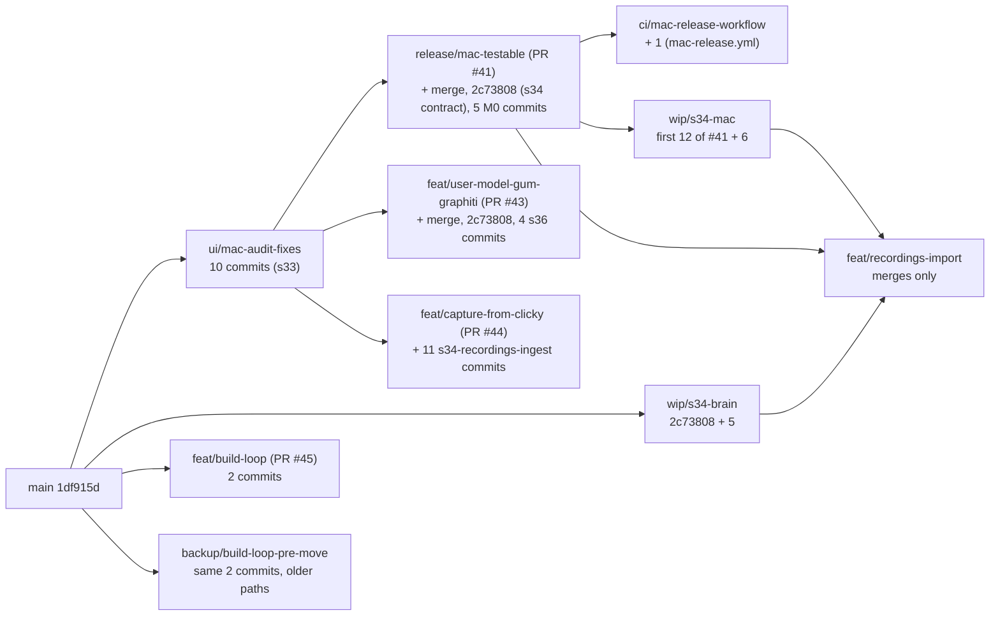

# Migration from the old repo

What v2 harvests from the old Offload repo ([`tabani-png/offload`](https://github.com/tabani-png/offload), `main` at `1df915d`, every local and `origin/*`
branch) and from the other inputs. Words follow [GLOSSARY.md](GLOSSARY.md).

**Fates.** **keep**: port the code, behaviour unchanged (tests come with it). **rewrite**: keep the idea and the
tests' intent, write new code. **drop**: not carried over. **context**: read for background; nothing is ported.

**Where things go.** The right-hand column names the v2 home by path where the skeleton already has it, and by topic
where the home is being decided (for example "the ADR on where fixes run"). Mac paths are written as
the SwiftPM targets in `apps/mac/Package.swift` (`OffloadContracts`, `OffloadStore`, `OffloadMasker`,
`OffloadObserver`, `OffloadUploader`, `OffloadImport`, `OffloadActuator`, and the app target `OffloadMac`).

**Licensing.** Old code is "all rights reserved" by its owner. Porting it under the v2 license (MIT for core, the
Offload Enterprise License for `ee/`) waits on
[OQ-12](OPEN_QUESTIONS.md#oq-12-relicensing-code-from-the-old-repo); the default is yes, relicense it (the owner owns it). Third-party code keeps its
notice in [NOTICE](../NOTICE), added in the same commit as the port.

**Review rule for ports.** Much of PR #43 and the first commits of PR #44 were written before the owner's rule that
Claude Code builds everything (PR #44 says only its post-review edits were made with Claude Code; PR #45's second
commit was a Claude Code hardening pass). So every port in this document lands through a slice: red tests first, the
code ported by a Claude Code worker, and a Claude Code (Opus) review before merge, the same as new code
([AGENTS.md](../AGENTS.md)). "keep" means the behaviour is kept, not that the code skips review.

## Contents

1. [Inputs read](#1-inputs-read)
2. [Old repo parts](#2-old-repo-parts) (root and harness, plan docs, old ADRs, engine, app, brain, control plane,
   packages, schemas, web, compliance, docs and scripts, old slices)
3. [Things deliberately changed](#3-things-deliberately-changed)
4. [Branches](#4-branches) (every branch, how they stack)
5. [Per-PR port plans](#5-per-pr-port-plans) (#41, `ci/mac-release-workflow`, #42, #43, #44, #45, and the s34 import
   branches)
6. [NOTICE files and other gaps found](#6-notice-files-and-other-gaps-found)

## 1. Inputs read

| Input | Used for |
|---|---|
| Old repo `main` and every branch (below) | sections 2 to 5 |
| PR summaries #41 to #45 ([old repo pull requests](SOURCES.md#old-repo-pull-requests)) | section 5 |
| [product spec (M0 to M9)](SOURCES.md#product-spec-m0-to-m9) (M0 to M9 spec, onboarding questions, memory design, ranking formula, Clicky teardown, Mem0/Cognee vs gum+graphiti, recap UI refs) | [ARCHITECTURE sections 5 and 6](ARCHITECTURE.md#5-cloud-brain-and-user-model), [ONBOARDING.md](ONBOARDING.md), [ROADMAP](ROADMAP.md), [ADR 0019](adr/0019-user-model-storage.md) |
| [repo scout log](SOURCES.md#repo-scout-log) (scouted repos, licenses, fit scores) | sandbox, connector and memory choices; [NOTICE](../NOTICE) |
| Research Page "approve → build → ship" | build pipeline, verifier, receipts, layered user model |
| Mockups Page (onboarding, Today, Weekly review, Build progress) | [PRODUCT.md section 4](PRODUCT.md#4-screens), [ONBOARDING.md](ONBOARDING.md) |
| [builder bench report](SOURCES.md#builder-bench-report) | [ADR 0012](adr/0012-builder-policy-one-worker-held-out-fan-out.md) |
| [pricing LEARNINGS](SOURCES.md#pricing-learnings) | [PRODUCT.md copy rules](PRODUCT.md#copy-rules), [ONBOARDING.md copy](ONBOARDING.md#13-copy-accessibility-and-test-hooks) |
| PR #42 plan docs (`docs/architecture-plan`, 7 files) | [section 5.3](#53-pr-42-docsarchitecture-plan-plan-documents); [ONBOARDING.md](ONBOARDING.md), [DEPLOYMENT.md](DEPLOYMENT.md) |

## 2. Old repo parts

### 2.1 Root files and harness

| Old path | Fate | v2 home | Why |
|---|---|---|---|
| `README.md` | context | [README.md](../README.md) | Old product pitch (local brain, 7-day promise) no longer true |
| `LICENSE` ("all rights reserved") | drop | `LICENSE` (MIT core, [OQ-11](OPEN_QUESTIONS.md#oq-11-license-for-the-core-and-for-ee) decided) | Relicensing is [OQ-12](OPEN_QUESTIONS.md#oq-12-relicensing-code-from-the-old-repo) |
| `AGENTS.md`, `CLAUDE.md`, `docs/adam-rules.md`, `docs/adam-folder-contract.md` | rewrite | [AGENTS.md](../AGENTS.md), [CLAUDE.md](../CLAUDE.md) | Same rules (tests first, scope, no merge to main), one place |
| `adam.json` (`tests_first_strict`, `max_parallel_builders: 4`, `auto_merge_to_main: false`) | rewrite | AGENTS.md | Same intent; no separate config file |
| `adam/context/*`, `adam/memory/*` (founder, preferences, research notes incl. `research/11-rea-clicky.md`) | context | | Background on the owner and earlier research; nothing to port |
| `agent-control/*` (16 status files) | drop | | Mostly unfilled templates; state lives in slices and git |
| `packet/PACKET.md` | context | [PRODUCT.md](PRODUCT.md) | The original ask; v2's brief supersedes it |
| `orchestration-runs/` | drop | | Run logs only |
| `LAUNCH.md` (launch readiness 2026-10-26) | context | [DEPLOYMENT.md](DEPLOYMENT.md#10-operator-items) | Its open items (CI minutes, a key to rotate, secret-scan debt) are re-stated as operator items |
| `.github/workflows/ci.yml` (`main`) | rewrite | `.github/workflows/ci.yml` | v2 workspace jobs; the `macos-26` pin carries over; the `xcode-select` step now selects Xcode instead of CLT so Swift Testing is available ([DEPLOYMENT.md section 6](DEPLOYMENT.md#6-ci)) |

### 2.2 Plan docs

| Old path | Fate | v2 home | Why |
|---|---|---|---|
| `plan/CONTEXT.md` (shared language) | rewrite | [GLOSSARY.md](GLOSSARY.md) | One glossary |
| `plan/plan.md` | context | [ROADMAP.md](ROADMAP.md) | Stage 1 plan; milestones re-sequenced |
| `plan/stage-2/plan.md`, `plan/stage-2-org.md` | context | [ROADMAP M8, M9](ROADMAP.md) | Company product, re-scoped as Pro and Enterprise |
| `plan/stage-2/API.md` | context | [API.md](API.md) | Endpoint shapes inform the v2 contract; not copied |
| `plan/stage-2/CONTEXT.md` | rewrite | [GLOSSARY.md](GLOSSARY.md) | Tenancy and team terms |
| `docs/store-contract.md` | context | Mac local store (the observer part of [ARCHITECTURE section 1](ARCHITECTURE.md#1-mac-client)) | Day-file layout stays on the Mac; the brain no longer reads it |
| `docs/SETUP.md` | drop | [README.md](../README.md), [DEPLOYMENT.md](DEPLOYMENT.md) | Developer setup for the local brain |
| `docs/media/*` (launch poster and video) | drop | | Marketing assets for the old product |

### 2.3 Old ADRs

Every old ADR, including branch-only ones and duplicate numbers. "Superseded" means the v2 ADR replaces it.

| Old ADR | Fate | v2 home |
|---|---|---|
| `plan/adr/0001-new-repo-reuse-workpaper` | context | [ADR 0001](adr/0001-record-decisions-and-v2-scope.md) |
| `0002-plain-swiftc` | superseded | [ADR 0024](adr/0024-client-stacks.md) (SwiftPM) |
| `0003-metadata-first-privacy` | kept as principle | [ADR 0006](adr/0006-metadata-first-capture.md) |
| `0004-agent-sdk-execution` | rewrite | [ADR 0010](adr/0010-mcp-first-connectors.md), [ADR 0021](adr/0021-model-router-and-builders.md) |
| `0005-deterministic-numbers` | kept as principle | [ADR 0003](adr/0003-numbers-come-from-code.md) |
| `0006-approval-gates` | kept as principle | [ADR 0004](adr/0004-every-external-action-is-gated.md) |
| `0007-perception-any-domain` | rewrite | [ADR 0005](adr/0005-masked-text-only-reaches-models.md), [ADR 0006](adr/0006-metadata-first-capture.md), connector chain in [ADR 0010](adr/0010-mcp-first-connectors.md); "pixels never leave" kept, cloud captioning of frames dropped |
| `0008-anthropic-sdk-computer-use` | rewrite | browser steps: attended on the Mac through the actuator, or a cloud sandbox for no-MFA service accounts ([ADR 0025](adr/0025-execution-placement-and-mac-actuator.md)); connectors in [ADR 0010](adr/0010-mcp-first-connectors.md); computer-use builders in [ADR 0021](adr/0021-model-router-and-builders.md) |
| `0009-model-router` | keep | [ADR 0021](adr/0021-model-router-and-builders.md) |
| `0010-name-masking` | keep | [ADR 0005](adr/0005-masked-text-only-reaches-models.md); keyed pseudonyms are a separate v2 topic ([ADR 0028](adr/0028-stable-keyed-pseudonyms.md)) |
| `0011-messaging-playbook`, `0012-playbook-review-fixes` | keep as code | Playbook and tone (see brain `playbook/`, `tone/` rows); no new ADR |
| `0013-safe-builder` (proposed) and its s35 addendum on `feat/build-loop` (containers per shard, `OFFLOAD_BUILDER_ENABLED`) | superseded | [ADR 0011](adr/0011-sandboxed-build-workers.md), [ADR 0012](adr/0012-builder-policy-one-worker-held-out-fan-out.md) |
| `0014-standalone-brain-bundle` | drop | [ADR 0007](adr/0007-cloud-brain-thin-mac-client.md): no brain on the Mac |
| `0015-read-steps` | keep (rules) | runtime reads in [ARCHITECTURE section 11](ARCHITECTURE.md#11-routine-runtime); [ADR 0004](adr/0004-every-external-action-is-gated.md) |
| `0016-brand-logos` (branch-only: `ui/mac-audit-fixes`, in PR #41) | open | [OQ-20](OPEN_QUESTIONS.md#oq-20-brand-logos-in-the-app) |
| `0016-retention-30-days` (branch-only: `origin/s32-retention-30d`) | open | [OQ-02](OPEN_QUESTIONS.md#oq-02-raw-ttl-for-masked-observations-in-the-cloud) (30-day metadata default; text 7 days); local Mac buffer TTL in [ARCHITECTURE section 1](ARCHITECTURE.md#1-mac-client) |
| `plan/stage-2/adr/0101-multi-tenant-rls` | keep (pattern) | [ADR 0013](adr/0013-tenancy-and-rls.md) |
| `0102-identity-rbac` | rewrite | [ADR 0014](adr/0014-identity.md) |
| `0103-sync-protocol` | rewrite | [ADR 0020](adr/0020-device-ingest-protocol.md) |
| `0104-workflow-registry` | rewrite | routines and versions in [DATA_MODEL.md](DATA_MODEL.md#7-routines-and-runs) (`definition_hash` kept) |
| `0105-cloud-workers-managed-agents` | drop for v2 runtime | Possible sandbox provider only ([ADR 0011](adr/0011-sandboxed-build-workers.md)). Its quiet-hours window (01:00 to 03:59) is the source of the runtime's quiet hours |
| `0106-overnight-policy` | rewrite | quiet hours and circuit breakers in [ARCHITECTURE section 11](ARCHITECTURE.md#11-routine-runtime); graduation in [ADR 0016](adr/0016-no-dry-run.md); [ADR 0017](adr/0017-policy-engine-cedar.md) is the engine only. The quiet window comes from old 0105, not 0106. `dryRunNights` dropped |
| `0107-continuity-offboarding` | rewrite later | Enterprise hand-over and offboarding of routines (M9 scope; see [section 6](#6-notice-files-and-other-gaps-found)) |
| `0108-monitoring-compliance` | keep (records) | [SECURITY_PRIVACY.md section 12](SECURITY_PRIVACY.md#12-compliance-notes-not-legal-advice), [ADR 0018](adr/0018-audit-log-hash-chain.md), [OQ-15](OPEN_QUESTIONS.md#oq-15-monitoring-law-features-for-teams) |
| `0109-hours-saved-metric` | keep | [ADR 0022](adr/0022-hours-saved-hs-1.md) |
| `0110-control-plane-stack` | keep (stack) | [ADR 0002](adr/0002-stack-bun-typescript-hono-postgres.md); Ajv on `schemas/stage2` replaced by zod in `packages/contracts` ([ADR 0008](adr/0008-contracts-first.md)) |
| `0111-wave-a-contract-amendments` (loopback PKCE device enrollment, RFC 8252 + 7636 S256) | keep | [ADR 0014](adr/0014-identity.md), slice m1-04 |
| `0112-cloud-workers-contract-notes` | drop | Managed Agents workers are not in v2 |
| `0112-playbook-on-promotion` (proposed) | rewrite later | A shared fix carries its de-personalised playbook; no v2 home until shared fixes exist (Pro, M8) |
| `0112-s2-07-review-b-amendments` (a policy approval holds only while the policy allows it) | rewrite | The rule "narrowing a policy revokes unspent approvals" is kept for routine approvals ([ADR 0004](adr/0004-every-external-action-is-gated.md)) |
| `0113-s2-07-review-round-2` (dry-run nights at execute) | drop | No dry run ([ADR 0016](adr/0016-no-dry-run.md)) |
| `0113-continuity-contract-amendments` | rewrite later | M9 with 0107 |
| `0113-metrics-floor-across-reads` (complementary suppression across reads) | keep | [ADR 0022](adr/0022-hours-saved-hs-1.md), [SECURITY_PRIVACY.md section 12](SECURITY_PRIVACY.md#12-compliance-notes-not-legal-advice) |
| `0114-dashboard-wiring` (SPA served by the control plane; no inline style or script, so the CSP needs no `'unsafe-inline'`) | keep (rule) | `apps/web`, [ADR 0024](adr/0024-client-stacks.md) |

### 2.4 Engine (Swift observer) → `apps/mac`

The NONET rule applies to `OffloadObserver`, `OffloadMasker` and `OffloadStore`. Uploads go only through
`OffloadUploader`, which acts as the Mac's egress guard ([ADR 0035](adr/0035-mac-egress-guard-and-ledger.md); see [section 5.3](#53-pr-42-docsarchitecture-plan-plan-documents)).

| Old path | Fate | v2 home | Why |
|---|---|---|---|
| `engine/Sources/OffloadCore/Capture/{CaptureTypes,ExclusionPolicy,UserExclusions,PerceptualHash,TextRecognizer,URLScrubber,WindowPlan}.swift` | keep | `apps/mac/Sources/OffloadObserver/` | Proven capture |
| `Capture/Keyframe.swift` | keep | `apps/mac/Sources/OffloadObserver/` | Throttle and renderer; stays local unless [OQ-04](OPEN_QUESTIONS.md#oq-04-keyframes-to-the-cloud) |
| `Capture/VideoFrames.swift` (`extract-frames`, `wip/s34-mac`) | keep | `apps/mac/Sources/OffloadImport/` | Recordings import ([section 5.7](#57-s34-import-branches-wips34-brain-wips34-mac-featrecordings-import)) |
| `Detectors/{Detection,DetectorChecksum,DetectorTokens,MaskCategory,Masker,ScanText,SensitiveDetector}.swift` | keep | `apps/mac/Sources/OffloadMasker/` | On-device masking ([ADR 0005](adr/0005-masked-text-only-reaches-models.md)); also the source for the server's transport scan (card, IBAN, API key, email, URL with path or query, phone), rewritten in TypeScript |
| `Model/{Clock,DayKey,Event,Log,ULID}.swift` | keep | `apps/mac/Sources/OffloadContracts/` (shared model types; `DayKey` with the store) | Fake-clock seam, ULIDs, event types |
| `Observer/{Observer,OCRExecutor,Sources,Status}.swift` | keep | `apps/mac/Sources/OffloadObserver/` | State machine and cadence constants; `Status` loses `inputMonitoring` from setup (Input Monitoring is a Settings-only option, [ONBOARDING.md](ONBOARDING.md#3-what-is-not-asked-during-setup)) |
| `Observer/{CommandLine,LaunchAgent,LogRotation}.swift` | rewrite | `apps/mac/Sources/OffloadMac/` (app part) | Capture runs inside the app process; login item by `SMAppService`, not a LaunchAgent; CLI kept for debug only. `LogRotation` logic kept |
| `Store/{DayStore,FrameStore,KeyVault,StoreCrypto,StoreLayout,Retention}.swift` | keep | `apps/mac/Sources/OffloadStore/` | AES-256-GCM day files, Keychain master key. Note: `KeyVault.swift:88` uses `kSecAttrAccessibleAfterFirstUnlockThisDeviceOnly`; the copy lint must scan only user-visible strings so this constant does not trip the banned word "unlock" |
| `Store/BrainKeys.swift` | drop | | No local brain |
| `engine/Sources/offload-observer/{main,LiveSources}.swift` | rewrite | `apps/mac/Sources/OffloadObserver/` (live sources) | `LiveInputCounter` is off by default (needs Input Monitoring); idle from `CGEventSource` needs no permission and stays |
| `engine/build.sh` (plain swiftc) | drop | `apps/mac/Package.swift` | SwiftPM ([ADR 0024](adr/0024-client-stacks.md)) |
| `engine/Tests/S01`, `S02` (CLI, focus, idle/input, OCR, pause, retention, store), `S02B` (exclusions, keys, LaunchAgent, OCR queue, status), `S02C` (brain key, export age, midnight), `S10C` (brain-key retention, logs, wrap-key import), `S11` (frame store, mask, privacy, retention CLI, throttle) | keep with their code | `apps/mac/Tests/OffloadMacTests/` | Tests travel with the code; brain-key and LaunchAgent tests drop with their code |
| `S02StoreTests.swift` `S02NoNetworkTests` | keep | `apps/mac/Tests/OffloadMacTests/` (slice m3-02) | Use the old banned list verbatim: `URLSession`, `import Network`, `NSURLConnection`, `CFNetwork`, `NWConnection`, `CFStream`, `socket(`, `URLRequest`. Applies to every Mac target except `OffloadUploader` (and the app target's API client) |
| `engine/README.md` | context | | |

### 2.5 App (SwiftUI) → `apps/mac`

| Old path (`app/Sources/…`) | Fate | v2 home | Why |
|---|---|---|---|
| `App/OffloadApp.swift` | rewrite | `apps/mac/Sources/OffloadMac/` | New app entry: menu bar item, in-process observer, uploader |
| `App/HotKey.swift` | keep | `apps/mac/Sources/OffloadMac/` | Pause hot key (Carbon hot key, no Input Monitoring) |
| `App/Snapshotter.swift` | keep | `apps/mac/Tests/` support | Snapshot tests per screen, light and dark |
| `Core/Onboarding.swift`, `Surfaces/OnboardingWindow.swift`, `Core/UserContext.swift`, `Core/UnderstandingDefaults.swift` | rewrite | `apps/mac/Sources/OffloadMac/Onboarding/` | New flow in [ONBOARDING.md](ONBOARDING.md). Keep the pure step model and the live permission-tick logic (`update(_:)`, `justGranted`) |
| `Core/{BrainClient,HTTPBrainClient,BrainSupervisor,BrainCheck,BrainEdits,BrainWire,AutoRunAndKeptFiles}.swift` | drop | | No local brain; the app calls the cloud API |
| `Core/{WorkflowWire,Models}.swift` | rewrite | Swift types generated from `packages/contracts` | One contract ([ADR 0008](adr/0008-contracts-first.md)) |
| `Core/{ClaudeKey,ClaudeVision}.swift`, `Surfaces/{ClaudeKeyViews,ClaudeKeychain}.swift` | drop | | BYOK is a tenant setting in the cloud ([OQ-05](OPEN_QUESTIONS.md#oq-05-model-provider-terms-and-monthly-model-budget)); no frames to Claude from the Mac |
| `Core/CompanyClient.swift`, `Surfaces/Company/*` (S2-13) | drop | `apps/web` | Team surfaces move to the web app |
| `Core/{Connect,Connections}.swift`, `Surfaces/{ConnectSheet,ConnectionsView}.swift` | rewrite | `apps/mac/Sources/OffloadMac/Connections/` | Calls `/v1/connections`; s33 grouping (Connected, Needs you, Ready to set up) kept |
| `Core/Approval.swift`, `Core/DiffLite.swift`, `Surfaces/{ReviewModel,ReviewView,PlanViews,Panels}.swift`, `Core/{Plan,Primary,ReviewMessages,Workflow,Tools,Voice}.swift` | rewrite | `apps/mac/Sources/OffloadMac/Approvals/`, `Routines/` | Batch approval card with exact hash; no dry-run panel. `DiffLite` logic kept for the draft-versus-sent view |
| `Core/{Dashboard,Figures,Format,TimeBreakdown,TimelineInk,TimelinePack}.swift`, `Surfaces/{DashboardModel,DashboardView,TimeView}.swift` | rewrite | `apps/mac/Sources/OffloadMac/Today/` | Today and its day grid; figure rendering with "how it was counted" kept |
| `Core/InboxState.swift`, `Surfaces/{InboxModel,RailView,InsightCardView}.swift` | rewrite | Today ("one suggested fix at a time") | New screen |
| `Core/{MockPlans,MockWeek,MockWorkflows,NeutralWeek,SampleWeek}.swift` | rewrite | `packages/testkit` fixtures; sample week mode | Sample week stays as a no-account preview of the product |
| `Core/{ObserverAgent,ObserverControl}.swift` | rewrite | `apps/mac/Sources/OffloadMac/` | Observer runs in-process; pause and exclusions call it directly |
| `Core/LogRotation.swift` | keep | `apps/mac/Sources/OffloadMac/` | Content-free logs |
| `Core/Copy.swift` | rewrite | `packages/contracts/src/copy/` (lint target) | One copy source for Mac and web |
| `Core/Pointer.swift`, `Design/PointerOverlay.swift` | keep | `apps/mac/Sources/OffloadMac/Design/` | In-window pointer used by the "last 10 minutes" moment |
| `Core/Tokens.swift`, `Design/{Theme,Motion,Components,Glass,Sheets}.swift` | rewrite | tokens generated from `packages/contracts` | One token source |
| `Design/WindowKit.swift`, `Surfaces/Windows.swift` | rewrite | `apps/mac/Sources/OffloadMac/Design/` | Window chrome for the new screens |
| `Surfaces/KeychainStore.swift` | rewrite | device key store | Device key in the Secure Enclave ([ADR 0014](adr/0014-identity.md)) |
| `app/Info.plist` | rewrite | | Bundle identifier locked before the first signed build ([DEPLOYMENT.md section 2](DEPLOYMENT.md#2-identity-bundle-id-team-id-and-permissions)) |
| `app/build.sh`, `app/release.sh` (s25 standalone, s28 DMG) | rewrite | CI `mac` job + release workflow | No brain bundle; Developer ID, notarized DMG ([DEPLOYMENT.md](DEPLOYMENT.md)) |
| `app/brain.entitlements` | drop | | No embedded bun |
| `app/INSTALL-TESTERS.md`, `app/README.md` | rewrite | [DEPLOYMENT.md section 5](DEPLOYMENT.md#5-install-and-test-guide) | Install guide for a notarized build |
| `app/snapshots/*` | drop | | Re-recorded for the new screens |

### 2.6 Brain (Bun + TS) → `services/*`, `packages/*`

Every directory and root file of `brain/src` on `main`, plus the files the in-flight branches add (marked with the
branch). Tests under `brain/tests/<slice>/` travel with the module they test.

| Old path (`brain/src/…`) | Fate | v2 home | Why |
|---|---|---|---|
| `sessionize.ts` | keep | `services/brain/src/understanding/sessionize.ts` | Constants: 10 s min span, 15 min idle merge, 120 s backdate |
| `stats.ts` | keep | `services/brain/src/opportunities/` | Code-only figures |
| `analyze.ts` | rewrite | `services/brain/src/understanding/pipeline.ts` | Wiring to Postgres and events |
| `cli.ts` | rewrite | an `offload` CLI in `services/*` | Debug and self-host commands only |
| `log.ts` | keep | `packages/testkit` or a shared logger | Content-free log lines |
| `types.ts` | rewrite | `packages/contracts` | One contract |
| `api/{server,http,dto,types,observer-route,connections-routes,workflow-routes,sync-routes,s14-routes,s14-types}.ts` | rewrite | `services/api` + `packages/contracts` | One versioned API ([API.md](API.md)) |
| `api/scheduler.ts` | rewrite | `services/runtime` schedules | Durable runtime ([ADR 0009](adr/0009-durable-execution-on-postgres.md)) |
| `api/memory-routes.ts` (PR #43) | rewrite | `GET /v1/records/*`, `GET /v1/review/week`, `POST /v1/review/answers` | Same shapes, cloud routes |
| `builder/{checks,approval,record}.ts` | rewrite | `services/builder/src/` | Frozen check + sha, exact-hash single-use approval (one scheme, TTL), append-only records, artifact hash |
| `builder/{harness,supervisor}.ts` | keep (protocol) | `services/builder/src/harness/` | Nonce proof and sweep run inside the sandbox |
| `builder/{sandbox,runner}.ts` | rewrite | `services/builder/src/sandbox/`, `src/worker/` | `sandbox-exec` replaced by the SandboxProvider port ([ADR 0011](adr/0011-sandboxed-build-workers.md)); old ADR 0013's same-uid `KERN_PROCARGS2` lesson kept |
| `builder/{cli,routes,service}.ts` | rewrite | `services/builder` API and `/v1/builds` routes | Cloud routes |
| `builder/{loop,heldout,container,outcomes}.ts` (PR #45) | see [section 5.6](#56-pr-45-featbuild-loop-s35-ok-build) | `services/builder`, `packages/hours-saved` | |
| `connectors/{chain,targets,capabilities,secrets}.ts` | keep | `packages/connectors-sdk/src/` | Chain order (MCP → Composio → API → browser) and capability vocabulary |
| `connectors/{mcp-client,composio,api}.ts` | rewrite | `packages/connectors-sdk/src/adapters/` | Credential vault instead of Keychain references |
| `connectors/{catalog,universe,connections,config,api-config,mcp-probe,methods}.ts` | rewrite | `packages/connectors-sdk/src/` (catalog, probe, connection records) | Catalog becomes data; probes run in the runtime |
| `connectors/link.ts` (demo simulation), legacy `via` | drop | | Stub code |
| `connectors/computer/{actions,driver,executor,session,probe,claude}.ts` | rewrite | `packages/connectors-sdk/src/adapters/browser/`, `OffloadActuator` `browser.step` | Typed browser steps; no model-written script |
| `connectors/computer/{ax-text,osa-driver}.ts` | context | `OffloadObserver` (AX text walk), `OffloadActuator` ([ARCHITECTURE section 12](ARCHITECTURE.md#12-execution-placement-and-the-mac-actuator)) | AX text reading informs the Accessibility text walk; the AppleScript driver informs the actuator's reviewed Apple Event templates (typed commands only, never model-written script) |
| `context/store.ts` | rewrite | `profiles` table, `GET/PATCH /v1/profile` | Profile API |
| `grouping/{group,normalize}.ts` | rewrite | fallback features inside understanding | Email-centric bundle sets |
| `insights/{rank,saving}.ts` | keep | `services/brain/src/opportunities/` | Code-only figures |
| `insights/judge.ts` | rewrite | `services/brain/src/opportunities/judge.ts` | Was a heuristic stub |
| `models/router.ts` | keep | `services/brain/src/models/router.ts` | Model ids and prices move to config |
| `models/{model,factory,api-backend,agent-auth,child-env}.ts` | rewrite | the router's provider backends | BYOK and provider selection per tenant; `child-env` scrubbing kept for worker processes |
| `models/local.ts` (PR #45) | rewrite | the router's optional local tier | Loopback or private network only; OpenAI-compatible (Ollama, exo) |
| `plan/{steps,capabilities,commit-fields,probe}.ts` | keep | `services/brain/src/fixes/plan/` | Typed read/draft/commit plans |
| `plan/{build,chain-resolver,design,evidence,outputs,text-step,tools}.ts` | rewrite | fix designer ([ARCHITECTURE section 7](ARCHITECTURE.md#7-fix-designer)) | Feeds the fix brief and the routine artifact contract |
| `plan/read-source.ts` (1078 lines) | rewrite | `services/runtime/src/reads/` | Too large; keep the old ADR 0015 rules |
| `plan/dryrun.ts` | drop | | No dry run ([ADR 0016](adr/0016-no-dry-run.md)) |
| `playbook/{types,leak,mask,stats}.ts` | keep | `services/brain/src/playbook/` | `leak.ts` is also a source for the server transport scan |
| `playbook/{build,check,promote,synth,render,read,store}.ts`, `playbook/wordlist` | rewrite | playbook and tone in the fix designer (drafts in the user's tone, number check as in `checkNarrative`) | The drafter that `agent_workflow` draft steps need. `wordlist` loads as data. `promote` waits for shared fixes (old 0112) |
| `privacy/{names,lexicon,policy}.ts` | keep | `packages/masking/src/` | Name masker and its tests |
| `solutions/{rules,signals,types,brief,left-alone}.ts` | keep | `services/brain/src/fixes/` | Five-kind rules become the v2 fix kinds (mapping below) |
| `solutions/design.ts` | keep | `services/brain/src/fixes/design.ts` | Opus wording pass only |
| `solutions/{routes,service}.ts` | rewrite | `/v1/opportunities`, `/v1/fixes` | Cloud routes |
| `store/{vault,crypto,retention,reader,observer,schema}.ts` | drop | | The Mac store is Swift; the cloud store is Postgres. `schema.ts` field rules move to contracts |
| `store/recordings.ts` (PR #44) | drop | | Import status lives on the Mac and in `imports` |
| `sync/{client,outbox,state,keys,device,enroll,http,envelope,encoding,schema,types}.ts` | rewrite | Mac uploader (Swift) + `services/api` ingest | New protocol ([ADR 0020](adr/0020-device-ingest-protocol.md)); `enroll.ts` is the loopback PKCE reference (old 0111) |
| `sync/jcs.ts` | rewrite | `packages/contracts` JCS (and a Swift JCS with the same RFC 8785 vectors) | One canonicaliser |
| `sync/{collect,consent,reviews,evidence-key}.ts` | rewrite | uploader collection; `notice_ack`, `review_event` kinds | Consent and review timings survive as upload kinds |
| `sync/project/{notice-ack,review-event,mask}.ts` | rewrite | upload kinds and the server transport scan | Kinds kept |
| `sync/project/{run-outcome,baseline-sample,daily-aggregate,working-time,workflow-proposal,index}.ts` | drop | | Computed in the cloud now |
| `time/{breakdown,kinds}.ts` | keep | `services/brain/src/records/` | Work kinds: code, docs, meeting, sheet, email, chat, browse, other |
| `time/format.ts` | keep | contracts copy formatting | Same number formatting on Mac and web |
| `time/now.ts` (PR #44, `GET /now`) | rewrite in Swift | Mac local now summary | See [section 5.5](#55-pr-44-featcapture-from-clicky-s34-recordings-ingest) |
| `tone/{bm25,clean,style,pack,types}.ts` | keep | `services/brain/src/tone/` | Tone in drafts |
| `tone/draft.ts` | rewrite | playbook and tone in the fix designer | Drafts for `agent_workflow` steps |
| `tone/bucket.ts` | rewrite | | Email-only buckets |
| `tone/{mail-source,text-source}.ts` | rewrite | connector reads in the runtime | Reads go through the gate |
| `tone/blind.ts` | keep | eval suite | Blind tests of drafted tone |
| `understanding/{induce,embed,describe,surfaces,verbs,labeler}.ts` | keep | `services/brain/src/understanding/` | Deterministic induction with golden tests |
| `understanding/context.ts` (`<user_context>` block) | keep | `services/brain/src/understanding/context.ts` | Goals reach models only inside this block |
| `understanding/eval.ts` | keep | eval suite | Golden evaluation |
| `understanding/{pipeline,frames,notes-source,reach}.ts` | rewrite | `services/brain/src/understanding/` | New store; frames only for opt-in keyframes |
| `vision/{claude,frames,notes,ollama,prompt,routed,schema,types,worker}.ts` | rewrite | `services/brain/src/vision/` | Only for opt-in masked keyframes ([OQ-04](OPEN_QUESTIONS.md#oq-04-keyframes-to-the-cloud)); Haiku `caption` route |
| `vision/stub.ts` | keep | `packages/testkit` | Test double |
| `workflows/{gate,allowlist,denied,untrusted,generic}.ts` | keep | `services/runtime/src/gate/` | Core of the safety story; gate mode `dry_run` removed |
| `workflows/batch.ts` | rewrite | `services/runtime/src/batch.ts` | JCS instead of `JSON.stringify`; hashed tokens with TTL |
| `workflows/{runner,executor,chain-executor,store,autorun,schedule,service}.ts` | rewrite | `services/runtime/src/` | Durable runtime, routines, triggers |
| `workflows/{skill,facts,labels,plan-live}.ts` | rewrite | routine artifact contract (`packages/routine-sdk`) | A built fix declares its inputs, capabilities and steps |
| `workflows/{observed,read-fetch}.ts` | rewrite | fixture capture; runtime reads | Real instances become replay fixtures |
| `workflows/{drafter,dryrun}.ts` | drop | | No dry run; drafting moves to playbook and tone |
| `workflows/prompts/draft-email.md` | keep | prompt data in the fix designer | |
| `workflows/scripts/{crm-log,recipients}.ts` | rewrite | example routine artifacts for `packages/routine-sdk` tests | |
| `memory/*`, `profile/store.ts`, `usermodel/*` (PR #43) | see [section 5.4](#54-pr-43-featuser-model-gum-graphiti-s36-user-memory) | | |
| `import/{folder,screenwatch,anchor,timestamps,cli}.ts` (`wip/s34-brain`) | see [section 5.7](#57-s34-import-branches-wips34-brain-wips34-mac-featrecordings-import) | | |
| `brain/fixtures/*` | keep | `packages/testkit/fixtures/` | Synthetic data |
| `brain/tools/import-screenwatch.ts`, `make-sample-recordings.ts` (`wip/s34-brain`) | rewrite | Mac import; testkit fixture generator | |
| `brain/API.md`, `brain/CONNECTORS.md` | context | [API.md](API.md), [ADR 0010](adr/0010-mcp-first-connectors.md) | |

Fix kind mapping: old `workflow` → `agent_workflow`; old `tool` → `script`, `small_app` or `api_integration`; old
`setup` → `setup_change`; old `remove_step` → `remove_step` (a non-build outcome); old `leave_alone` →
`leave_alone`. New: `scheduled_routine`, `browser_automation`. Where each kind runs (cloud runtime, or the Mac actuator
for device steps) is in [ARCHITECTURE section 12](ARCHITECTURE.md#12-execution-placement-and-the-mac-actuator).

### 2.7 Control plane (`control/`, stage 2) → `services/*`, `packages/*`, `ee/`

| Old path (`control/…`) | Fate | v2 home | Why |
|---|---|---|---|
| `src/app.ts` (module loader), `src/ports.ts`, `src/config.ts`, `src/server.ts` | rewrite | plugin registry ([ADR 0015](adr/0015-open-core-layout-and-license-gating.md)), `services/api` | Core/EE seam |
| `src/db/{tenant,pool,migrate,people}.ts` (`withTenant`, migration runner) | keep | `packages/db/src/` | RLS pattern |
| `src/audit/{audit,anchor,verify-chain}.ts` | keep | `packages/db/src/audit/` | Hash chain, anchors, verify. Port the chain writer (`appendAudit(tx, event)`) in M1 (slice m1-03) so M1 audit rows are chained from the first insert |
| `src/audit/anchor-job.ts` | keep | hourly anchor job ([ADR 0018](adr/0018-audit-log-hash-chain.md)) | |
| `src/audit/routes.ts` | rewrite | `/v1/audit` | |
| `src/auth/{devices,jwt}.ts` | keep (logic) | `services/api/src/auth/` | ES256 device tokens, challenge, revoke |
| `src/auth/{routes,principal,directory,webhook,workos}.ts` | rewrite | `services/api/src/auth/`, `ee/` (directory sync) | OIDC in core, WorkOS as a config ([ADR 0014](adr/0014-identity.md)) |
| `src/rbac/permissions.ts` | rewrite | `packages/policy` | Roles change; the matrix becomes built-in policies |
| `src/schema/{encoding,http,inline,registry}.ts` | rewrite | `packages/contracts` | zod source of truth |
| `src/modules/registry/{hash,port,routes,store,sync,types}.ts`, `sop/` | rewrite | routines and versions | Immutable versions, `definition_hash` kept |
| `src/modules/registry/strip.ts` | keep (rules) | shared fixes (M8) | De-personalisation on promotion |
| `src/modules/policies/{evaluate,repo}.ts`, `src/modules/broker/{broker,executors,index,routes,schemas,stage1}.ts` | rewrite | `services/runtime`, `packages/policy` | Overnight policy becomes graduation, quiet hours and breakers; broker approval rules kept |
| `src/modules/workers/*` (Managed Agents: `cron`, `digest`, `orchestrator`, `managed-agents`, `fake-managed-agents`, `cma-contract.json`, …) | drop for now | | Routines run in the runtime; Managed Agents stays a possible sandbox provider |
| `src/modules/continuity/*` | rewrite later | M9 | Enterprise hand-over and offboarding |
| `src/modules/compliance/{common,consent,features,hours,notices,retention,schemas,selfview,templates}.ts` | keep | `ee/` (M9), [OQ-15](OPEN_QUESTIONS.md#oq-15-monitoring-law-features-for-teams) | Monitoring-law records and notice templates |
| `src/modules/metrics/{floor,hours,adoption,load,recompute,scope,span,store}.ts` | keep (`floor`, `hours`), rewrite (rest) | `services/runtime/src/metrics/` | Group floor of 5; complementary suppression (old 0113) |
| `src/modules/org/{tenant,people,util}.ts` | rewrite | tenants, workspaces, members ([ADR 0013](adr/0013-tenancy-and-rls.md)) | New tenancy shape |
| `src/modules/org/{departments,job-roles,role-identities,support-grants}.ts` | rewrite later | `ee/` (M9) | Team structure and support access are Enterprise |
| `src/modules/sync/{config,envelope,ingest}.ts` | rewrite | `services/api` ingest | [ADR 0020](adr/0020-device-ingest-protocol.md) |
| `src/modules/web/{index,static}.ts` | rewrite | `apps/web` serving | Keep the no-inline CSP rule (old 0114) |
| `migrations/0100_core_tables`, `0101_auth_audit`, `0102_rls_roles`, `0103_wave_a` | rewrite | `packages/db/migrations/` | New table set ([DATA_MODEL.md](DATA_MODEL.md)); role split (`offload_migrator`, `offload_app`) kept |
| `migrations/0500..0507` (sync ingest, metrics, snapshots) | rewrite | ingest and metrics migrations | New observation tables |
| `migrations/0600_registry` | rewrite | routines and versions | |
| `migrations/0700..0703` (policies, broker) | rewrite | runtime approvals | `dryRunNights` columns dropped |
| `migrations/0800..0804` (compliance, notices, retention grants) | rewrite later | `ee/` migrations (M9) | |
| `migrations/0900..0910` (workers) | drop | | |
| `migrations/1000_continuity` | rewrite later | M9 | |
| `control/docker-compose.yml` | rewrite | `infra/docker-compose/compose.yaml` | Postgres 17 + pgvector |
| `control/tests/*` | keep with their code | next to the ported modules | |

### 2.8 Packages, schemas, web, compliance

| Old path | Fate | v2 home | Why |
|---|---|---|---|
| `packages/hours-saved/{src,tests}` (`aggregate`, `core`, `digest`, `report`, `time`, golden fixtures) | keep (as is) | `packages/hours-saved` | hs-1 ([ADR 0022](adr/0022-hours-saved-hs-1.md)) |
| `schemas/event.schema.json`, `schemas/frame-note.schema.json` | rewrite | `packages/contracts` | zod is the source of truth; JSON Schema 2020-12 generated |
| `schemas/stage2/{common,error,tenant,person,device-enrollment,sync-envelope,sync-receipt,audit-event,approval,batch,connection,kill-switch,feature-enablement,notice,notice-ack,review-event}.schema.json` | rewrite | `packages/contracts` | Fields kept where the kind survives |
| `schemas/stage2/{workflow,workflow-definition,promote-request}.schema.json` | rewrite | routine and routine version contracts | |
| `schemas/stage2/{hours-saved-report,hours-saved-evidence}.schema.json` | rewrite | measured saving contracts | |
| `schemas/stage2/{department,job-role,role-identity,role-policy,overnight-policy,handover,offboarding-request,person-summary,self-view,adoption-report,digest}.schema.json` | rewrite later | `ee/` contracts (M9) | Team features |
| `schemas/stage2/{run-outcome,baseline-sample,daily-aggregate,working-time-aggregate,working-time-report,worker,worker-run}.schema.json` | drop | | Computed in the cloud, or Managed Agents |
| `web/src/{api,app,lib}/*`, `web/src/main.tsx` | rewrite | `apps/web` | New screens; React 19 + Vite |
| `web/src/design/{tokens.ts,styles.css,components.tsx}` | rewrite | tokens from `packages/contracts` | Keep the CSP approach (tokens written at start-up, no inline style) |
| `web/src/screens/{Overview,Digest,Workflows,Workflow,Evidence,Approvals,Me}.tsx` | rewrite | `apps/web` Today, Weekly review, Routines, approvals | |
| `web/src/screens/{People,Department,Compliance,Offboarding,Workers}.tsx` | rewrite later | `ee/` web (M9) or drop (Workers) | |
| `web/vite.config.ts`, `web/scripts`, `web/tests` | rewrite | `apps/web` | |
| `compliance/data-map.md`, `compliance/dpa-subprocessors.md` | rewrite | [SECURITY_PRIVACY.md](SECURITY_PRIVACY.md) | New data flows |
| `compliance/templates/*` (BC/AB, CA notice and risk assessment, CT posting, DE notice and works agreement, DPIA, NY notice and ack, Ontario ESA policy, Quebec 8.1/8.2, UK/EU transparency) | keep | `ee/` compliance templates (M9) | Monitoring-law notices for teams |

### 2.9 Scripts and old slices

| Old path | Fate | v2 home | Why |
|---|---|---|---|
| `scripts/verify-all.sh` | rewrite | `scripts/verify-all.sh` | Workspace-wide harness |
| `scripts/lib/slice-changes.sh`, `scripts/tests/slice-changes.test.sh` | keep (simplified) | `scripts/lib/slice-changes.sh` | Scope checks |
| `scripts/{demo,run,live-captures}.sh` | drop | | Local brain demos |
| `scripts/tests/import-smoke.sh` (`wip/s34-brain`) | rewrite | Mac import smoke test | |
| `slices/<id>/{SPEC.md,verify.sh}` format (front-matter: id, title, depends_on, parallel_safe, human_gated, verify, paths_in_scope, paths_out_of_scope; tagged tests, MIN_TESTS, scope check) | keep | `slices/_template/` | Same keys plus `milestone`, `status`, `min_tests`, `red_tests` |
| Old slices `s01`..`s32`, `S2-01`..`S2-13`, `S2-common`, `S2-review` | context | | Test intent travels with the ported code; v2 slices are re-specified per milestone. `slices/s24-brief-runner` is the format example |
| `slices/s10-review/DESIGN-REVIEW-4.md` (`origin/design-review-4`) | context | [PRODUCT.md section 6](PRODUCT.md#6-ui-direction) | Design review notes |

## 3. Things deliberately changed

- **Dry run removed** everywhere: gate mode, workflow lifecycle, copy, `dryRunNights` ([ADR 0016](adr/0016-no-dry-run.md)).
  The s34 rename to "Preview from your last week" is not carried over either; replay of real instances happens inside
  the build.
- **One approval scheme** (hashed token, single use, 24 h TTL) replaces the build token and the plain-text workflow
  token.
- **One canonicaliser** (JCS, RFC 8785) replaces three, with the same test vectors in TypeScript and Swift.
- **Brain to the cloud**; the Mac bundle no longer ships bun or the brain. Screen text is uploaded masked; pixels are
  not (unless [OQ-04](OPEN_QUESTIONS.md#oq-04-keyframes-to-the-cloud) turns keyframes on).
- **Input Monitoring is not asked during setup.** Key and click counts are an optional setting.
- **Run outcomes and baselines** are computed in the cloud, so the old upload kinds `run_outcome`, `baseline_sample`,
  `daily_aggregate`, `working_time_aggregate`, `workflow_proposal` are gone.
- **Local brain features become cloud routes**: `GET /now` becomes a Mac-local summary (no upload); `/profile`,
  `/review/*`, `/memory/model` become `/v1/profile`, `/v1/records/*`, `/v1/review/*`.

## 4. Branches

### 4.1 How the branches stack

Several branches contain the same commits. Port each commit once, from the branch named "owner" below.

| Commits | Owner (port from here) | Also in |
|---|---|---|
| s33 Mac UI audit, 10 commits (`6bca018`..`0f79aec`) | `ui/mac-audit-fixes` | #41, `ci/mac-release-workflow`, #43, #44, `wip/s34-mac`, `feat/recordings-import` |
| `2c73808` s34 frozen import contract, date-independent engine export tests, macOS smoke script | `release/mac-testable` | #43, `wip/s34-brain`, `wip/s34-mac`, `feat/recordings-import` |
| "no dry-run ceremony" copy (`c85ef44`, cherry-picked as `c01174c`) | `wip/s34-mac` | #41, `feat/recordings-import`. Not ported ([section 3](#3-things-deliberately-changed)) |
| M0 commits `90c456e`, `1b78c63`, `7feca16`, `5b3d0c9` | `release/mac-testable` | `ci/mac-release-workflow`, `feat/recordings-import` (partly) |

So PR #43's 16 commits are 4 of its own; PR #44's 21 are 11 of its own; `ci/mac-release-workflow`'s 18 are 1 of its
own.

### 4.2 Every branch

| Branch | Ahead of `main` | What is there | Fate |
|---|---|---|---|
| `release/mac-testable` (PR #41) | 17 (5 own) | M0 installable build | [section 5.1](#51-pr-41-releasemac-testable-m0-installable-build) |
| `ci/mac-release-workflow` (local only) | 18 (1 own) | `.github/workflows/mac-release.yml` | [section 5.2](#52-cimac-release-workflow) |
| `docs/architecture-plan` (PR #42), `origin/docs/architecture-plan` | 1 (`c493edd`) | 7 plan docs, about 4.6k lines | [section 5.3](#53-pr-42-docsarchitecture-plan-plan-documents). Not in `main` |
| `feat/user-model-gum-graphiti` (PR #43) | 16 (4 own) | s36 user memory, 55 tests | [section 5.4](#54-pr-43-featuser-model-gum-graphiti-s36-user-memory) |
| `feat/capture-from-clicky` (PR #44) | 21 (11 own) | s34-recordings-ingest, implemented: `GET /now`, Never watch, engine recordings ingest, permission gate | [section 5.5](#55-pr-44-featcapture-from-clicky-s34-recordings-ingest) |
| `feat/build-loop` (PR #45) | 2 (`f075da0`, `473cafb`) | s35 OK, build | [section 5.6](#56-pr-45-featbuild-loop-s35-ok-build) |
| `backup/build-loop-pre-move` | 2 (`2522b2b`, `51997df`) | The same s35 work before `builder-mac.yml` moved from `.github/workflows/` to `slices/s35-build-loop/builder-mac.yml.proposed` | Read only; port from `feat/build-loop` |
| `wip/s34-brain` | 6 (5 own) | Brain `import-folder` CLI (s34-import-recordings) | [section 5.7](#57-s34-import-branches-wips34-brain-wips34-mac-featrecordings-import) |
| `wip/s34-mac` | 18 (6 own) | `extract-frames`, "Choose recordings folder…", import progress panel (clicky), INSTALL_AND_TEST for recordings | [section 5.7](#57-s34-import-branches-wips34-brain-wips34-mac-featrecordings-import) |
| `feat/recordings-import` | 29 (merges only) | Integration of `wip/s34-brain`, `wip/s34-mac` and #41 | Reading reference for the import port |
| `ui/mac-audit-fixes`, `origin/ui/mac-audit-fixes` | 10 | s33 Mac UI audit; 28+ Swift tests written on Linux, compiled on `macos-26` in #41 | Concepts and Core logic; see [section 5.1](#51-pr-41-releasemac-testable-m0-installable-build) |
| `origin/s32-retention-30d` | 7 | Old ADR 0016-retention-30-days: local data kept 30 days instead of 7; `/status` reports retained days | Source of the 30-day metadata default in [OQ-02](OPEN_QUESTIONS.md#oq-02-raw-ttl-for-masked-observations-in-the-cloud). Port the idea "one constant per side, read never hard-coded" (`OFFLOAD_RAW_TTL_DAYS`, `OFFLOAD_TEXT_TTL_DAYS` in the cloud, the buffer TTL on the Mac) and "status shows retained days" (Settings, privacy section). No code |
| `origin/research/cindy-eval` | 1 | `adam/memory/research/cindy-eval/EVAL.md` | context; nothing to port |
| `origin/design-review-4` | 1 | `slices/s10-review/DESIGN-REVIEW-4.md` | context ([section 2.9](#29-scripts-and-old-slices)) |
| `origin/docs/readme` | 1 | README with launch video, `docs/SETUP.md`, "proprietary license" wording | context; nothing to port |
| `origin/handoff-2026-10-25` | 1 | `agent-control/next-orchestrator-brief.md` | context; nothing to port |
| `ui/audit-first-fixes`, `origin/ui/audit-first-fixes` | 0 | Merged into `main` (PR #40) | nothing beyond `main` |
| `origin/S2-01-control-core`, `S2-02-mac-sync`, `S2-04-admin-web`, `S2-05-followups`, `S2-05-ingest-metrics`, `S2-06-registry`, `S2-07-followups`, `S2-07-policies-broker`, `S2-08-compliance`, `S2-09-cloud-workers`, `S2-10-continuity`, `S2-11-dashboard-wiring`, `S2-13-followups`, `S2-13-mac-company-surfaces` | 0 | Merged into `main` | Covered by [section 2.7](#27-control-plane-control-stage-2--services-packages-ee) |
| `origin/s10f-ui-round5`, `s18-name-masking`, `s19-messaging-playbook`, `s20-blind-fixes`, `s21-importer-v2`, `s22-solution-designer`, `s23-time-breakdown`, `s23-time-breakdown-contract`, `s24-brief-runner`, `s25-standalone-install`, `s26-automation-e2e`, `s27-workflow-reads`, `s28-dmg`, `s29-byok-key`, `s30-test-isolation`, `s31-local-jobs` | 0 | Merged into `main` | Covered by [section 2](#2-old-repo-parts) |
| `origin/ci-github-actions`, `contract-api-lists-evidence-floor`, `docs/launch-readiness`, `docs/launch-refresh-20261026`, `integration-wave-b`, `tooling-scope-base` | 0 | Merged into `main` | Covered by [section 2](#2-old-repo-parts) |
| `origin/feat/*`, `origin/release/mac-testable`, `origin/feat/recordings-import` | same as local | Mirrors of the local branches above | |

## 5. Per-PR port plans

Each plan lists what to port as code, which tests to carry as red tests in a v2 slice (written first, they fail, then
the port makes them pass), and what to drop. Test names are the old names; the v2 slice gives them v2 tags.

### 5.1 PR #41 `release/mac-testable` (M0 installable build)

Own commits: `2c73808`, `90c456e`, `1b78c63`, `7feca16`, `5b3d0c9`, plus the merged s33 work (owned by
`ui/mac-audit-fixes`).

**Port as code**
- Date-independent tests: the engine export-day tests take `now` explicitly instead of a fixed October date
  (`2c73808`). Rule for every ported test: inject the clock (`Model/Clock.swift`, testkit fake clock).
- The checksum-verified download of a pinned tool (`app/build.sh` fetching bun 1.3.12 and checking it against
  `SHASUMS256.txt`): reuse for any pinned binary the release workflow fetches (Sparkle, notarization helpers).
- s33 Core logic, re-verified on a Mac: `TimeHeadline.swift` (one-sentence week headline), `ConnectionGroups.swift`
  (Connected / Needs you / Ready to set up), `MetaText.swift` (middle-dot strings become separate items), `Buddy.swift`
  (three moods, lowercase line). Into Today, Connections and the design system.
- `slices/s33-mac-ui-audit/MAC_BUILD_CHECKLIST.md`: into the release checklist ([DEPLOYMENT.md section 9](DEPLOYMENT.md#9-release-checklist)).

**Carry as red tests** (from `S33Tests.swift`)
- `TOKENS: the highlight has the web accent's values in both schemes`, `TOKENS: highlight text reaches 4.5:1 on the
  canvas, a grouped box and its own chip tint` (contracts tokens, both clients).
- `TIME: one headline, then what could be faster, then where the time goes; an empty week is the headline only`,
  `TIME: the maths sits behind a link, as separate items; no percentages, no outreach` (Today and Weekly review).
- `CONNECTIONS: no search groups by Connected, Needs you, Ready to set up in the brain's order`, `CONNECTIONS: one
  action per row, named for what it does`.
- `META: middle-dot strings become separate items`, `TYPE: the last two words of a sentence stay together`.
- `BUDDY: it speaks in lowercase, one short line, never shouting`.

**Docs to port**
- `INSTALL_AND_TEST.md` structure (download, first open, permissions, what to expect, sending logs) → [DEPLOYMENT.md
  section 5](DEPLOYMENT.md#5-install-and-test-guide), rewritten for a notarized Developer ID build (no Gatekeeper
  workaround, no `--brain-check`).
- Runner facts: app build and every app Swift test passed on `macos-26`; the Linux brain job fails on macOS-only s24
  sandbox tests; the 45-minute mac job ran out of time in the slice loop ([DEPLOYMENT.md section 6](DEPLOYMENT.md#6-ci)).

**Drop**
- Bundling bun and the brain into the app; `--brain-check`; the s10d/s10e copy-check exception for "Claude API key".
- "Preview from your last week" wording (still a preview run in disguise; [ADR 0016](adr/0016-no-dry-run.md)).
- Bundled Simple Icons logos (`app/Resources/Logos/*`, `AppLogos.swift`, old ADR 0016-brand-logos) until
  [OQ-20](OPEN_QUESTIONS.md#oq-20-brand-logos-in-the-app) is answered; their NOTICE is listed in
  [section 6](#6-notice-files-and-other-gaps-found).
- `CONNECTIONS: known apps get their bundled logo…` and `…every logo is a small bundled PDF with its notice` tests,
  until OQ-20.
- `ONBOARDING: the cards keep the promises: never which keys, passwords skipped, 7 days` as written: the v2 promises
  differ (text is uploaded masked; raw TTL is OQ-02). Re-written as an ONBOARDING copy test.

### 5.2 `ci/mac-release-workflow`

One own commit, `3833218`: `.github/workflows/mac-release.yml`, never pushed because the GitHub token lacks the
`workflow` scope.

**Port** its job shape into the v2 CI `mac` job and the release workflow ([DEPLOYMENT.md section 6](DEPLOYMENT.md#6-ci)):
`macos-26` runner; `xcode-select` (v2 selects the image's newest Xcode, not the old job's
`/Library/Developer/CommandLineTools`, because Swift Testing ships with Xcode); print `swiftc`, SDK and OS versions; pinned
bun with a lockfile cache; build the app and DMG; `codesign --verify --deep --strict`; zip with `ditto -c -k
--sequesterRsrc --keepParent`; **upload the artifact before the tests** so a red test never hides an installable
build; smoke-test the installed app from a copy outside the repo with an empty environment (`env -i`, temp `HOME`);
each test suite as its own step with its own timeout and `continue-on-error`, then one result step that fails if any
suite failed; 150-minute job with a 70-minute budget for the slice loop.

**Drop**: the ad hoc signature (releases are Developer ID signed), the bundled-brain checks.

### 5.3 PR #42 `docs/architecture-plan` (plan documents)

Written with Claude Code on Fable 5.2 for a Mac-first consumer product with a local brain and a small cloud. The owner
later chose a cloud brain with a thin Mac client, so v2 adopts the parts that do not depend on where the brain runs.
None of the 7 files is copied; v2 docs cite them by section (`A§` ARCHITECTURE, `D§` DEPLOYMENT, `ONB§` ONBOARDING).

**Adopted**

| PR #42 content | v2 home |
|---|---|
| Onboarding screen by screen: permission mechanics (ONB§6), product modes and every skip path (ONB§9), re-consent and lost permissions (ONB§10), no Input Monitoring in setup, move-to-Applications check | [ONBOARDING.md](ONBOARDING.md) |
| Deployment: Developer ID, notarization and stapling, DMG, Sparkle 2 (EdDSA, channels, phased rollout, halt and roll forward), bundle id lock and `.dev` bundle id, TCC grants bound to bundle id + Team ID, signing order, entitlements, CI secrets in a protected environment, supply-chain pins, environments, release checklist | [DEPLOYMENT.md](DEPLOYMENT.md) |
| Egress guard (A§6.2): one module, destination and payload-class allowlist, closed schemas, fail closed, a lint banning network calls elsewhere | On the Mac, `OffloadUploader` is the guard ([ADR 0035](adr/0035-mac-egress-guard-and-ledger.md)); on the server, model and connector calls only through the router and the connector broker ([SECURITY_PRIVACY.md](SECURITY_PRIVACY.md)) |
| Egress ledger (A§6.4): a readable record of what was sent | Local 7-day ledger of uploaded batches, readable in the app ([ONBOARDING.md section 6](ONBOARDING.md#6-screens-4-and-5-sign-in-and-what-leaves-your-mac)) |
| Accessibility-first capture (A§4.1): bounded AX text walk (1,500 nodes, depth 12, 150 ms), OCR only under 200 characters, pause on lock and sleep, `permission_change` events, observer as part of the app for TCC attribution, `SMAppService` login item | Mac client capture ([ARCHITECTURE section 1](ARCHITECTURE.md#1-mac-client), slice m3-02) |
| Observer resource budgets (A§4.5): under 3% of one core over an 8-hour day on an M1 Air, under 200 MB resident, at most one OCR per 30 s per window and none on battery below 20%, local growth under 300 MB a day | [ARCHITECTURE section 1](ARCHITECTURE.md#1-mac-client) budgets; acceptance test `PERF:` in [ROADMAP M3](ROADMAP.md#m3-capture-to-cloud) |
| Failure-mode table (A§17, F1 to F19) | [ARCHITECTURE section 18](ARCHITECTURE.md#18-failure-modes). F1, F2, F3, F13, F14, F16, F17, F18 apply to the Mac client as written; F4 to F12 and F19 re-stated for the cloud runtime. [ONBOARDING.md section 11](ONBOARDING.md#11-coming-back-re-consent-lost-permissions-restarts) uses F1, F2, F14, F18 |
| TASKS format: id, description, acceptance criteria, depends on, model tier (opus/sonnet/haiku), size (S/M/L), parallel group; shared-file ownership rules | Slice front-matter keys `model_tier`, `size`, `parallel_group`, `owns` ([AGENTS.md](../AGENTS.md#slice-format), [slices/_template](../slices/_template/SPEC.md)) and the ROADMAP task tables; acceptance criteria are the SPEC's red tests |
| Operator items (PR #42 O1 to O11: Apple enrolment, retention terms, Composio plan, policies, bundle id, key rotation, CI capacity, billing, own Google OAuth client, Windows signing, cloud accounts) and spikes S1 (TCC attribution), S2 (screen-capture re-consent cadence) | [ROADMAP M0](ROADMAP.md#operator-items) (renumbered), [DEPLOYMENT.md section 10](DEPLOYMENT.md#10-operator-items). Billing and Windows signing are out of v2's current scope |
| Lane separation (A§15.1): a model that reads untrusted content has no tools | [SECURITY_PRIVACY section 7](SECURITY_PRIVACY.md#7-prompt-injection-defenses) |
| Honest limits (PRIVACY §10), canary no-content-logging test (V5), column allowlist (V6) | SECURITY_PRIVACY, [DEPLOYMENT.md section 8](DEPLOYMENT.md#8-observability-without-content) |

**Rejected** (the owner later chose a cloud brain, or v2 decided otherwise)
- Local brain bundled in the app (bun in `Helpers/`, JIT entitlements, `libsqlcipher`, local memory DB).
- "Raw captures and screen text stay local; the cloud has no table that can hold captured content" (A§13.1). v2
  uploads masked screen text and keeps it for the text TTL (default 7 days, [OQ-02](OPEN_QUESTIONS.md#oq-02-raw-ttl-for-masked-observations-in-the-cloud)).
- The owned agent loop on the device, the instant read run on the Mac, the dry-run side-by-side on screen 9a.
- Consumer-only scope with Stage 2 parked; Windows plan (P5) is out of v2 scope.
- AWS ECS/Fargate two-task topology as the first deployment: v2 starts on one host for the tenant of one
  ([DEPLOYMENT.md section 7](DEPLOYMENT.md#7-cloud-deploy-for-the-tenant-of-one)).
- Routing that excludes Fable/Mythos because of zero-retention terms is kept as a router allowlist, not a design input
  ([OQ-19](OPEN_QUESTIONS.md#oq-19-what-is-fable-52-and-should-it-shape-the-architecture)).

### 5.4 PR #43 `feat/user-model-gum-graphiti` (s36 user memory)

Own commits: `fd02632`, `555f83c`, `486dcda`, `f9e2793`. Most valuable branch. Written mostly before the Claude Code
rule; `f9e2793` notes it was written with Claude Code.

**Port as code** (into `services/brain`, storage as Postgres tables per [ADR 0019](adr/0019-user-model-storage.md))
- `memory/ledger.ts`: task ledger with stable `k_` keys (signature → kind/app/host + name-word Jaccard ≥ 0.5 → same
  key, else new key). Add centroid-cosine matching (listed as not done).
- `memory/day-record.ts`, `memory/week-record.ts`: day records and episodes; week, month and quarter rollups;
  Theil-Sen trend; new/recurring/gone tasks; baselines as the median of earlier weeks; `checkNarrative` (refuse any
  number not in the record).
- `memory/opportunities.ts`, `usermodel/rank.ts`: goal-weighted score `hours × persistence × goalWeight × confidence ÷
  payback × declinePenalty`; declined and left-alone tasks stay out unless hours rise 50% or more; an empty profile
  changes no number. `paybackWeeks` is fixed at 1 in the branch; v2 computes it from the fix estimate.
- `usermodel/{propose,merge,observe,types,model}.ts`: gum-style propositions (computed 1..10 confidence,
  decay from days of evidence, revision groups, revise on a similar rate), graphiti-style bi-temporal fields
  (`valid_at`, `invalid_at`, `expired_at`, `created_at`), supersede when a rate moves by more than 50%, end beliefs
  not seen for 7 analysed days (`invalid_at`, never deleted). Ported in slices `p43a-user-model-core` and
  `p43b-user-model-store-api` (design note: `slices/p43a-user-model-core/DESIGN.md`).
- `profile/store.ts` validation rules: goals ≤ 3, each ≤ 80 chars, one line, enumerated drains and autonomy, review
  slot default Friday 16:00, goal ids stable for the same text.
- `memory/{answers,review}.ts`: review answers (`not_now` takes a task out of opportunities; a goal override sets
  alignment 1).

**Carry as red tests** (from `brain/tests/s36-user-memory/`, all 55 are candidates; these are the minimum)
- `LEDGER: two weeks of the same work keep the same taskKeys (>= 95% of active time)`, `LEDGER: a renamed-but-same
  task … maps to the old key`, `LEDGER: a genuinely new task gets a new key; two tasks in one window never share a
  key`, `LEDGER: deterministic`.
- `DAY: one record per closed day of the window; minutes match the spans of that day`, `LEAKS: episode names have no
  emails, digits, URLs or raw titles`.
- `WEEK: hours are the sum of the week's day records; every figure says how it was computed`, `WEEK: tasks are new,
  recurring or gone; vsBaseline compares with the median of earlier weeks`, `THEIL-SEN: median of pairwise slopes,
  robust to one odd week`, `MONTH: with one week there is no trend, and the record says so`.
- `SCORE: hours x persistence x goalWeight x confidence / payback x declinePenalty`, `SCORE: a declined task scores 0
  unless its hours rose 50% over baseline`, `SCORE: an empty profile changes nothing`.
- `PROPOSE: confidence is a computed 1..10 integer (gum scale)…`, `PROPOSE: bi-temporal fields (graphiti)…`,
  `SUPERSEDE: a rate that moved by more than half invalidates the old version…`, `INVALIDATE: a pattern absent from
  the new window ends … and is expired, not deleted`, `MERGE: updating twice with the same window is idempotent`.
- `PROFILE: validation -> 400 (more than 3 goals, over 80 chars, two lines, unknown drain/autonomy/field, bad
  times)`, `PROFILE: goal ids stay the same when the same goal text is sent again`, `PROMPTS: goals reach a model only
  inside the <user_context> block`.
- `PRIVACY: no window title, OCR text, URL or event id from the recording is in the stored profile` (re-stated: no raw
  observation text in any `R-model` table).
- `API: GET /review/week?w= answers the week record; future week 404; malformed 400` (as `/v1/review/week`).

**Drop**
- Sealed local files under `$OFFLOAD_HOME/memory/` and the `memory`/`profile` brain keys (Postgres now).
- `memory/seal.ts`, `memory/cli.ts`, `memory/update.ts` as written; `api/memory-routes.ts` as local routes.
- `usermodel/workflows.ts`: task workflows repeat what week records and opportunities hold, chains need `sequence`
  propositions, and no v2 table holds them (corrected in p43a; it was listed under port as code).
- `sequence` propositions and `precedes` edges until M7; goal drift and realized stubs (re-specified with measured saving in M4 and user model depth in M7).
- The spec's M5 plan for graphiti on a FalkorDB Lite sidecar (graphiti stays an optional adapter,
  [OQ-14](OPEN_QUESTIONS.md#oq-14-optional-graphiti-adapter-and-graph-backend-licenses)).

**Notice**: `brain/src/usermodel/NOTICE.md` (gum MIT, graphiti Apache-2.0; ideas and data shapes, no code copied)
goes into v2 [NOTICE](../NOTICE) with the port.

### 5.5 PR #44 `feat/capture-from-clicky` (s34-recordings-ingest)

Own commits: `873c5bf` to `ab3051d` (11). Implemented, not tests only. Code written before the Claude Code rule except
the post-review edits. Engine and app UI Swift were never compiled; only the app Core and S34 app tests typechecked
on Linux with shims.

**Port as code**
- `brain/src/time/now.ts` (`GET /now?minutes=10`) → rewritten in Swift as the Mac local now summary: top 3 apps by
  active minutes, switches inside the window, idle excluded, one honest line and a short lowercase remark, both from
  the numbers, no model call, no upload ([ONBOARDING.md section 4](ONBOARDING.md#5-screen-3-last-10-minutes)).
- `app/Sources/Core/Recordings.swift` `ScreenPermissionGate` (from clicky): ask with the system prompt once per
  launch, then open Settings; a confirmed Screen Recording grant survives a `CGPreflightScreenCaptureAccess` false
  negative; Privacy pane deep links; "Show Offload in Finder" when the app is missing from the list.
- `StableFileGate` (a file is ready only when its size is unchanged for 3 s), `RecordingName.swift` timestamp rules
  (macOS default names with U+202F before AM/PM, `(2)` copies, 24-hour names, CleanShot and QuickTime exports),
  `MenuBarApp.swift` (app name from the menu bar band), `RecordingLedger.swift` (SHA-256 fingerprints only, no names
  or paths), `RecordingFolder.swift`, `AVRecordingFrameSource.swift` (≤ 1280 px, every 5 s, at most 720 frames),
  `RecordingIngestor.swift` (frames through the observer's OCR, masker, exclusions and keyframe throttle).
  These go into the Mac import path: in v2 the import must run on the Mac, because the cloud never receives pixels.
- "Never watch these apps or sites" → exclusions, applied by the running observer within one check.

**Carry as red tests**
- `NOW-1` to `NOW-5`: `top 3 apps by active minutes in the window`, `switches count app changes inside the window
  only`, `one honest line and a short lowercase remark, both from the numbers`, `idle time is not active time`,
  `nothing seen yet says so and points nowhere` (Swift, against the same fixture as
  `brain/fixtures/s34-recordings/2026-11-13.jsonl`). `NOW-6` becomes "zero model calls and zero uploads".
- `promptOnceThenSettings`, `aConfirmedGrantSurvivesAPreflightFalseNegative`, `settingsLinksArePrivacyPanes`.
- `ahaAsksOnlyOnceScreenRecordingIsOnAndStopsWhenItHasSomething`, `anEmptyWindowShowsNothingYet`,
  `appsAndSitesAreToldApart`, `theFlowKeepsWhatWasTyped`.
- `aFileIsReadyOnlyWhenItStoppedGrowing`, `videosOnly`, `copyNeverMentionsDryRunsOrMiddleDots`.
- Engine: `ocrTextIsMaskedBeforeItIsWritten`, `excludedAppsGetNoText`, `theUsersExclusionsApplyToRecordings`,
  `aFileIsIngestedOnceAndTheLedgerHoldsNoNames`, `fingerprintChangesWhenTheFileChanges`, every
  `S34RecordingNameTests` case, `theCLIRefusesTheLiveHome` (re-stated: imports never mix with live data).

**Drop**
- `oldRecordingsAreRebasedIntoTheRetentionWindow`, `futureStampsAreRebasedToo`: v2 keeps real timestamps in an import
  space instead of rebasing them.
- The separate "Offload Import" home and `ingest-folder` CLI as the user path (the import runs inside the app).
- `store/recordings.ts` and `/observer` recordings status (the Mac shows import status itself).
- `REC-1`..`REC-6` brain tests as written (they test the old day-file schema).

**Notice**: the root `NOTICE` on this branch credits clicky file by file; merged into v2 [NOTICE](../NOTICE).

### 5.6 PR #45 `feat/build-loop` (s35 OK, build)

Two commits: `f075da0` (implementation) and `473cafb` (Claude Code Opus hardening). Not empty, whatever the brief says.

**Port as code** (into `services/builder`, behind the SandboxProvider port)
- `loop.ts`: hash-checked approval before anything is written; frozen visible check and a separate held-out check;
  one test-first builder by default; check shards in parallel, any failing shard is FAIL; fan-out to up to 3 builders
  only on FAIL; winner order: all shards passing, then cost, then smaller artifact (no mutation score); every builder
  gets its own approval claim; no orphaned builders; stale lock recovery.
- `heldout.ts`: written by a separate call that sees the brief and the visible check's interface; never shown in the
  builder-facing text; a copy of the visible check is refused.
- Teeth gate: a held-out check that passes on an empty workspace stops the session before any builder.
- `container.ts` flags into the Docker provider: `--network none`, read-only root, `--cap-drop ALL`, the check mounted
  read-only, one copy per shard, temps removed; an exec error is a failed shard, never a pass.
- The container guard: a builder-planted `bunfig.toml` preload, `node_modules` package, tsconfig path, package
  imports entry or `.env` is never loaded into a check.
- Budget: $4 cap with a $0.30 checks reserve ([ADR 0012](adr/0012-builder-policy-one-worker-held-out-fan-out.md)).
- `outcomes.ts` → measured saving after ship: four weekly windows; only ended weeks are measured, each once; a week
  whose raw days were purged says so and is never guessed; after 4 weeks the median measured saving is compared with
  the estimate (`on_track` ≥ 80%, `partial` ≥ 50%, else `under`; `unmeasured`), with the arithmetic, shown in the
  month record. Into `packages/hours-saved` and the measured-saving milestone.
- `models/local.ts` → the router's local tier: off unless `OFFLOAD_LOCAL_MODEL_URL` is set, loopback only. Not
  ported by the builder slices: it belongs to the model router and is handed to m5-03 with its `LOCAL:` red tests
  ([p45a DESIGN.md section 5](../slices/p45a-build-loop/DESIGN.md#5-dropped-and-why)).

**Carry as red tests**
- `GATE: a wrong brief hash is refused as forbidden before any check is written or any worker runs`.
- `CHECKS: visible and held-out checks are frozen before the first worker; the held-out never reaches a builder`.
- `DEFAULT1: one builder by default…`, `SHARDS: any shard failing makes that worker FAIL, and fans out to 3 parallel
  builders`, `FANOUT: winner order is all shards passing, then cost, then smaller artifact`, `FANOUT: when every
  builder fails the session needs you, with the reasons in plain words`.
- `TEETH: … a held-out check that passes on an empty workspace stops the session before any builder`.
- `HELDOUT: a copy of the visible check is refused (not independent); so is a bad reply`, `HELDOUT: never shown in
  BUILD.md`.
- `SHARDS: a builder-planted bunfig.toml preload in the artifact cannot fake a PASS` and the other container-guard
  cases.
- `STALL: the same failing artifact twice in a row stops the run as FAIL (stalled)`.
- `LOCK: two OKs of the same brief at once: exactly one 202 …, the other 409`, `SHIP: shipping the same session twice
  is refused (409)`.
- `MEASURE: only weeks that have ended are measured, each once, at its own end`, `MEASURE: a week whose raw days were
  purged before it was measured says so and is never guessed`, `FLAG: after 4 weeks the median measured saving is
  compared with the estimate, with the arithmetic`, `MEASURE: a week with only some stored days is scaled … (× 7 /
  days stored)`.
- `LOCAL: refuses any host that is not loopback`.

**Drop**
- The apple/container runner on the Mac and the `sandbox-exec` fallback (builds run in cloud sandboxes, or Docker for
  self-host); `RUNTIME: containers are used only on macOS…`.
- `OFFLOAD_BUILDER_ENABLED` flag (the build is gated by the approval and the budget ledger instead).
- `slices/s35-build-loop/builder-mac.yml.proposed`: it ran s24 and s35 tests on `macos-26` because they needed
  `sandbox-exec`; v2 builder tests run on Linux. Its blocker (no `workflow` scope) is recorded in
  [DEPLOYMENT.md section 6](DEPLOYMENT.md#6-ci).
- "Install plan" as a local install step (deploy approval in v2).

**Notice**: the root `NOTICE` on this branch (craft-anything, superpowers, apple/container, container-use, exo,
CompanyOS) is merged into v2 [NOTICE](../NOTICE).

**Ported** in slices [p45a-build-loop](../slices/p45a-build-loop/SPEC.md) (`services/builder`) and
[p45b-measured-saving](../slices/p45b-measured-saving/SPEC.md) (`packages/hours-saved/src/measured/`). The review of the
old code, every hole found and the stubs for other streams are in
[p45a DESIGN.md](../slices/p45a-build-loop/DESIGN.md). The winner order above follows this plan; ADR 0029 and the M6
`WINNER:` test say smallest diff, which the owner has to reconcile.

### 5.7 s34 import branches (`wip/s34-brain`, `wip/s34-mac`, `feat/recordings-import`)

Slice s34-import-recordings, separate from PR #44's s34-recordings-ingest. `feat/recordings-import` only merges the
two wip branches and #41.

**Port**
- From `wip/s34-brain`: `import/screenwatch.ts` (rows with app, window and URL become masked focus events; rows
  without app fields get one synthetic app), `import/timestamps.ts` (screenshot and recording name rules; no timestamp
  or an impossible one falls back to mtime), `import/anchor.ts` idea (an import space is analysed as of its last day,
  so last month's import still shows its week), the JSONL progress protocol (start, progress, warning, done, error
  lines), refusing a folder that is an Offload home, and the `--max-usd` cost cap (as the import's model budget in
  the cloud).
- From `wip/s34-mac`: `VideoFrames.swift` (`extract-frames`: AVAssetImageGenerator, long edge ≤ 1280, JPEG q 0.6,
  manifest), "Choose recordings folder…", the import progress panel adapted from clicky's `MenuBarPanelManager.swift`
  (KeyablePanel: a non-activating `NSPanel` that can become key, floating, on every Space), the source pill
  ("Recordings from <folder> · <first day>–<last day>"), "Switch to live", "Remove imported data".
- Where it runs: on the Mac. Frames are read, OCR'd and masked locally and uploaded as observations with
  `source = 'import'` and an `import_id`; frames are deleted after reading. Merged with PR #44's ingest path into one
  Mac import.

**Carry as red tests**
- `SCREENWATCH: rows with app/window/url become masked focus events…`, `SCREENSHOTS: names give the time (macOS,
  CleanShot), else mtime; depth <= 3; nothing copied`, `NAMES: …` (all three), `EMPTY: a folder with nothing readable
  is no_recordings…`, `OFFLOAD HOME: an Offload home (or its days/ folder) is refused…`.
- `ANCHOR: anchorNow is the end of lastDay for an import home in the past, the real clock otherwise` (as "an import
  space's records are anchored to its last day").
- `LINES: start, progress, warning, done and error lines parse; anything else is ignored`, `PROGRESS: …` (three),
  `PILL: Recordings from <folder> · <firstDay>–<lastDay>, in plain dates`, `NODRYRUN: …`.
- The 8 `S34ExtractFramesTests`.

**Drop**
- Captioning imported frames with Claude (`captioner auto|claude`): pixels would leave the Mac.
- A separate local import home, restarting the brain on it (`--home`), and the retention exemption for import homes
  (an import space is wiped as a unit in the cloud instead).
- `wip/s34-mac`'s 152-line `INSTALL_AND_TEST.md` for recordings (folded into the install guide).

## 6. NOTICE files and other gaps found

**Five NOTICE files in the old repo, all on branches:**

| File | Branch | Content | v2 |
|---|---|---|---|
| root `NOTICE` | `wip/s34-mac` | clicky `MenuBarPanelManager.swift` → import panel, MIT text | merged into [NOTICE](../NOTICE) |
| root `NOTICE` | `feat/capture-from-clicky` | clicky `WindowPositionManager`, `CompanionManager`, `CompanionScreenCaptureUtility`, MIT text | merged |
| root `NOTICE` | `feat/build-loop` | craft-anything, superpowers, apple/container, container-use, exo, CompanyOS (ideas only) | merged |
| `brain/src/usermodel/NOTICE.md` | `feat/user-model-gum-graphiti` | gum (MIT, Copyright (c) 2024 Omar Shaikh), graphiti (Apache-2.0, Zep Software) | merged |
| `app/Resources/Logos/NOTICE.md` | `ui/mac-audit-fixes` (in PR #41) | Simple Icons 16.37.0 (CC0 SVG data; marks are trademarks) | listed in NOTICE as not ported, pending [OQ-20](OPEN_QUESTIONS.md#oq-20-brand-logos-in-the-app) |

**Other gaps** (closed in the final pass)
- Continuity (old 0107 and `0113-continuity-contract-amendments`) is in [ROADMAP M9](ROADMAP.md#m9-enterprise) scope
  with the `CONTINUITY:` acceptance test.
- Playbook and tone live in the fix designer ([ARCHITECTURE section 7](ARCHITECTURE.md#7-fix-designer), "Playbook and
  tone").
- Key and click counts depend on Input Monitoring, which v2 does not ask for in setup: `input_counts` is sent only
  when turned on in Settings ([SECURITY_PRIVACY section 3](SECURITY_PRIVACY.md#3-what-leaves-the-mac)).
- `KeyVault.swift`'s `kSecAttrAccessibleAfterFirstUnlockThisDeviceOnly` passes the copy lint, which now checks only
  user-visible strings with word boundaries (`scripts/check-copy.ts`).
- Execution placement is decided in [ADR 0025](adr/0025-execution-placement-and-mac-actuator.md) (Mac actuator from
  M6). Whether the owner accepts device steps at all is
  [OQ-23](OPEN_QUESTIONS.md#oq-23-may-the-mac-client-run-deployed-fixes-locally).
