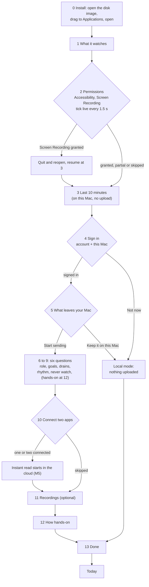

# Onboarding: screen by screen

How a person goes from download to a working Offload on their Mac, for v2's cloud model: the Mac client captures and
masks, the cloud brain does the rest. Words follow [GLOSSARY.md](GLOSSARY.md). Text in quotation marks is draft
product copy and follows the [copy rules](#13-copy-accessibility-and-test-hooks); final wording is reviewed in the
onboarding slice. Sources and where this differs from them are in [section 14](#14-sources-and-divergences).

The order is Clicky's cadence (explain, permissions that tick live, one unprompted proof it sees your screen, a typed
invitation), then sign-in and an honest "what leaves your Mac", then six one-tap questions, then seeding (connect two
apps, optional recordings). Proof comes before questions, so the person has seen it work before it asks anything.

## 1. Goals and rules

**Goals**
1. A person with no technical knowledge finishes setup alone: no API keys, no terminal, no config files.
2. Something real in the first session: the "last 10 minutes" line within a minute or two of granting access, and
   with two apps connected, an instant read of their last 30 days before setup ends (from M5).
3. Before anything leaves the Mac, the person has read what leaves, where it goes and how long it is kept, and said
   yes.
4. Every step can be skipped or declined. Skipping lowers what Offload can do; it never traps the person.

**Rules**
- One decision per screen, one primary button. "Skip" is always visible on question screens and the same size as
  other secondary actions.
- Ask for a permission only right after its purpose is explained, never in a batch prompt.
- Say what happens on "no", on the same screen, in one sentence.
- Never pre-tick consent. Never re-ask more often than [section 10.3](#103-limits-on-re-asking) allows.
- Capture starts only after the permissions screen is resolved. **Nothing is uploaded before screen 5 is accepted.**
  Data captured before that stays on the Mac and is not sent later unless the person chooses it.
- State survives quitting and the relaunch macOS needs after Screen Recording; the flow resumes where it stopped.
- Works with the keyboard and VoiceOver, light and dark, and with Reduce Motion (final state shown, no animation).
- No stage of Offload is called a "dry run" or a preview run anywhere in onboarding ([ADR 0016](adr/0016-no-dry-run.md)).

## 2. The flow at a glance

| # | Screen | Required | Typical time | Calls |
|---|---|---|---|---|
| 0 | Install and first open | yes | 30 s | none |
| 1 | What it watches | yes | 15 s | none |
| 2 | Permissions | recommended | 60 s plus relaunch | `AXIsProcessTrustedWithOptions`, `AXIsProcessTrusted`, `CGRequestScreenCaptureAccess`, `CGPreflightScreenCaptureAccess`, Settings deep links |
| 3 | Last 10 minutes | automatic | 30 s to 2 min | local now summary (no network) |
| 4 | Sign in | recommended | 40 s | browser: `/auth/login`, then `GET /v1/devices/authorize` (PKCE S256, loopback redirect); `POST /v1/devices/enroll`, `POST /v1/devices/challenge`, `POST /v1/devices/token`; pseudonym key; `GET /v1/me` |
| 5 | What leaves your Mac | yes, if signed in | 30 s | upload consent recorded (`POST /v1/me/consents`); uploader starts |
| 6 | What you do | optional | 10 s | `PATCH /v1/profile` (`role`) |
| 7 | Goals | optional | 20 s | `PATCH /v1/profile` (goals) |
| 8 | Drains | optional | 10 s | `PATCH /v1/profile` (`drains`) |
| 9 | Rhythm and never watch | optional | 30 s | `PATCH /v1/profile` (`schedule`, `timezone`, `review_slot`); `POST /v1/exclusions` |
| 10 | Connect two apps | recommended | 60 s per app | `GET /v1/connections`, `POST /v1/connections`; from M5 `POST /v1/connections/{id}/instant-read` |
| 11 | Recordings | optional | seconds to start; import runs in the background | `POST /v1/imports`, then a local import that uploads with `source = 'import'` (from M3) |
| 12 | How hands-on | optional | 10 s | `PATCH /v1/profile` (`autonomy`) |
| 13 | Done | yes | 10 s | `SMAppService` login item |

Target for the fast path through screen 12: under 5 minutes, not counting the Screen Recording relaunch.

## 3. What is not asked during setup

- **Input Monitoring.** Not asked. Its system wording is the most alarming, and idle detection (`CGEventSource`) needs
  no permission. Key and click counts per minute are an option in Settings ("Count how much I type and click, never
  what"), off by default. Until it is on, observations carry no key or click counts.
- **Automation (Apple Events).** Not asked. Most fixes run in the cloud. From M6 the Mac actuator can run approved
  device steps (a Shortcut, a reviewed Apple Event template, an Accessibility action, an attended browser step;
  [ARCHITECTURE section 12](ARCHITECTURE.md#12-execution-placement-and-the-mac-actuator)). macOS's Automation prompt
  for a target app is shown the first time an approved device step needs that app, right after Offload's own
  one-line explanation on the approval card.
- **Notifications.** Offered with the first weekly review or first suggested fix, never during setup.
- **Calendars, Contacts, Reminders.** Not used. Calendar data comes from connected apps, through the cloud.

## 4. Screens 0 to 2: install, what it watches, permissions

### Screen 0: install and first open

The person downloads `Offload-<version>.dmg`, drags Offload to Applications and opens it. The app is Developer ID
signed and notarized, so macOS shows only its standard "downloaded from the internet" confirmation
([DEPLOYMENT.md section 3](DEPLOYMENT.md#3-signing-notarization-and-the-disk-image)).

- If Offload runs from the disk image or a translocated path, one sheet comes first: "Move Offload to Applications"
  with **Move and reopen** and **Quit**. Updates and permissions are unreliable from there.
- If an older local buffer exists that cannot be opened (no master key in the Keychain), it offers **Start fresh**
  ([section 11](#11-coming-back-re-consent-lost-permissions-restarts), row 11.6).
- Decline: quitting leaves nothing behind.

### Screen 1: what it watches

From the approved mockup, with the promises corrected for v2.

- Headline: "It watches how you work. It keeps none of what you type."
- Card "Notices": "Which app and window you're in" · "How often you switch" · "Work you do more than twice".
- Card "Never keeps": "Keystrokes or passwords" · "Banking and private windows" · "Screenshots past 7 days".
- Caption: "counted on your mac · nothing is sent until you say so".
- Primary: **Get started**. Secondary: **Look at a sample week** (bundled demo data, labelled "Sample data", no
  permissions, no account, no network).

Nothing to decline here. Closing the window quits setup; nothing has been recorded or sent.

### Screen 2: permissions

- Headline: "Two switches in System Settings."
- Two rows, each with a tick that turns on the moment the switch is flipped:
  - **Accessibility**: "to read window titles and the words in them, not what you type". Tag: "needed for good
    results".
  - **Screen Recording**: "to read apps that don't share their text". Tag: "recommended".
- Each row has **Open Settings** until it ticks, then "on".
- Caption: "checks every 1.5 s · ticks the moment you flip it · you can continue with any missing".
- An honest note under Accessibility: "macOS says this lets an app control your Mac. Offload reads with it, and acts
  only in steps you approve."
- A note under Screen Recording: "macOS shows a menu bar indicator while an app reads the screen, and may ask you
  again from time to time. Offload keeps working from window text if you say no."
- Primary: **Continue** (always enabled). Secondary: **Show Offload in Finder** (shown only when a row is missing and
  Offload is not in the Settings list, so the person can drag it in).

**Mechanics** (PR #42 ONB§6, PR #44 `ScreenPermissionGate`, ported from clicky)
- Accessibility first, because it is the primary text source (Accessibility text walk; OCR is the fallback for
  windows with under 200 characters of text). **Open Settings** calls `AXIsProcessTrustedWithOptions` with the prompt
  option once, so Offload appears in the list, then opens the Accessibility pane by URL. No relaunch is needed.
- Screen Recording: **Open Settings** calls `CGRequestScreenCaptureAccess()` (the system prompt is shown once per
  launch), then opens the Screen & System Audio Recording pane.
- Both rows are polled every 1.5 s (`AXIsProcessTrusted()`, `CGPreflightScreenCaptureAccess()`). A tick never goes
  back from on to off during the session because of one false preflight: a confirmed Screen Recording grant survives
  a `CGPreflightScreenCaptureAccess` false negative.
- Pane URLs are not documented by Apple. One helper holds a per-macOS-version table (14, 15, 26) with a fallback to
  the Privacy & Security root plus the line "Choose Screen Recording, then turn on Offload."
- macOS needs a restart before screen capture works. When the Screen Recording grant is detected, or macOS shows its
  own "Quit & Reopen", Offload saves its place and shows **Quit and reopen Offload**. On relaunch it resumes at
  screen 3 with "Screen reading is on."
- The control names shown match the running macOS version (read from the same table, not hard-coded).
- Capture (the observer) starts when this screen is resolved and at least one of the two permissions is on. It
  writes only to the encrypted local buffer.

**If skipped or declined**
- Accessibility missing: "Without this, Offload can't see window titles or web addresses, so its picture of your
  work will be rougher." Mode: Screen only ([section 10.1](#101-product-modes)).
- Screen Recording missing: "Without this, Offload reads only apps that share their text." Mode: Text only.
- Both missing: screen 3 shows "nothing seen yet", and the person continues to sign-in.

## 5. Screen 3: last 10 minutes

The unprompted proof that it sees *your* screen (Clicky's 40-second moment, done Offload's way: in code, on the
Mac, with no model call and no upload).

- Headline: "Here's your last 10 minutes." When capture has run for less than 10 minutes, the headline names the
  real span ("Here's your last 3 minutes.").
- The line, from the local now summary: "10 min · Cursor 6m · Chrome 3m · Slack 1m · 14 switches", with a bar of the
  top 3 apps.
- The in-window pointer flies once to the line, and a lowercase remark types next to it, made from the numbers:
  "that's you, mostly in cursor."
- Then the typed invitation, at about 28 ms a character: "keep working. i'll take notes on this mac. next, you choose
  what gets sent."
- Caption: "counted on your mac from the last 10 minutes · no model call · nothing sent".
- Primary: **Continue**.

**Mechanics**
- The local now summary reads local spans from the buffer: the top 3 apps by active minutes, app switches inside the
  window only, idle time excluded. It is code only (harvested from the old `GET /now` and its tests NOW-1 to NOW-5).
- It refreshes every 5 s while the screen is open. The pointer flight and remark run once, when the line first has
  at least one app with a full minute of active time. Reduce Motion: the line, remark and invitation appear in their
  final state.
- **Nothing seen yet** (no permissions, or no active minute yet): "Nothing seen yet. Keep working for a minute." The
  pointer does not move. After 2 minutes with nothing, **Continue** is the only action and the copy says "You can
  turn on access later in Settings."

## 6. Screens 4 and 5: sign in, and what leaves your Mac

### Screen 4: sign in

The brain runs in the cloud, so the person needs an Offload account, and this Mac needs to be enrolled as a device
before it can upload.

- Headline: "Sign in to your Offload account."
- Body: "Your account is where Offload learns your week and builds your fixes. One sign-in also links this Mac."
- Primary: **Continue in your browser**. Secondary: **Not now**.
- Footer: "By continuing you agree to the Terms and Privacy Policy." (Documents pending
  [OQ-17](OPEN_QUESTIONS.md#oq-17-privacy-policy-terms-and-dpa).)

**Mechanics** ([ADR 0014](adr/0014-identity.md), old ADR 0111)
- The app creates a P-256 device key in the Secure Enclave and starts a loopback listener on
  `http://127.0.0.1:<port>/callback`. It opens the browser at `GET /v1/devices/authorize` with PKCE S256; if the
  person has no session, the server sends them through sign-in first (`/auth/login`, the identity provider from
  [OQ-06](OPEN_QUESTIONS.md#oq-06-identity-provider-for-offload-cloud)) and then back.
- On first sign-in the server creates the person's personal tenant (a tenant of one).
- The server redirects to the loopback with a single-use code. The app posts `POST /v1/devices/enroll` with the code,
  the verifier, the same `redirect_uri`, the public key and the Mac's name, then gets 15-minute tokens with
  `POST /v1/devices/challenge` and `POST /v1/devices/token` (audience `device` for uploads, `member` for the REST
  screens) and reads `GET /v1/me`.
- On the first Mac of the account, the app creates the pseudonym key and stores it only wrapped
  (`PUT /v1/devices/{id}/pseudonym-key-wrap`); a later Mac receives it wrapped by an existing one. No screen is shown for
  this unless a key recovery step is needed ([ADR 0028](adr/0028-stable-keyed-pseudonyms.md)).
- While waiting: "Waiting for your browser..." with **Open the page again** and **Cancel**. After 5 minutes: "That took
  too long. Try again?"
- Offline: "You're offline. You can continue without an account and sign in later."

**If "Not now"**: Local mode ([section 10.1](#101-product-modes)). Capture stays in the local buffer (7 days), the
local now summary works, nothing is uploaded, and screens 5 to 12 are skipped. Today shows one calm banner: "Sign in
to see your week and get fixes."

### Screen 5: what leaves your Mac

The honest screen. Accepting it is what starts the uploader. Every line maps to
[SECURITY_PRIVACY.md section 3](SECURITY_PRIVACY.md#3-what-leaves-the-mac); if that section changes, this screen
changes in the same slice.

- Headline: "What leaves your Mac."
- Left card, "Sent to your Offload account, masked first":
  - "Which app and window you're in, and for how long."
  - "The words on screen. Names, emails and phone numbers become stand-ins on this Mac. Card numbers, codes and keys
    are removed."
  - "The website, not the full address."
  - "When you're idle, when you pause, and when a permission changes."
  - "Your answers, and your approvals."
- Right card, "Stays on this Mac":
  - "Screenshots. Pictures of your screen are never sent."
  - "What you type. Keys are never recorded."
  - "Anything from apps and sites you choose not to watch, and private windows."
  - "Passwords, banking apps and password managers are skipped entirely."
  - "The key that turns stand-ins back into names. Only your Macs hold it."
- Below, plain facts:
  - "AI models from Anthropic read the masked text to understand your work. Offload doesn't sell your data."
  - "Screen text is deleted after 7 days, app and window details after 30. What Offload learns about your work, like
    which tasks repeat, is kept until you delete it."
  - "Masking is automatic and can miss things. You can see every batch sent from this Mac in the last 7 days, and
    delete anything from Settings."
- Links: "Read the privacy details" · "Using a work Mac? Check your employer's policy first."
- Primary: **Start sending**. Secondary: **Keep it on this Mac**.

**Mechanics**
- **Start sending** records consent (notice `what-leaves-your-mac` and its version, the device, the time) through the
  REST API (`POST /v1/me/consents` with the member token, table `consents`, audited as `privacy.consent_given`), then
  the uploader starts from this moment. Ingest rejects observations with `consent_missing` until consent exists.
  `notice_ack` is not used here because it is the Enterprise monitoring-notice kind. Data captured before consent stays
  local and is not sent unless the person later chooses "Include the last few days" in Settings (off by default,
  [OQ-26](OPEN_QUESTIONS.md#oq-26-backfill-data-captured-before-upload-consent)).
- The numbers on this screen come from config, not copy: `OFFLOAD_TEXT_TTL_DAYS` (default 7) and
  `OFFLOAD_RAW_TTL_DAYS` (default 30), both pending
  [OQ-02](OPEN_QUESTIONS.md#oq-02-raw-ttl-for-masked-observations-in-the-cloud); the derived model rule (pending
  [OQ-03](OPEN_QUESTIONS.md#oq-03-keep-the-derived-user-model-long-term)), the model provider (pending
  [OQ-05](OPEN_QUESTIONS.md#oq-05-model-provider-terms-and-monthly-model-budget)), and screenshots never sent unless
  [OQ-04](OPEN_QUESTIONS.md#oq-04-keyframes-to-the-cloud) changes the default (then this screen gains a separate,
  unticked choice). A test asserts the screen's numbers equal the config values.
- "Every batch sent from this Mac in the last 7 days" is the local upload ledger: one line per batch with time, kind
  counts and size, readable in Settings, holding no content beyond what was sent.
- If the version of this notice changes later (new data class, new sub-processor), the person sees the screen again
  before uploads continue ([section 11](#11-coming-back-re-consent-lost-permissions-restarts), row 11.11).

**If "Keep it on this Mac"**: Local mode, as above. Settings has **Start sending** at any time.

## 7. Screens 6 to 9: six questions

One tap each, chips, all skippable. Answers go to the profile (`PATCH /v1/profile`, each edit bumps `version`) and are
editable later in Settings. They are context for naming, drafting and ranking; they never change a counted hour
([ADR 0003](adr/0003-numbers-come-from-code.md)). Goals and drains reach a model only inside the `<user_context>`
block.

| # | Question | Screen | Choices (from the mockups) | Stored as | What it changes |
|---|---|---|---|---|---|
| Q1 | "What do you do?" | 6 | Founder, Engineer, Designer, Sales, Operations, Creator, or type one | `profiles.role` | Naming and drafts. Caption: "used to name things and write drafts in your words · never to count hours" |
| Q2 | "What do you want more of in the next 90 days?" | 7 | Ship a product, More deep work, Close customers, Less admin, Learn something new, or type one; up to 3, each one line, at most 80 characters | goals (`horizon` 90 days) | Goal weight in the opportunity score; the weekly review reports on each. Caption: "2 of 3 · your weekly review reports on each one" |
| Q3 | "What eats your week?" | 8 | Email, Meetings, Coding-agent babysitting, Reporting, Content, Admin, Context switching | `profiles.drains` | A ranking prior shown as "you said"; it fades once 4 weeks of evidence exist. Caption: "a starting hunch · after 4 weeks your real hours take over" |
| Q4 | "When do you work?" | 9 | Days (default Mon to Fri), hours (default 9:00 AM to 6:00 PM), weekly review slot (default Fri 4:00 PM) | `profiles.schedule`, `timezone`, `review_slot` | The analysis window, quiet hours for nudges, when the weekly review is built |
| Q5 | "What should it never watch?" | 9 | Locked on: 1Password, Banking sites, Private windows. Optional: Messages, WhatsApp, Personal Chrome profile, Photos, Spotify, or type an app or site | `POST /v1/exclusions` (`bundle_id` or `host`) | Capture scope. Applied on the Mac at once, before the server copy is saved. Caption: "excluded apps stop being seen within one check · no text, no frames" |
| Q6 | "How hands-on should it be?" | 12 | Suggest only ("Show me what repeats. I'll decide."), Draft for me ("Prepare the fix. I say OK before anything runs."), Run fixes I've approved ("Once I've said OK to a fix, run it without asking.") | `profiles.autonomy` (`suggest`, `draft`, `run_approved`) | The default for new fixes only. Every fix still needs "OK, build" and a deploy approval, and commit steps start in ask-before-commit. Caption: "change it any time · each fix still asks once" |

Q6 sits after the seeding screens so the person has seen connections before choosing how much to hand over.
Exclusions are written to the Mac first so a skipped or failed network call never leaves a "never watch" app
watched. If the person is in Local mode, Q5 is still offered (from Settings) and applies locally.

## 8. Screens 10 and 11: connect two apps, recordings

### Screen 10: connect two apps

The instant read: with two connected apps, Offload can find repeated work in the last 30 days without waiting for a
week of capture.

- Headline: "Connect the two apps you use most."
- Body: "Offload reads them to find repeated work. It acts in them only after you approve."
- A grid of apps from the connection catalog (Gmail, Google Calendar, Google Sheets, Slack, Notion, Linear, and
  others the catalog supports). Each tile has the app name, **Connect**, and one line on the path: "Connects
  directly" (the app's own MCP server or API) or "Connects through Composio" (the partner holds the authorization).
- Caption: "read only for now · you approve every action later".
- Primary: **Continue** (reads "Continue without connecting" when none). Secondary: **Skip for now**.

**Per-app flow**
1. **Connect** shows what is granted: "Offload will be able to read your sent mail to find patterns, and create
   drafts. It sends nothing without your approval." For Google apps it adds Google's required disclosure (what the
   data is used for; that masked excerpts go to an AI provider).
2. The app calls `POST /v1/connections` and opens the returned `authorize_url` in the browser.
3. Back in Offload the tile ticks and shows the account label.
4. Failures: cancelled ("No problem. You can connect later."), a scope denied ("Offload needs read access to find
   patterns."), timeout, offline.

**Instant read** (shown to the person as "your first read")
- Starts when the first app connects; runs in the cloud while the person answers the remaining screens.
- Reads up to 30 days through the gate in read mode, groups and counts in code, names with a model over masked text.
  First finding within 2 minutes; hard stop at 3 minutes with whatever is ready.
- Results appear on screen 13 and in Today: up to three findings, each with its figures and "how it was counted".
  If something is worth fixing, Today shows it as the one suggested fix. No fix runs during onboarding.
- Honest outcomes: "There isn't enough here to find a pattern yet." or "Nothing here is worth fixing yet." Offload
  never invents a suggestion to have one; "leave it alone" is a real answer.
- The instant read is `POST /v1/connections/{id}/instant-read`, available from M5. Before M5 this screen only
  connects apps (the hand-fed loop needs them), and screen 13 does not mention it.

**If skipped**: Watching mode. Suggested fixes that need an app say which one to connect. Settings has Connections.

### Screen 11: recordings (optional)

- Headline: "Already record your screen? Start with last week."
- Shows the folder macOS saves recordings to (or the folder last chosen), with file count, total length and date
  range: "12 files · .mov · 6 h 10 m · Nov 5 to 11".
- Buttons: **Import** and **Choose folder…**. Secondary: **Skip**.
- While importing (in a floating progress panel that keeps going after setup): "reading file 3 of 12", then "done ·
  1,284 moments read · 9 things you repeat". Until the cloud analyses an import space (the m3-05 server half), the
  done line stops at "done · 1,284 moments read". **Import** starts the import in the background and setup moves on
  to screen 12; **Choose folder…** keeps the folder for next time. A folder that cannot be read says why on the
  screen (an Offload data folder, nothing readable, gone).
- Caption: "optional · kept in its own space · wipe it in one click".

**Mechanics** (MIGRATION [section 5.7](MIGRATION.md#57-s34-import-branches-wips34-brain-wips34-mac-featrecordings-import))
- Available from M3. `POST /v1/imports` creates the import space; then the import runs on the Mac. Frames are read every 5 s (at most 720 per file, 1280 px), OCR'd and masked locally with the same
  exclusions, then deleted. Masked observations upload with `source = 'import'` and an `import_id`. Pixels never
  leave.
- A file is read only once its size has stopped changing for 3 s. A fingerprint ledger (SHA-256 only, no names or
  paths) prevents reading a file twice.
- Recording names give the time (macOS default names with a narrow no-break space before AM/PM, `(2)` copies,
  24-hour names, CleanShot and QuickTime); otherwise the file's modified time (minus its length, for a recording).
  Times are kept as they are, never moved; a file whose time is in the future is skipped and named in the panel.
- The folder may also hold screenshots (png, jpg, heic, webp, up to 3 folders deep) or be a screenwatch archive
  (`days/DATE/log.jsonl`, rows with app, window and URL become masked focus observations).
- Settings, Recordings (and "Recordings…" in the menu bar item) shows the same folder and Import, and each import
  space as "Recordings from Desktop · Nov 5 to 11 · 1,284 moments read" with **Remove imported data**. Like screen
  11, the menu entry and Import show only when the import is offered (below); the folder is read when the screen
  appears, never at launch. After setup the main window's sidebar has a **Recordings** screen with the same view, the
  default folders found on the Mac (`~/screenwatch`, where screen recordings are saved, Desktop, Movies) with **Use
  this folder**, and "counted on this Mac".
- A recording has no window title or URL, so the person's host and title exclusions, banking sites and private
  windows are matched against the text on each frame; a frame that shows one gets no text and no keyframe. An app
  name is read off the menu bar only when it is followed by menu titles and the masker leaves it unchanged; otherwise
  the app is "Screen". Never watch apps match a recording by the names the app is shown by (looked up when each
  import starts, localized too), so an app chosen on screen 9 is skipped in a recording that shows its menu bar.
  Menu bars are read in English, German, French and Spanish.
- In `.local` backend mode (the test build) the import runs fully on this Mac (m3-10): Vision reads the frames, the
  interim masker masks the text, and the masked observations are kept on this Mac only, without the text itself.
  The progress panel ends "done · 1,284 moments read · 9 things you repeat" once local insights have counted the
  import's days.
- The import space is analysed as of its last day, so last month's recordings still show their week. "Remove
  imported data" calls `POST /v1/me/forget` with `scope: "import"`.
- Offered in Local mode when the import is kept on this Mac (backend mode `.local`); in the cloud only while the
  person is signed in and sending (screen 5 accepted). Onboarding still skips screens 5 to 12 in Local mode, so a
  Local-mode person imports from the Recordings screen, Settings or the menu bar "Recordings…" (m3-10).

## 9. Screens 12 and 13: how hands-on, done

Screen 12 is Q6 ([section 7](#7-screens-6-to-9-six-questions)).

### Screen 13: done

- Headline: "You're set. Keep working."
- Body: "It learns your week as it happens. Your first review lands Friday at 4:00 PM, built around ship a product
  and more deep work." (The day, time and goals come from the profile; with no goals: "built around your hours".)
- If the instant read finished: one line, "From your connected apps: 3 things repeat. See Today." If it is still
  running: "Your first read is still going. It will be in Today."
- Toggle **Open Offload when I log in** (on by default; `SMAppService`; macOS shows its own login-item notice).
- A pointer to the menu bar item: "Pause, or tell it not to watch an app, from here."
- Primary: **Open today**. Secondary: **Look at a sample week**.
- In Local mode the body reads: "Offload is watching on this Mac only. Sign in when you want your week and fixes."

## 10. Skips and product modes

### 10.1 Product modes

| Signed in and sending | Accessibility | Screen Recording | Apps connected | Mode | Works | Missing | Shown as |
|---|---|---|---|---|---|---|---|
| yes | yes | yes | yes | **Full** | Everything | | |
| yes | yes | yes | no | **Watching** | Today, weekly review, suggested fixes from capture | Fixes that act in an app until it is connected | Connect prompts on the fixes that need one |
| yes | yes | no | any | **Text only** | Titles, web hosts, text from apps that share it | Text from apps that don't (no OCR fallback) | One line in Settings, privacy: "Screen reading is off" with **Turn on** |
| yes | no | yes | any | **Screen only** | Text by on-device OCR, app-level time | Window titles, web hosts, structured text | "Window details are off" with **Turn on** |
| yes | no | no | yes | **Connected apps only** | Instant read, refreshed weekly; fixes on connected apps | Today's day grid, anything from the screen | Today says "Working from your connected apps only" |
| yes | no | no | no | **Dormant** | Sample week; setup checklist | Everything real | Checklist; two reminders, then silence |
| no (not signed in, or "Keep it on this Mac") | any | any | n/a | **Local** | Capture to the local buffer (7 days), last 10 minutes line, pause, never watch | Today, weekly review, fixes, connections | One banner: "Sign in to see your week and get fixes" (or "Start sending" if signed in) |

The observer degrades and never blocks the person (PR #42 failure modes F1, F2): a lost Screen Recording grant keeps
Accessibility capture running; a lost Accessibility grant makes OCR primary.

### 10.2 Every skip path

| Step | Skip or decline means | Asked again |
|---|---|---|
| Move to Applications | The app quits | Next launch |
| Accessibility | Screen only (or Connected apps only) | A line in Settings; one notification 7 days after setup if a suggested fix would have been better with it |
| Screen Recording | Text only | Same rule |
| Last 10 minutes | Nothing to skip; Continue always works | n/a |
| Sign in ("Not now") | Local mode | Banner in Today, dismissible; a prompt when they open a screen that needs the cloud |
| What leaves your Mac ("Keep it on this Mac") | Local mode, signed in | Same banner, with **Start sending** |
| What you do, Goals, Drains, Rhythm | Profile fields stay empty; ranking uses hours only; review slot default Fri 4:00 PM | The weekly review asks one question at a time; never a pop-up |
| Never watch | Built-in exclusions only | Settings and the menu bar item ("Don't watch this app") |
| Connect two apps | Watching mode | On a suggested fix that needs an app; Settings, Connections |
| Instant read cancelled or failed | Nothing kept from it | "Look at my last 30 days" in Connections |
| Recordings | No import space | Settings, Recordings |
| How hands-on | `autonomy = suggest` | Settings |
| Open at login off | Offload watches only while open | One reminder if not opened for 3 working days |

### 10.3 Limits on re-asking

- No modal dialog re-asks for anything after setup.
- At most one notification per missing permission, ever, unless it was granted and later lost
  ([section 11](#11-coming-back-re-consent-lost-permissions-restarts)).
- A dismissed banner stays dismissed for 30 days.
- In Dormant mode, reminders stop after the second.

## 11. Coming back: re-consent, lost permissions, restarts

| # | Situation | Detected by | What the person sees | Meanwhile |
|---|---|---|---|---|
| 11.1 | Relaunch after granting Screen Recording | Saved onboarding position | Setup resumes at screen 3 with "Screen reading is on." | n/a |
| 11.2 | macOS re-asks about screen recording (periodic system prompt) | System alert; then frame requests fail and preflight turns false | Nothing from Offload while the system alert is up. If access lapses: a quiet banner and one notification, "macOS paused screen reading. Offload is still working from window text." with **Turn back on**; a relaunch may be needed | Accessibility capture continues; a `permission_change` observation is recorded |
| 11.3 | A permission switched off in System Settings | Polling (every 5 s in normal running) | Same banner, naming the permission | Mode from [section 10.1](#101-product-modes) |
| 11.4 | After an app update | First launch of a new version checks both permissions | Nothing if intact. Updates signed with the same bundle id and Team ID keep their grants. If one is missing, the banner from 11.3 | Degraded until fixed |
| 11.5 | Signed out, or this Mac removed from the account | `401` from the API, or a revoked device on token refresh | "This Mac is signed out. Offload is still watching on this Mac, but nothing is sent." with **Sign in** | Local mode; the uploader keeps its queue for up to the local 7 days, then drops it |
| 11.6 | New Mac, or data restored without the Keychain | The local buffer cannot be opened | "Offload's saved data on this Mac can't be opened. Start fresh?" with **Start fresh** (deletes the unreadable buffer) and **Quit**. Cloud data is unaffected | No capture until chosen |
| 11.7 | A connected app needs reconnecting | Authorization expired or revoked | A card on affected routines and in Connections: "Reconnect Gmail" | Those routines pause; nothing else is affected |
| 11.8 | Setup abandoned part-way | Saved position | Next launch reopens setup at the first unfinished screen; a "Finish setting up" checklist stays in Today until done or dismissed | Whatever was granted works |
| 11.9 | Paused for more than 24 hours | Pause state | One line in the menu bar item: "Paused since yesterday" | Paused |
| 11.10 | A tool in a connected app changed | Tool definition hash differs at a routine's pre-run check | "Something changed in how Offload talks to Notion. Review before it runs again." | That routine pauses |
| 11.11 | "What leaves your Mac" changed version | Server returns the current notice version with `GET /v1/me` | Screen 5 again, with the change marked "new" | Uploads pause until accepted; capture stays local |
| 11.12 | Learning paused by the person | `profiles.learning_paused` | "Learning is paused" in Today with **Resume** | Uploads stop and capture stays in the local buffer (7 days), as in [SECURITY_PRIVACY section 11](SECURITY_PRIVACY.md#11-retention-export-forget-wipe); records are not updated |

## 12. The first week

| When | What arrives | Where | Purpose |
|---|---|---|---|
| Setup | Last 10 minutes; instant read if apps are connected (M5) | Onboarding, Today | Proof it works |
| End of day 1 | "Yesterday": time by kind of work, top three tasks | Today | Show it is accurate; invite corrections to task names |
| Day 2 or 3 | First suggested fix from capture, with "how it was counted" | Today; at most one notification that day, if allowed | The core loop |
| Review slot | Weekly review: one sentence, a few tiles against the usual week, goals, up to 4 one-tap questions | Weekly review; notification offered here for the first time | Habit |

At most one notification a day in the first week.

## 13. Copy, accessibility and test hooks

**Copy** (from [PRODUCT.md copy rules](PRODUCT.md#copy-rules) and the pricing-page learnings)
- Lead with the outcome, in the fewest words. Sentences a person could say aloud. No exclamation marks.
- **No em dashes in UI copy.** Use a full stop or "·".
- Lowercase for captions and small notes, with "·" separators ("counted on your mac · no model call"). Headlines,
  labels and buttons in sentence case. The pointer's remark and invitation are lowercase.
- Banned words: generous, unlock, seamless, powerful, at scale, robust, "everything you need", "built for teams
  that…". Never "dry run" or "preview run".
- No internal terms on screen: never "MCP", "token", "LLM", "gate", "OCR", "TCC", "ingest", "tenant". Say "AI model",
  "your approval", "connect", "reads the screen", "permission", "your account".
- Every number on screen is counted and says how; the screen-5 retention numbers come from config.
- Use the macOS control names exactly as the running OS shows them.

**Accessibility**
- Logical VoiceOver order, labelled controls, visible focus ring. Return activates the primary button, Escape the
  secondary.
- The pointer flight and typed text have text equivalents; nothing relies on colour alone; ticks are announced.
- Reduce Motion: final states, fades only. Text follows the system text size where SwiftUI allows.

**Test hooks** (for the onboarding slice)
- The step model stays pure and testable (ported from the old `Onboarding.swift`), with a derived mode
  ([section 10.1](#101-product-modes)).
- Launch flags `--onboarding` and `--onboarding-screen <n>`; a fake permission source and a fake clock, so every
  screen and every mode row renders in snapshot tests (light and dark) without touching System Settings.
- A fake API (contracts fixtures) drives screens 4, 5, 10 and 13; the local now summary runs on the
  `2026-11-13.jsonl`-style fixture from the old s34 tests.
- Red tests to start from: `NOW-1`..`NOW-5`, `promptOnceThenSettings`, `aConfirmedGrantSurvivesAPreflightFalseNegative`,
  `settingsLinksArePrivacyPanes`, `anEmptyWindowShowsNothingYet`, `theFlowKeepsWhatWasTyped` (MIGRATION
  [section 5.5](MIGRATION.md#55-pr-44-featcapture-from-clicky-s34-recordings-ingest)), plus new ones:
  - `ONBOARDING: nothing is uploaded before "Start sending"; data captured earlier stays local`
  - `ONBOARDING: screen 5 retention numbers equal OFFLOAD_TEXT_TTL_DAYS, OFFLOAD_RAW_TTL_DAYS and the derived-model
    rule from config`
  - `ONBOARDING: Input Monitoring is never requested during setup`
  - `ONBOARDING: every question screen has Skip, and skipping writes no profile field`
  - `ONBOARDING: never-watch entries apply locally before the server call returns`
  - `COPY: onboarding strings contain no em dash, no banned word and no "dry run"`

## 14. Sources and divergences

| Source | Taken |
|---|---|
| Approved mockups (`mockups-page.tsx`, onboarding, 10 steps) | Screen order (proof before questions), copy of screens 1, 3, 6 to 9, 11 to 13, captions, 1.5 s ticks |
| [product spec (M0 to M9)](SOURCES.md#product-spec-m0-to-m9) §2 | The questions, their storage and what each changes; the first-run line computed in code |
| product spec §6 (Clicky teardown) and clicky (MIT) | Cadence: explain, live permission ticks, one unprompted proof, a typed invitation; permission gate; Show in Finder |
| PR #42 `docs/ONBOARDING.md` §6, §9, §10 | Permission mechanics and relaunch, product modes and skip paths, re-consent and lost permissions, re-ask limits |
| PR #44 (s34-recordings-ingest), `wip/s34-*` | Local now summary, Never watch, recordings import |
| [pricing LEARNINGS](SOURCES.md#pricing-learnings) | Copy and motion rules |

Where this differs from the mockups, and why:
- **Two permissions, not three.** The mockup's Input Monitoring row is dropped ([design review C (2026-11-14)](SOURCES.md#design-review-c); PR #42 ONB§6).
- **Screen 1 caption.** The mockup's "runs on your mac · nothing leaves it unless you say ok" overstated v2: masked
  screen text does leave, after screen 5. The caption now says nothing is sent until the person says so, and screen 5
  says exactly what.
- **Sign-in and "what leaves your Mac" are new screens** between the proof and the questions, because answers are
  stored in the cloud profile and nothing may upload before consent.
- **Connect two apps is new**, for the instant read. It sits before the recordings screen; the rest of the mockup
  order (recordings, hands-on, done) is unchanged.
