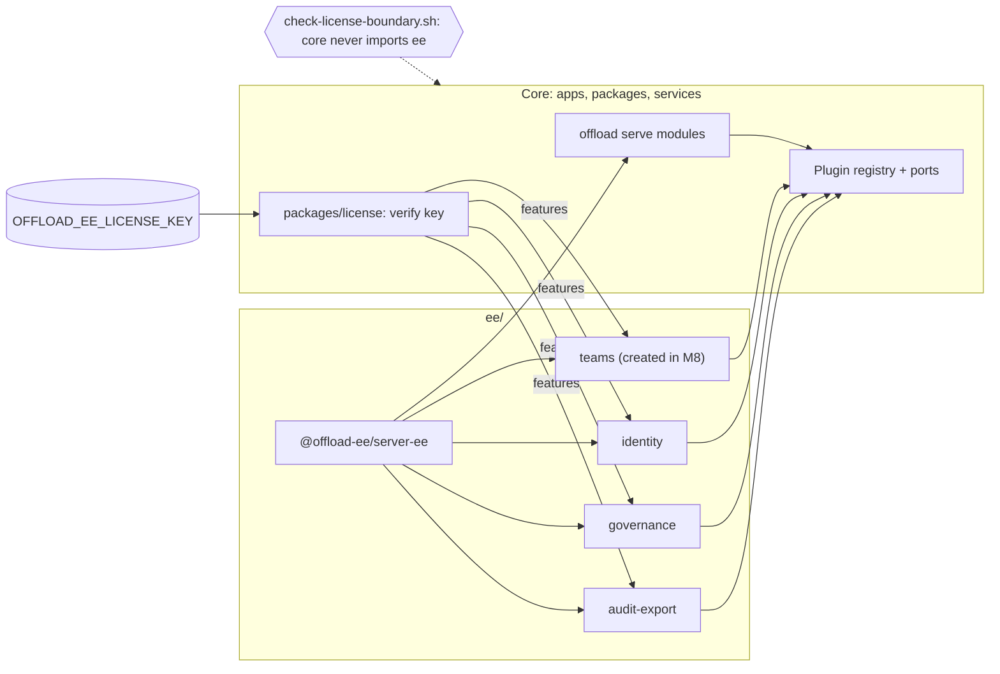

# Open core

How Offload splits into a free open core, Pro and Enterprise, how the split lives in the code, and how it is enforced
at runtime. Decision: [ADR 0015](adr/0015-open-core-layout-and-license-gating.md). Plan contents and prices are owner
decisions ([OQ-13](OPEN_QUESTIONS.md#oq-13-plan-contents-and-prices)). **The split is decided** (2026-11-14, owner:
"One person free, teams pay."). **Prices are not decided**; nothing here is a price. Values marked "default" below are
details the owner has not ruled on; agents build on them. Hosting is decided too: Offload Cloud and self-host at
feature parity ([ADR 0037](adr/0037-hosting-cloud-and-self-host-parity.md)).

## 1. License

| Part | Recommended default | Status |
|---|---|---|
| Everything outside `ee/` (core) | **Apache-2.0** (permissive, explicit patent grant) | Pending owner decision [OQ-11](OPEN_QUESTIONS.md#oq-11-license-for-the-core-and-for-ee) |
| `ee/` | **Offload Enterprise License** (commercial, source-visible; dev and test use allowed; production use needs a license key and subscription), modelled on the Langfuse EE license | Pending OQ-11 |
| Code harvested from the old repo | Owner's own code, currently "all rights reserved"; relicensing is his call | Pending [OQ-12](OPEN_QUESTIONS.md#oq-12-relicensing-code-from-the-old-repo) |
| Third-party code ported in | Keeps its own license; listed in `NOTICE` | Rule in [AGENTS.md](../AGENTS.md#license-boundary-and-notices) |

Until OQ-11 is answered, `LICENSE` and `ee/LICENSE` are placeholders that grant nothing. The repository will be
published as a public repository (owner decision, [OQ-27](OPEN_QUESTIONS.md#oq-27-publish-the-repository-publicly)).
Public is not the same as open source: until OQ-11 is answered, people can read the code but have no license to use it.

Why Apache-2.0 and not MIT: the patent grant matters for a product that automates business workflows. Why not a
fair-code license (n8n's Sustainable Use License) for the core: the owner asked for an open-source core, and fair-code
is not OSI open source. The owner's OQ-13 answer keeps the core open source; fair-code is no longer an option for the core.

## 2. Feature split

**Decided (OQ-13, 2026-11-14): single-player is core and free, multiplayer is paid through Pro.**

- **Core** is everything one person needs, self-host included: capture, the cloud brain, the build loop, the runtime,
  connectors, gates, masking, the audit chain, export and forget. Safety is core. Trust is not an upgrade.
- **Pro** is team tenants (`tenants.kind = 'team'`): invites, workspaces, shared fixes, team weekly review. The code
  lives in `ee/packages/teams` (created in M8) and is enabled by Offload Cloud's own license key for Pro tenants.
- **Enterprise** adds SSO and SCIM, approval chains, SIEM streaming and audit export, BYOC, and support (the owner's
  list). Custom Cedar policies, the external audit anchor sink, dedicated deployment, configurable retention and legal
  hold are Enterprise by default (details the owner has not ruled on).

Why: with an Apache-2.0 core, anyone can host the same product. Offload self-host is Postgres plus object storage, so
paid hosting alone (Temporal's model) is a weak moat. One gate, team tenant creation, is easy to enforce and leaves a
hosted clone with the single-player product only. The alternatives that were open under OQ-13, hosting-only Pro and
a fair-code core, are closed.

Pro and Enterprise features run on Offload Cloud and on self-host alike. In both, a license key switches them on
([section 3](#3-how-gating-works)).

Some EE parts are a few lines on top of core: audit export is paging `GET /v1/audit-events`, and a custom policy is a
write to a table core already has. EE value is SSO/SCIM, approval chains, custom policies, SIEM, the external anchor
sink, BYOC and support, not export. The license key check is the legal boundary, as with Langfuse; it is not meant to
be hard to remove technically.

Rows follow the decided split. Rows marked "default" are details the owner has not ruled on.

| Feature | Free (core, self-host or personal) | Pro (team tenants, Cloud or self-host) | Enterprise |
|---|---|---|---|
| Mac client: capture, on-device masking and pseudonyms, upload | yes | yes | yes |
| Cloud brain: understanding, user model, records | yes | yes | yes |
| Opportunity finder, manual opportunities, instant read, fix designer | yes | yes | yes |
| OK, build with sandboxed workers ($4.00 cap per build) | yes (bring your sandbox provider) | yes (hosted E2B) | yes |
| Deploy, routine runtime, ask before commit, graduation, Mac actuator | yes | yes | yes |
| Connectors: MCP, Composio, OpenAPI, browser; credential broker | yes | yes | yes |
| Gates, approvals, item journal, kill switches | yes | yes | yes |
| Built-in TypeScript policy rules, rule id on every decision | yes | yes | yes |
| Audit chain, verify, in-app viewer | yes | yes | yes |
| Export, forget, wipe, pause learning | yes | yes | yes |
| OIDC login, magic link, device-key login on the Mac | yes | yes | yes |
| Offload MCP server and outbound webhooks (M8); inbound webhook triggers (M6) | yes | yes | yes |
| Web app (all plans; hosted on Pro and Enterprise) | yes (self-host) | yes | yes |
| Personal tenant (one member, one workspace) | yes | yes | yes |
| **EE**: team tenants: invites, workspaces, shared fixes, team weekly review (`ee/packages/teams`, M8) | | yes | yes |
| Hosted operations, backups, upgrades (Offload Cloud only; operations, not a feature) | | yes, on Cloud | yes, on Cloud |
| Higher build and model budgets | | plan limits | contract |
| **EE**: SAML SSO, enforced SSO, SCIM, custom roles (`ee/packages/identity`) | | | yes |
| **EE**: approval chains (N of M); custom Cedar policies and policy simulation (default) (`ee/packages/governance`) | | | yes |
| **EE**: SIEM streaming and audit export; external audit anchor sink, legal hold, configurable retention (default) (`ee/packages/audit-export`) | | | yes |
| **EE**: per-person views and working time for teams with compliance records (M9, package TBD; [OQ-15](OPEN_QUESTIONS.md#oq-15-monitoring-law-features-for-teams)) | | | yes |
| **EE**: BYOC; dedicated database and region choice (default) (M9, package TBD) | | | yes |
| Support | community | email | SLA |

Self-host itself is not an Enterprise feature: every plan can self-host ([ADR 0037](adr/0037-hosting-cloud-and-self-host-parity.md)).

Open sub-questions under OQ-13 (the split is decided; these details and the prices are not), each with the default
used above:
- **Prices** for Pro and Enterprise: not decided. No price appears in any doc.
- (a) **Free hosted tier** on Offload Cloud: default none beyond the owner's tenant until he decides who pays its model
  and sandbox costs. "One person free" may mean a free hosted tier for one person; the owner to confirm.
- (b) **Pro feature set**: decided as multiplayer (team tenants, invites, workspaces, shared fixes, team review);
  onboarding help for teams new to AI is a default. A Pro key for self-hosters is a default (parity).
- (c) **Seat enforcement**: default seat counts from the license key; going over warns for 30 days before blocking new
  invites, never blocks existing members or safety features.
- (d) **Support tiers**: default community, email, SLA as in the table.
- **BYOK** (own model key) for every tenant: default yes.
- **Pro team size**: default 3 to 20 people, not decided ([OQ-13](OPEN_QUESTIONS.md#oq-13-plan-contents-and-prices)).

## 3. How gating works

**In the code**
- All EE code is under `ee/` (`ee/packages/*`, scope `@offload-ee/*`).
- Core never imports EE. `scripts/check-license-boundary.sh` checks static imports, dynamic `import()`, `require()`,
  core `package.json` dependencies and tsconfig paths, and has its own tests (`scripts/tests/license-boundary.test.ts`).
  It runs in `scripts/verify-all.sh` and CI.
- Core exposes ports and a plugin registry. EE packages implement ports (for example `IdentityProvider` for SAML,
  `AuditSink` for SIEM, `AnchorSink` for external anchors, `PolicyStore` for custom policies, `TenantKindProvider` for
  team tenants).
- Two composition roots: the core entry (`offload serve`) and the Enterprise entry `@offload-ee/server-ee`, which
  imports the core modules and registers EE plugins.

**At runtime**
- `packages/license` verifies `OFFLOAD_EE_LICENSE_KEY` offline: Ed25519 signature over
  `{ licensee, plan, features[], seats, expires_at, issued_at, key_id }`, public keys compiled in. The variable holds one
  key or several (one per plan); no call home.
- **The same in both hosting modes** ([ADR 0037](adr/0037-hosting-cloud-and-self-host-parity.md#license-key-gating-is-identical-in-both-modes)):
  a tenant's entitlements are the features of the key whose `plan` equals `tenants.plan`. Offload Cloud loads its own
  key per paid plan and sets each tenant's plan from billing. A self-hoster loads the key they bought; new tenants take
  its plan. No code checks which mode it runs in.
- Each EE plugin declares the feature it needs (`teams`, `sso`, `scim`, `custom_policies`, `approval_chains`,
  `audit_export`, `siem`, `anchor_sink`, `legal_hold`, `per_person_views`, `byoc`). It registers only if the key
  entitles that feature, and checks again on each use.
- **Routes**: the EE composition root always mounts EE routes and returns `403 feature_not_licensed` when the key does
  not entitle the feature. The core root does not mount them, so they are `404`.
- An invalid or expired key disables EE features with a banner and an audit event; core keeps running; data created by
  EE features stays readable.
- Seat counts follow sub-question (c) above (a default; the owner has not ruled on it).

## 4. How others split

Checked 2026-11-14 from the brief's references. These are summaries to justify the design; re-check before citing
them externally.

| Project | Core license | Paid part | Gating | What we take |
|---|---|---|---|---|
| **Langfuse** | MIT for everything outside `ee/` directories (`ee/`, `web/src/ee/`, `worker/src/ee/`, `packages/shared/src/server/ee/`) | `ee/` under a commercial Enterprise license: SCIM, audit logs, data retention, project RBAC, server-side masking, management APIs | EE code ships as source; needs `LANGFUSE_EE_LICENSE_KEY` to run. Same codebase for OSS, EE self-host and Cloud | The `ee/` directory layout, license-key gating, one codebase, a legal rather than technical boundary. We differ: audit log and masking stay core |
| **n8n** | Sustainable Use License (fair-code, not OSI: internal use only, no hosting as a service for others) | Files with `.ee.` in name or directory under the n8n Enterprise License | Production use of EE needs a license | Why fair-code exists (stop hosted clones); kept as alternative (b) under OQ-13. We avoid scattered `.ee.` files; also why n8n is not our integration layer |
| **Temporal** | MIT for server and SDKs | Temporal Cloud (hosted) only | None in code | Paid hosting works when the product is hard to run. Offload self-host is easy, which is why hosting-only Pro is no longer the default |
| **Composio** | SDKs MIT | Hosted platform (toolkits, auth, triggers) is a proprietary service under its terms | Service account | An adapter behind the connector port (section 5) |

## 5. What each part connects to

| Part | Connects to | Required? |
|---|---|---|
| Core modules | Postgres 17 + pgvector, S3-compatible storage | yes |
| Credential broker | A key provider: AWS KMS, GCP KMS, or a local master key file for self-host | yes (one of them) |
| Core brain and builder | A model provider (Anthropic API or BYOK; optional local exo or Ollama tier for cheap routes) | yes (a model) |
| Core builder | A sandbox provider: E2B, Docker, or container-use on Dagger (`apple-container` for development only) | yes (one of them) |
| Core runtime | MCP servers, Composio (optional), SaaS APIs, the user's Mac for device steps | per routine |
| Core identity | Any OIDC provider, or magic link (needs an email sender) | yes (one of them) |
| EE teams | Nothing extra; enabled by the license key | Pro and Enterprise |
| EE identity | SAML IdPs, SCIM clients (Okta, Entra ID, Google); WorkOS on Offload Cloud from M8 | Enterprise |
| EE audit export | S3 (with object lock for the anchor sink), SIEM webhooks | Enterprise |
| Offload Cloud | Cloud provider and region (open, [OQ-01](OPEN_QUESTIONS.md#oq-01-cloud-hosting-provider-and-region), default AWS `ca-central-1`), E2B, Anthropic, WorkOS (from M8) | Cloud only |
| Self-host (compose or Helm) | Postgres 17 + pgvector, S3-compatible storage (MinIO or another), the `local` key provider or a KMS, Docker or container-use sandboxes, the self-hoster's own OIDC client and model key; telemetry off by default | self-host only |

Composio is never required in code. In practice Google apps need Composio for any user outside the owner's own Google
Workspace until Offload has a verified OAuth client; the owner's tenant uses his own internal OAuth client
([ADR 0033](adr/0033-pinned-connector-resolution-and-launch-catalog.md)).
