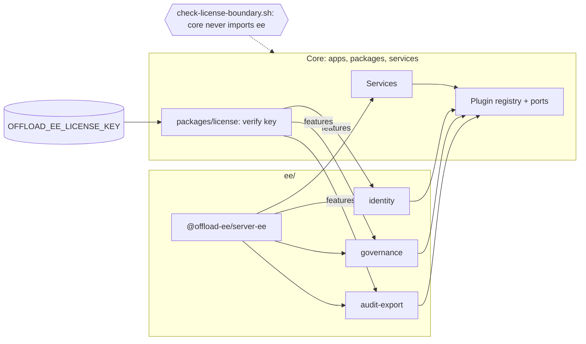

# Open core

How Offload splits into a free open core, Pro and Enterprise, how the split lives in the code, and how it is enforced
at runtime. Decision: [ADR 0015](adr/0015-open-core-layout-and-license-gating.md). Prices and plan contents are owner
decisions ([OQ-13](OPEN_QUESTIONS.md#oq-13-plan-contents-and-prices)); nothing here is a price.

## 1. License

| Part | Recommended default | Status |
|---|---|---|
| Everything outside `ee/` (core) | **Apache-2.0** (permissive, explicit patent grant) | Pending owner decision [OQ-11](OPEN_QUESTIONS.md#oq-11-license-for-the-core-and-for-ee) |
| `ee/` | **Offload Enterprise License** (commercial, source-visible; dev and test use allowed; production use needs a license key and subscription), modelled on the Langfuse EE license | Pending OQ-11 |
| Code harvested from the old repo | Owner's own code, currently "all rights reserved"; relicensing is his call | Pending [OQ-12](OPEN_QUESTIONS.md#oq-12-relicensing-code-from-the-old-repo) |
| Third-party code ported in | Keeps its own license; listed in `NOTICE` | Rule in [AGENTS.md](../AGENTS.md#license-boundary-and-notices) |

Until OQ-11 is answered, `LICENSE` and `ee/LICENSE` are placeholders that grant nothing.

Why Apache-2.0 and not MIT: the patent grant matters for a product that automates enterprise workflows. Why not a
fair-code license (n8n's Sustainable Use License) for the core: the owner asked for an open-source core, and fair-code
is not OSI open source.

## 2. Feature split

Rule: **safety is core**. Gates, masking, approvals, the audit chain, kill switches, export and forget are in the free
core. Enterprise sells governance at organisation scale, identity integration and deployment options. Pro is a
hosting plan for small teams, not a code tier.

| Feature | Free (core, self-host or personal) | Pro (Offload Cloud, teams) | Enterprise |
|---|---|---|---|
| Mac client: capture, on-device masking, upload | yes | yes | yes |
| Cloud brain: understanding, user model, records | yes | yes | yes |
| Opportunity finder, fix designer | yes | yes | yes |
| OK, build with sandboxed workers ($4.00 cap per build) | yes (bring your sandbox provider) | yes (hosted E2B) | yes |
| Deploy, routine runtime, ask before commit, graduation | yes | yes | yes |
| Connectors: MCP, Composio, OpenAPI, browser | yes | yes | yes |
| Gates, approvals, item journal, kill switches | yes | yes | yes |
| Built-in policies, rule id on every decision | yes | yes | yes |
| Audit chain, verify, in-app viewer | yes | yes | yes |
| Export, forget, wipe, pause learning | yes | yes | yes |
| OIDC login, magic link, roles owner/admin/member/auditor | yes | yes | yes |
| Offload MCP server, webhooks in and out | yes | yes | yes |
| Web app | yes (self-host) | yes | yes |
| Workspaces and team members | yes | yes | yes |
| Hosted operations, backups, upgrades | | yes | yes |
| Shared fixes across a workspace, team weekly review | yes | yes | yes |
| Higher build and model budgets | | plan limits ([OQ-13](OPEN_QUESTIONS.md#oq-13-plan-contents-and-prices)) | contract |
| **EE**: SAML SSO, enforced SSO, SCIM, custom roles (`ee/packages/identity`) | | | yes |
| **EE**: custom Cedar policies, approval chains (N of M), policy simulation (`ee/packages/governance`) | | | yes |
| **EE**: audit export, SIEM streaming, legal hold, configurable retention (`ee/packages/audit-export`) | | | yes |
| **EE**: per-person views and working time for teams with compliance records | | | yes ([OQ-15](OPEN_QUESTIONS.md#oq-15-monitoring-law-features-for-teams)) |
| **EE**: deployment options: self-host with license, BYOC, dedicated database, region choice | | | yes |
| Support | community | email | SLA |

Pro runs core plus whichever EE features Offload Cloud's own license key enables for Pro tenants (default: none).

## 3. How gating works

**In the code**
- All EE code is under `ee/` (`ee/packages/*`, scope `@offload-ee/*`).
- Core never imports EE. `scripts/check-license-boundary.sh` checks static imports, dynamic `import()`, `require()`,
  core `package.json` dependencies and tsconfig paths, and has its own tests (`scripts/tests/license-boundary.test.ts`).
  It runs in `scripts/verify-all.sh` and CI.
- Core exposes ports and a plugin registry. EE packages implement ports (for example `IdentityProvider` for SAML,
  `AuditSink` for SIEM, `PolicyStore` for custom policies).
- Two composition roots: the core entry (each service's `src/index.ts`) and the Enterprise entry
  `@offload-ee/server-ee`, which imports the core services and registers EE plugins.

**At runtime**
- `packages/license` verifies `OFFLOAD_EE_LICENSE_KEY` offline: Ed25519 signature over
  `{ licensee, plan, features[], seats, expires_at, issued_at, key_id }`, public keys compiled in.
- Each EE plugin declares the feature it needs (`sso`, `scim`, `custom_policies`, `approval_chains`, `audit_export`,
  `siem`, `legal_hold`, `per_person_views`, `byoc`). It registers only if the key entitles that feature, and checks again
  on each use (`403 feature_not_licensed`).
- An invalid or expired key disables EE features with a banner and an audit event; core keeps running; data created by
  EE features stays readable.
- Seat counts are checked against active members; going over warns for 30 days before blocking new invites (never
  blocks existing members or safety features).

## 4. How others split

Checked 2026-11-14 from the brief's references. These are summaries to justify the design; re-check before citing
them externally.

| Project | Core license | Paid part | Gating | What we take |
|---|---|---|---|---|
| **Langfuse** | MIT for everything outside `ee/` directories (`ee/`, `web/src/ee/`, `worker/src/ee/`, `packages/shared/src/server/ee/`) | `ee/` under a commercial Enterprise license: SCIM, audit logs, data retention, project RBAC, server-side masking, management APIs | EE code ships as source; needs `LANGFUSE_EE_LICENSE_KEY` to run. Same codebase for OSS, EE self-host and Cloud | The `ee/` directory layout, license-key gating, one codebase. We differ: audit log and masking stay core |
| **n8n** | Sustainable Use License (fair-code, not OSI: internal use only, no hosting as a service for others) | Files with `.ee.` in name or directory under the n8n Enterprise License | Production use of EE needs a license | We avoid fair-code for the core and avoid scattered `.ee.` files; also why n8n is not our integration layer |
| **Temporal** | MIT for server and SDKs | Temporal Cloud (hosted) only | None in code | Proof that a fully open core with paid hosting works; our Pro is similar |
| **Composio** | SDKs MIT | Hosted platform (toolkits, auth, triggers) is a proprietary service under its terms | Service account | We use it as an adapter behind the connector port, never as a required dependency |

## 5. What each part connects to

| Part | Connects to | Required? |
|---|---|---|
| Core services | Postgres 17 + pgvector, S3-compatible storage | yes |
| Core brain and builder | A model provider (Anthropic API or BYOK; optional local Ollama/exo for cheap routes) | yes (a model) |
| Core builder | A sandbox provider: E2B, container-use on Dagger, or Docker | yes (one of them) |
| Core runtime | MCP servers, Composio (optional), SaaS APIs, Playwright | per routine |
| Core identity | Any OIDC provider, or magic link (needs an email sender) | yes (one of them) |
| EE identity | SAML IdPs, SCIM clients (Okta, Entra ID, Google); WorkOS on Offload Cloud | Enterprise only |
| EE audit export | S3, SIEM webhooks | Enterprise only |
| Offload Cloud | AWS (default region `ca-central-1`), E2B, WorkOS, Anthropic | Cloud only |
